# Architecture

This document describes the internal structure, dependency rules, and runtime flows of `platform-gincommon`.

`platform-gincommon` is a **private Go module** (`github.com/BCBP-SOLUTIONS-FZC-LLC/platform-gincommon/v2`, `go 1.26.0` directive, `toolchain go1.26.9`) imported by every IAM Go service. It owns the platform's **transport layer**: the HTTP middleware and gRPC interceptor chains that recover panics, correlate requests, trace, log, emit metrics, validate gateway identity, build tenant context and authorize calls. It is also the Go home of the **Enterprise Platform Observability Standard**: the central registry (`internal/obsregistry/registry.json`), the `platform_*` collectors built from it, and `metricslint`. It owns the Go side of the platform's **error contract**: RFC 9457 Problem Details (`pkg/problem`, rendered by the global error handler at the end of `ObservabilityMiddlewares`; see [docs/problem-details](docs/problem-details/README.md)). It is **never deployed**. Consumers import `pkg/`; `cmd/server` is a reference binary whose image exists only for CI smoke tests. Release `v2.0.0` replaced the error contract with RFC 9457 and moved the module path to `/v2`; `v1.4.0` shipped earlier breaking changes as a MINOR, a [recorded exception](VERSIONING.md#recorded-exceptions).

**Does not own:** authentication (JWT/OAuth/API keys are validated by the API gateway; this library trusts gateway-injected headers at the network layer); business authorization policy (each service implements `Authorizer`, and `NewDemoRBAC` is reference-only); database access, pooling and RLS (platform-pgcommon); outbox, SNS/SQS and schema registry (platform-events, platform-schemagov); messaging and DB metric *emission* (platform-events / platform-pgcommon emit their own series, which this registry governs); rate limiting, retries and circuit breaking (gateway / mesh); the production collector, Tempo, Prometheus, Loki and Grafana (the `docker-compose.yml` stack is local-only); ratifying `proposed` metrics (observability governance; this repo records their decisions).

---

## Layer model

The library is organised in concentric Clean Architecture layers. Inner layers have **zero knowledge** of outer layers; dependencies always point inward.

> Source: [`docs/architecture/mermaid/layer-model.mmd`](docs/architecture/mermaid/layer-model.mmd)

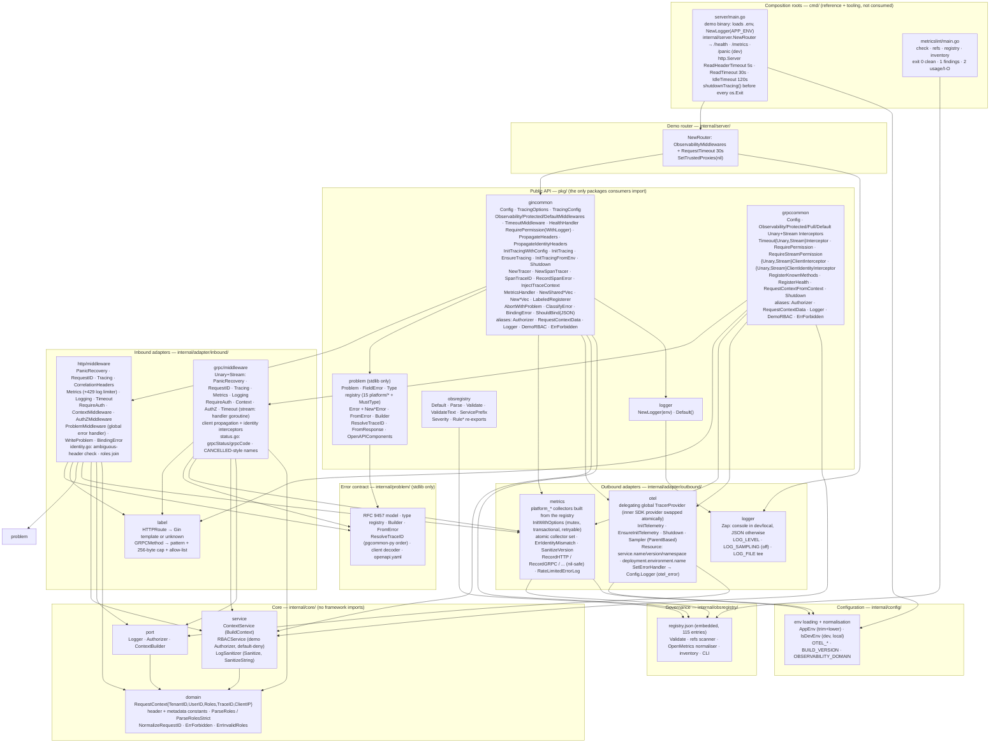

**Rule:** `domain` ← `port` ← `service` ← `adapter` ← `pkg`. The `core/` packages import nothing from `adapter/`, `pkg/`, Gin, gRPC, Prometheus or OpenTelemetry. `core/service` imports only `core/domain`, and `RBACService` satisfies `port.Authorizer` structurally. Interfaces in `core/port` are implemented in adapters and injected inward. `internal/obsregistry`, `internal/problem` and `internal/config` are standalone leaves with no internal imports. `internal/problem` (RFC 9457, standard library only) is used by the HTTP and gRPC middleware (the gRPC side only for `ErrorChainTypes`) and re-exported by `pkg/problem`; `internal/obsregistry` and `internal/config` are used by the outbound adapters and `pkg/`. `pkg/gincommon` and `pkg/grpccommon` are composition layers; neither imports the other. They share process state only through `adapter/outbound/metrics` and `adapter/outbound/otel`, which is why there is **one metrics identity and one tracer provider per process**. `pkg/gincommon` imports `pkg/logger` (for `MetricsHandler`'s rate-limited error log).

**Type exposure rule.** Every internal type that appears in a `pkg/` signature has a `pkg/` alias (`types.go`): `Authorizer`, `RequestContextData`, `Logger`, `DemoRBAC`, `ErrForbidden`. A consumer must never need an `internal/` import, which Go would reject. `test/unit/gincommon/consumer_api_test.go` pins this rule for both stacks. The alias is `RequestContextData` in both packages because `gincommon.RequestContext` was already the accessor function.

---

## Package dependency graph

Arrows are Go `import` relationships (module-internal only), generated from `go list`. Test packages are excluded.

> Source: [`docs/architecture/mermaid/package-dependencies.mmd`](docs/architecture/mermaid/package-dependencies.mmd)

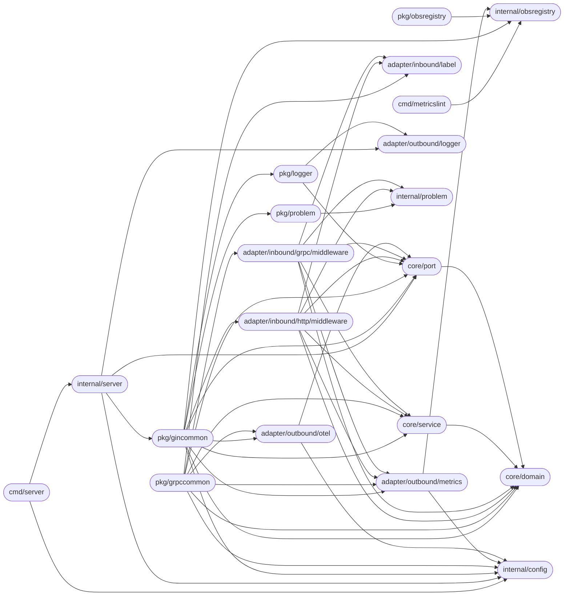

`core/domain` is the dependency sink. Both inbound adapters depend on the same five packages (`label`, `metrics`, `service`, `port`, `domain`), so HTTP and gRPC share label bounding, classification (`HTTPStatusClass` / `GRPCStatusClass`), role parsing and sanitisation by construction. `cmd/metricslint` and `pkg/obsregistry` depend only on `internal/obsregistry`, so the CLI can be cross-compiled and shipped without the middleware.

---

## Middleware stack composition

`ObservabilityMiddlewares`, `ProtectedMiddlewares`, `DefaultMiddlewares` and the gRPC `Observability*`/`Protected*`/`Full*` constructors are factories: each call returns a new slice. The only process-wide effects are metrics initialisation (one identity per process) and tracing installation (one provider per process). Both are safe to repeat with the same configuration.

> Source: [`docs/architecture/mermaid/middleware-stack-composition.mmd`](docs/architecture/mermaid/middleware-stack-composition.mmd)

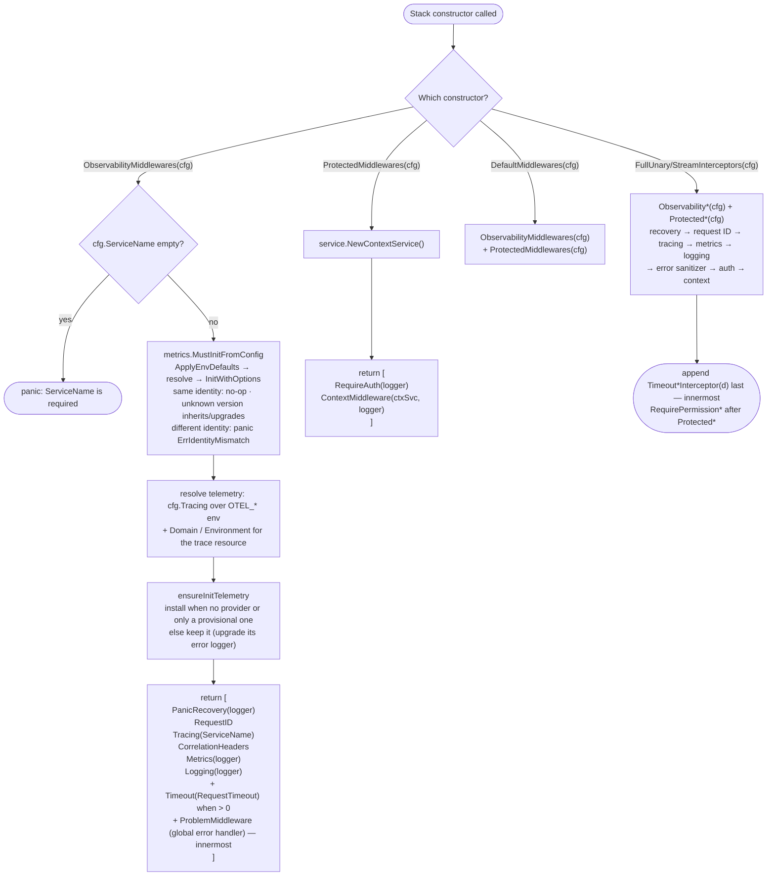

Constructors validate at startup, not at request time: an empty `ServiceName`, a missing or unregistered domain, an environment outside `local|dev|test|staging|prod`, or a conflicting identity panics while the service is still booting, so a misconfigured pod never serves traffic with corrupt labels.

---

## Request flow

Every HTTP request passes through the full chain. Pre-handler work runs top-down; deferred work (metrics, the access log, span end) runs bottom-up after the handler returns, so every signal sees the final status.

> Source: [`docs/architecture/mermaid/request-flow.mmd`](docs/architecture/mermaid/request-flow.mmd)

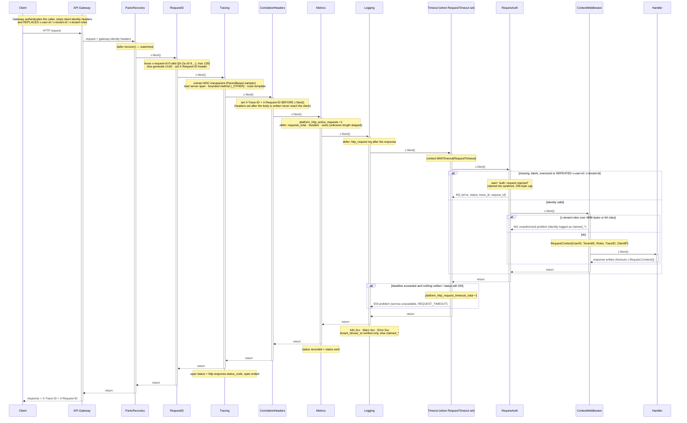

**Middleware execution model.** With `DefaultMiddlewares` and `Config.RequestTimeout` set:

```
PanicRecovery.defer ──────────────────────────────────────────── recover · 500 JSON or abort
  RequestID                                                       x-request-id → X-Request-ID
    Tracing.defer ────────────────────────────────────────────── span status · end
      CorrelationHeaders                                          X-Trace-ID / X-Request-ID set BEFORE c.Next()
        Metrics.defer ────────────────────────────────────────── counter · duration · sizes · active gauge
          Logging.defer ──────────────────────────────────────── http_request log
            Timeout (innermost observability handler)             deadline → 503 only on DeadlineExceeded
              [/api group] RequireAuth                            401 + audit log
                ContextMiddleware                                 RequestContext · roles caps
                  [per route] RequirePermission                   403 / 500
                    Handler ← executes here
```

Register `/health` and `/metrics` before the protected group: probes and scrapers send no identity headers. `RequirePermission` placed before `ProtectedMiddlewares` returns `500`, because there is no `RequestContext` to authorize against. That is a diagnosable misconfiguration, never a silent pass.

---

## gRPC interceptor flow

`FullUnaryInterceptors` / `FullStreamInterceptors` are `Observability*` followed by `Protected*`. Logging wraps auth, so calls that auth rejects are logged. The verified identity flows back to the logging interceptor through a holder in the context, which the context interceptor fills.

> Source: [`docs/architecture/mermaid/grpc-interceptors.mmd`](docs/architecture/mermaid/grpc-interceptors.mmd)

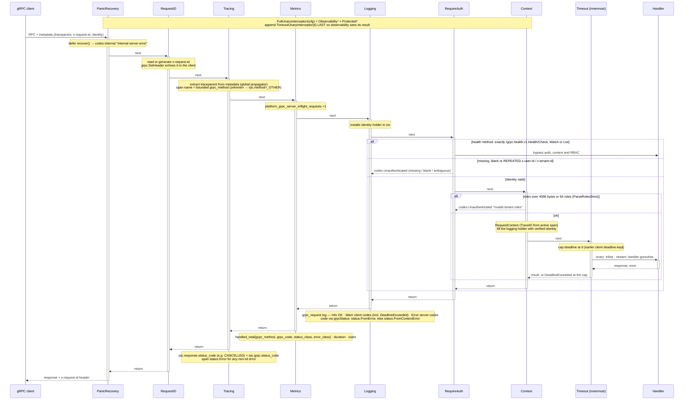

**Interceptor order:**

```
PanicRecovery ── RequestID ── Tracing ── Metrics ── Logging ── RequireAuth ── Context ── [RequirePermission] ── [Timeout] ── Handler
  ← pre-handler, left to right ──────────────────────────────────────────────────────────────────────────────────────┘
  ── post-handler, right to left: span end, grpc_request log, metric observation ──────────────────────────────────────
```

**Bounded method names.** `label.GRPCMethod` maps `info.FullMethod` to `unknown` unless it matches `^/[A-Za-z0-9_.]+/[A-Za-z0-9_]+$`, is at most 256 bytes and, once `RegisterKnownMethods` has run, is a registered method. A server using `grpc.UnknownServiceHandler` (proxies, muxes) cannot be made to mint unbounded metric series or span names. The allow-list is **process-wide and additive**: call `RegisterKnownMethods` for every server, after every service (including `RegisterHealth`) is registered.

**Status classification.** `grpcStatus` mirrors grpc-go: `status.FromError`, else `status.FromContextError`. A handler returning a plain `context.DeadlineExceeded` is therefore recorded, logged and traced as `DeadlineExceeded`, matching what the client receives. Spans carry `rpc.response.status_code` with canonical names (`CANCELLED`, `DEADLINE_EXCEEDED`, ...) plus the legacy integer `rpc.grpc.status_code`. Span status is Error for any non-nil error.

---

## Identity, authentication and request context

Identity is trusted, not verified: the gateway authenticates and injects `x-user-id`, `x-tenant-id` and `x-tenant-roles`. This library's job is to reject anything **ambiguous, malformed or oversized**, and to keep unverified values out of verified fields.

> Source: [`docs/architecture/mermaid/auth-context-flow.mmd`](docs/architecture/mermaid/auth-context-flow.mmd)

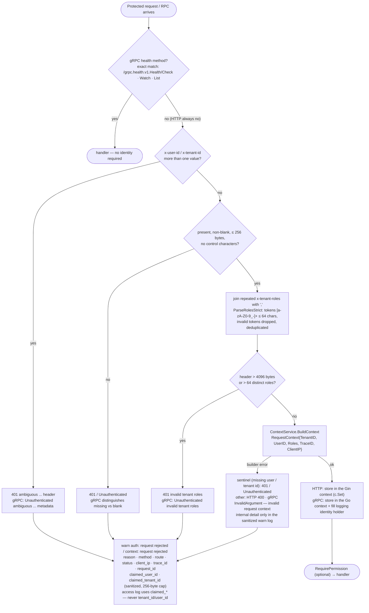

| Rule | HTTP | gRPC |
|---|---|---|
| Repeated `x-user-id` / `x-tenant-id` | `401 ambiguous <h> header` (`identity.go`) | `Unauthenticated "ambiguous <key> metadata"` (`checkRequiredMeta`, after the missing check) |
| Missing / blank / >256 bytes / control chars | `401` | `Unauthenticated` (missing vs blank distinguished) |
| Repeated `x-tenant-roles` | joined with `,` | joined with `,` |
| Roles over 4096 bytes or 64 roles | `401 invalid tenant roles` (`ParseRolesStrict`) | `Unauthenticated "invalid tenant roles"` (`ParseRolesStrict`) |
| `BuildContext` failure | sentinels → `401 missing tenant id / missing user id`; other → `400 invalid request context`, sanitized warn log | sentinels → `Unauthenticated`; other → `InvalidArgument "invalid request context"` |
| Where the context is stored | Gin context (`c.Set`) — not `c.Request.Context()` | Go context |
| Health probes | register `HealthHandler` before the protected group | exactly `/grpc.health.v1.Health/{Check,Watch,List}` bypass auth, context and RBAC |
| `ClientIP` | `c.ClientIP()` (respects `SetTrustedProxies`) | `peer.FromContext`, guarded against a nil `Addr` |
| `TraceID` | from the active span | from the active span when valid |

**Verified vs claimed in logs.** The access log writes `tenant_id`/`user_id` only from a `RequestContext` that was actually built. When `RequireAuth` or `ContextMiddleware` rejected the request, or the route is public, client-supplied values go to `claimed_tenant_id`/`claimed_user_id`, sanitized and capped at 256 bytes. A spoofed header can never appear in a verified field.

---

## Authorization (RBAC) flow

`AuthZMiddleware` (HTTP) and the AuthZ interceptors (gRPC) are installed per route / per RPC, after the protected chain. Both delegate the decision to the consumer's `Authorizer`.

> Source: [`docs/architecture/mermaid/rbac-middleware-flow.mmd`](docs/architecture/mermaid/rbac-middleware-flow.mmd)

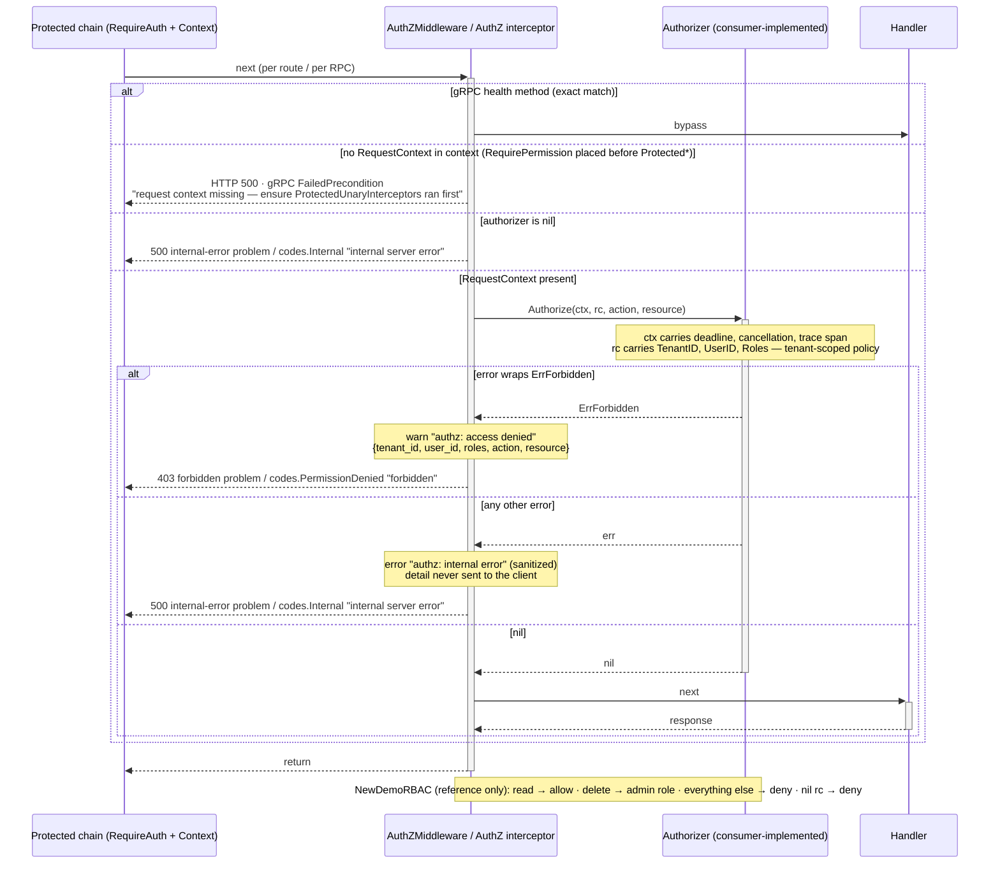

`Authorize(ctx context.Context, rc *RequestContextData, action, resource string) error` gets the request context (deadline, cancellation, span) and the full `RequestContext`, including `TenantID`, so production IAM/OPA policies can be tenant-scoped and time-bounded. The return contract is three-valued: `nil` allows; an error wrapping `ErrForbidden` denies with `403` / `PermissionDenied`; any other error is an internal failure (`500` / `Internal`) that is logged and never forwarded to the client.

---

## Panic and abort recovery

Panic handling is split across four layers that each record their own signal and then re-panic, so a panic is counted **exactly once** in every signal and recovery happens only at the outermost layer. `http.ErrAbortHandler`, the sentinel net/http and `httputil.ReverseProxy` use when a client goes away, is recognised at every layer as a client abort, not a crash.

> Source: [`docs/architecture/mermaid/panic-recovery-flow.mmd`](docs/architecture/mermaid/panic-recovery-flow.mmd)

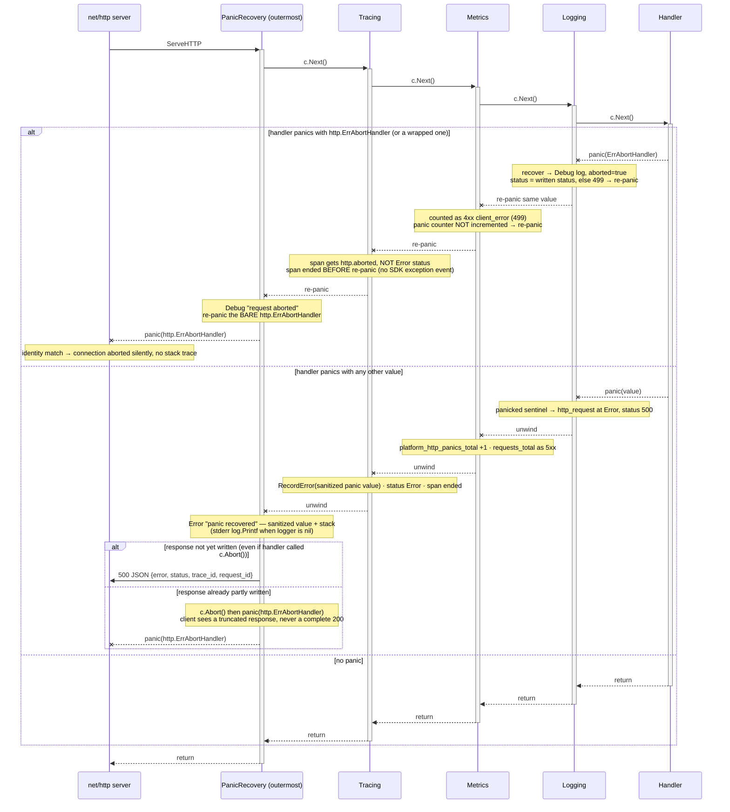

| Case | Client sees | Metrics | Access log | Span |
|---|---|---|---|---|
| `panic("boom")`, nothing written | `500` JSON | `platform_http_panics_total` +1, 5xx | Error, status 500 | Error + sanitized exception |
| `panic("boom")` after a partial write | truncated response (connection aborted) | panic +1, 5xx | Error | Error |
| `panic(http.ErrAbortHandler)` (or wrapped) | connection closed, no stack trace in server logs | 4xx `client_error`, status 499 (or the status already written) | Debug, `aborted=true` | `http.aborted`, not Error |

gRPC is the same pattern: `Unary/StreamPanicRecoveryInterceptor` is outermost, and the tracing, metrics and logging interceptors use `panicked` sentinels. The tracing interceptor records the **real** panic value through an inner `recover` + re-panic before recovery converts it to `codes.Internal`.

---

## Error handling (RFC 9457)

Every HTTP error the stack writes, and every error a handler reports through it, is an RFC 9457 problem (`application/problem+json`). Contract, registry and migration: [docs/problem-details/](docs/problem-details/README.md).

| Concern | Where | Rule |
|---|---|---|
| Single writer | `middleware.WriteProblem` | The only HTTP error writer: builds the problem (`problem.BuilderFor`), sets `X-Trace-ID` / `X-Request-ID`, aborts, writes, then logs one WARN `problem response` `{traceId, type, status, errorCode, service, tenantId}`, plus, for an unclassified 500, an ERROR `unclassified error` with route, operation and error-chain types (never the error text). A panicking logger is ignored |
| Global error handler | `middleware.ProblemMiddleware`, innermost `ObservabilityMiddlewares` handler | Stores the per-app settings (type base, logger, service), then after the handlers renders the last `c.Error` (`ClassifyError`) or a bodiless error status (`c.Status(404)`, Gin's 404 `ROUTE_NOT_FOUND` / 405). A written response is never touched; `context.Canceled` → 499 with no body. Innermost, so metrics, the access log and the span record the problem's status |
| Classification | `ClassifyError` → `problem.FromError` | `*problem.Error` as is; `validator.ValidationErrors` → 400 `validation-failed`; `ErrForbidden` → 403; `errors.ErrUnsupported` → 501; `context.DeadlineExceeded` → 503 `REQUEST_TIMEOUT`; `*http.MaxBytesError` → 413; anything else → 500 without detail |
| Validation | `BindingError`, `ShouldBind(JSON)` | JSON field paths (Gin's default validator gets a json/form tag-name function once; a replaced `binding.Validator` is left alone) and fixed messages that never echo the value |
| Correlation | `problem.ResolveTraceID` | `traceparent` trace-id → sanitized client `x-request-id` → server span → generated (platform-pgcommon-py's order and vectors) |
| Tenant | `WriteProblem` | `tenantId` only from the verified `RequestContext`; never on a 401 |

Library-emitted problems keep their v1 status codes: 401 (`RequireAuth` / `ContextMiddleware`), 400 `INVALID_REQUEST_CONTEXT`, 403 / 500 (`RequirePermission`), 500 (panic), 503 `REQUEST_TIMEOUT` (timeout). RFC 9457 is HTTP-only: `pkg/grpccommon` keeps gRPC status codes, under the same confidentiality rule. Its error sanitizer (`Unary/StreamErrorSanitizerInterceptor`, the innermost `Observability*` interceptor) keeps status errors (only the inner status of a wrapped one, never the wrappers' text), gives context errors a fixed message, and turns any other handler error into `Internal "internal server error"` with the same `unclassified error` log entry (`grpc_method`, ids, error-chain types, never `err.Error()`). Without it grpc-go sends a plain error as `Unknown` with its full text.

---

## Timeouts

A deadline only helps if the layers that report on the request see the same outcome the client does. Both stacks therefore place the timeout **inside** observability.

> Source: [`docs/architecture/mermaid/timeout-flow.mmd`](docs/architecture/mermaid/timeout-flow.mmd)

```mermaid
flowchart TD
    subgraph http["HTTP — Config.RequestTimeout > 0 (innermost observability handler)"]
        H1(["TimeoutMiddleware(d)"]) --> H2["c.Request = WithContext(context.WithTimeout(d))"]
        H2 --> H3["c.Next() — handler runs on the same goroutine<br/>it must honour c.Request.Context()"]
        H3 --> H4{"ctx error is DeadlineExceeded?<br/>(client Canceled is NOT a timeout)"}
        H4 -- no --> H9(["return — handler's response stands"])
        H4 -- yes --> H5{"response written, or status changed from 200?<br/>(e.g. c.Status(204) after the deadline)"}
        H5 -- yes --> H9
        H5 -- no --> H6["platform_http_request_timeouts_total +1<br/>503 service-unavailable problem"]
        H6 --> H7(["Metrics / Logging / Tracing are OUTSIDE it:<br/>they record the same 503 the client receives"])
    end

    subgraph grpcu["gRPC unary — TimeoutUnaryInterceptor(d), appended after Full*"]
        U1(["capDeadline: min(client deadline, now + d)"]) --> U2["handler(ctx) inline — must honour ctx"]
    end

    subgraph grpcs["gRPC stream — TimeoutStreamInterceptor(d), appended after Full*"]
        S1(["client deadline earlier than d?"]) -- yes --> S2["run handler inline"]
        S1 -- no --> S3["start handler in a goroutine on timeoutStream"]
        S3 --> S4{"select: handler done or capped ctx Done"}
        S4 -- "handler done" --> S5["return its result<br/>re-raise a handler panic with its original value"]
        S4 -- "client cancelled" --> S5b["wait for the handler's own result"]
        S4 -- "cap reached" --> S6["mark expired → every Send/Recv/SetHeader/SendHeader/SetTrailer<br/>on the wrapper now returns DeadlineExceeded"]
        S6 --> S7["return status DeadlineExceeded<br/>grpc-go tears the stream down → abandoned handler exits"]
        S7 --> S8(["observability (outside) records DeadlineExceeded<br/>abandoned handler's later result / panic is discarded (panic logged to stderr)"])
    end
```

- **HTTP.** `Config.RequestTimeout` appends `TimeoutMiddleware` as the innermost observability handler. Only `context.DeadlineExceeded` produces the `503`; a client disconnect (`Canceled`) does not. A response that was written, or whose status the handler changed from the default 200 (a `204` set after the deadline), is never overwritten. The handler goroutine is not interrupted: handlers must pass `c.Request.Context()` to their DB and HTTP calls.
- **gRPC unary.** The deadline is capped (an earlier client deadline is kept) and the handler runs inline. It must honour `ctx`.
- **gRPC stream.** The handler runs in a goroutine so a handler blocked in `RecvMsg` against an idle client cannot outlive the cap. At the deadline the wrapper starts failing every stream call with `DeadlineExceeded`, the interceptor returns `DeadlineExceeded`, and grpc-go tears the stream down. Because the interceptor sits innermost, metrics and logs record `DeadlineExceeded` even when the abandoned handler later swallows the error and returns `nil`. `TestGRPC_StreamTimeoutInnermost_MetricsMatchClient` pins this.

---

## Tracing initialisation

Tracing is installed by the first stack constructor for its `Config`. Services that need spans earlier call `InitTracingWithConfig` with the same identity. The global provider is a **delegating provider owned by this package**: it is installed once, and swapping SDK providers replaces only its inner pointer.

> Source: [`docs/architecture/mermaid/tracing-initialization.mmd`](docs/architecture/mermaid/tracing-initialization.mmd)

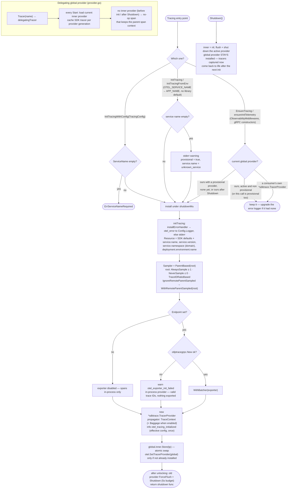

**Why a delegating provider.** OpenTelemetry's global delegate binds once, and instrumentation (pgcommon's `Config.Tracer`, package-level `otel.Tracer`, otelgrpc/otelgin handlers) captures a provider at construction. If the global itself were replaced, every tracer captured before the replacement (for example, under a provisional `unknown_service` provider created by `InitTracingFromEnv`) would keep pointing at a shut-down provider and silently drop its spans. With the delegating provider, every captured tracer resolves the current SDK provider on each `Start`: one atomic load, no lock, about the same cost as a direct SDK tracer. `Shutdown` leaves the delegating provider installed with no inner provider, so a provider captured during a restart is live again after re-init. A consumer that installed its own `*sdktrace.TracerProvider` is respected and never replaced.

| Setting | Default | Notes |
|---|---|---|
| Endpoint | `OTEL_EXPORTER_OTLP_ENDPOINT`, else `localhost:4317` (an empty value counts as unset) | `none`/`off`/`disabled`, or the spec's `OTEL_TRACES_EXPORTER=none`, disables export (in-process provider, init logs `exporter=disabled`). Exporter creation failure → `otel_exporter_init_failed` warning + in-process provider |
| TLS | on, unless `APP_ENV` is `dev`/`local` (trimmed, lowercased) | `OTEL_EXPORTER_OTLP_INSECURE` overrides |
| Sampler | `ParentBased(ratio)`: `1.0` in dev/local, `0.1` otherwise | `OTEL_TRACES_IGNORE_REMOTE_PARENT_SAMPLED=true` re-samples remote-sampled parents at the ratio (edge services) |
| Resource | `service.name`, `service.version`, `service.namespace` (domain), `deployment.environment.name` | Schemaless merge with `resource.Default()`, so no schema-URL conflict |
| Propagator | W3C TraceContext (+ Baggage when `OTEL_PROPAGATOR_BAGGAGE=true`) | |
| SDK errors | `otel_error` to `Config.Logger`, else stderr | A later stack with a logger upgrades a logger-less handler |

---

## Metrics initialisation and process identity

Metrics initialisation is **transactional, retryable and identity-checked**. It replaced a `sync.Once` that silently kept the first caller's identity and could leave half-registered collectors behind.

> Source: [`docs/architecture/mermaid/metrics-initialization.mmd`](docs/architecture/mermaid/metrics-initialization.mmd)

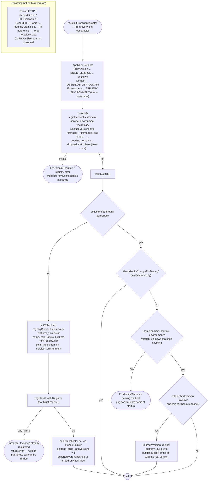

**Identity rules.** `domain`, `service` and `environment` must match exactly across every stack in a process. `unknown` (no `BuildVersion`, no `BUILD_VERSION`) matches any version in either order: a later `unknown` inherits the established version, and a later real version upgrades an established `unknown` (relabelling `platform_build_info`). Two different real versions are `ErrIdentityMismatch`. Invalid versions (`feat/x`, `refs/tags/v1.4.0`, `:`-separated, over 64 characters) are sanitised to the registry pattern `^[0-9A-Za-z][0-9A-Za-z._+-]{0,63}$` with a one-time warning. Startup fails only if nothing usable remains.

**Concurrency.** Initialisation runs under `initMu`. The collector set is published through an `atomic.Pointer`, which the recording helpers load on every observation, so recording never races with re-initialisation and is a no-op before init. The exported collector vars (`metrics.HttpRequestsTotal`, ...) are a read-only view for tests. `metrics.InitWithRegistererOptions(opts, prometheus.NewRegistry())` builds an isolated set for tests. `metrics.AllowIdentityChangeForTesting(true)`, enabled by `test/testenv`, restores first-identity-wins only for test processes that build stacks with different service names.

| Metric | Type | Labels (+ `domain`, `service`, `environment`) |
|---|---|---|
| `platform_http_requests_total` | Counter | `method`, `route`, `status_class`, `error_class` |
| `platform_http_request_duration_seconds` | Histogram | `method`, `route`, `status_class`, `error_class` |
| `platform_http_request_size_bytes` / `_response_size_bytes` | Histogram (`payload_size`, up to 16 MiB) | `method`, `route`, `status_class`, `error_class` |
| `platform_http_active_requests` | Gauge | `route` |
| `platform_http_panics_total` | Counter | `method`, `route` |
| `platform_http_rate_limited_requests_total` | Counter | `method`, `route` |
| `platform_http_request_timeouts_total` | Counter | `method`, `route` |
| `platform_grpc_server_handled_total` | Counter | `grpc_method`, `grpc_code`, `status_class`, `error_class` |
| `platform_grpc_server_handling_seconds` | Histogram | `grpc_method`, `status_class`, `error_class` |
| `platform_grpc_server_request_size_bytes` / `_response_size_bytes` | Histogram | `grpc_method`, `status_class`, `error_class` |
| `platform_grpc_server_inflight_requests` | Gauge | `grpc_method` |
| `platform_grpc_panics_total` / `platform_grpc_rate_limited_requests_total` | Counter | `grpc_method` |
| `platform_build_info` | Gauge (= 1) | `version` (the only series carrying it) |

HTTP `method` is bounded (non-standard methods → `OTHER`); `route` is the Gin template or `unknown`; 1xx is `2xx`/`success` (WebSocket upgrades are not errors); requests of unknown length (`Content-Length: -1`) are not observed in the size histogram.

---

## Observability registry and governance

The registry is the contract. Shared metrics exist **only** as registry entries, collectors are built from them, and CI enforces them in every consuming service.

> Source: [`docs/architecture/mermaid/registry-governance.mmd`](docs/architecture/mermaid/registry-governance.mmd)

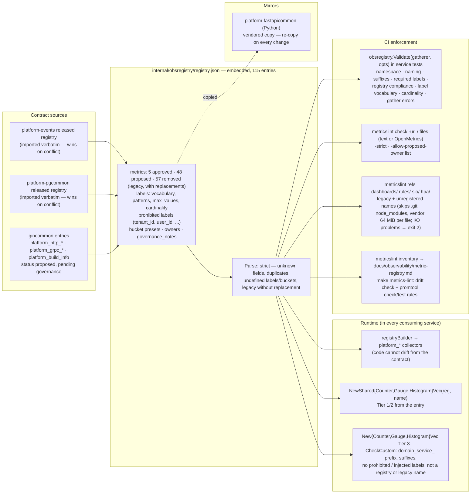

| Tier | Prefix | Who defines it | How it's built |
|---|---|---|---|
| 1 | `platform_*` | Registry (cross-domain) | `registryBuilder` (gincommon's own), `NewShared*Vec` |
| 2 | `<domain>_*` | Registry (one domain, e.g. the eight `iam_*` entries) | `NewShared*Vec` |
| 3 | `<domain>_<service>_*` | The service | `New*Vec`, validated by `CheckCustom` and `metricslint` |

`domain`, `service` and `environment` are const labels injected centrally, never declared by instrumentation. Each label name has one meaning: platform HTTP uses `method` and platform gRPC uses `grpc_method`. Byte-size histograms use `_bytes` through an explicit `unit: bytes` exception to the `_seconds` rule, which is pending governance ratification.

---

## Observability stack

> Source: [`docs/architecture/mermaid/observability-stack.mmd`](docs/architecture/mermaid/observability-stack.mmd)

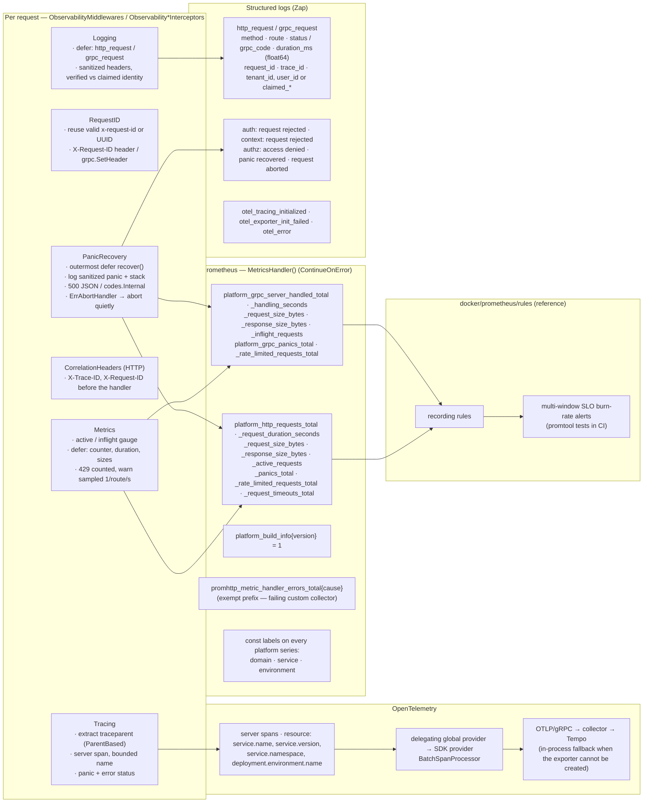

The three signals are independent: metrics are synchronous in-process counters, spans are batched and exported asynchronously, and logs go to stdout and optionally `LOG_FILE`. Disabling or losing one never affects the others or the request. `MetricsHandler` uses `promhttp.ContinueOnError`, so one failing custom collector costs only its own series. The failure is counted in `promhttp_metric_handler_errors_total` and logged at most once per 5 minutes per distinct error.

---

## Consuming service wiring

> Source: [`docs/architecture/mermaid/consuming-service-wiring.mmd`](docs/architecture/mermaid/consuming-service-wiring.mmd)

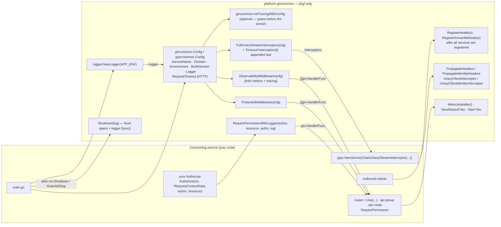

```go
log, _ := logger.NewLogger(os.Getenv("APP_ENV"))
cfg := gincommon.Config{
    Logger: log, ServiceName: "my-service", Domain: "iam",
    Environment: os.Getenv("APP_ENV"), BuildVersion: os.Getenv("BUILD_VERSION"),
    RequestTimeout: 30 * time.Second,
}
r := gin.New()
r.Use(gincommon.ObservabilityMiddlewares(cfg)...)       // metrics + tracing initialised here
r.GET("/health", gincommon.HealthHandler())
r.GET("/metrics", gin.WrapH(gincommon.MetricsHandler()))
api := r.Group("/api", gincommon.ProtectedMiddlewares(cfg)...)
api.DELETE("/items/:id", gincommon.RequirePermissionWithLogger("delete", "items", myAuthorizer, log), del)
// ... srv.Shutdown(ctx) ...
_ = gincommon.Shutdown(log)                                // flush spans + logger.Sync()
```

The full HTTP and gRPC examples in [README.md](README.md#integrating-into-a-consuming-service) compile from an external module that imports only `pkg/`.

---

## Concurrency model

| Shared state | Protection | Hot path cost |
|---|---|---|
| Metrics collector set | `initMu` for init; `atomic.Pointer` publish | one atomic load per observation |
| Global tracer provider | `shutdownMu` for install/shutdown; inner provider in `atomic.Pointer` | one atomic load per span start (+ SDK tracer lookup) |
| OTel error logger | `atomic.Pointer`, written under `shutdownMu` | read on SDK error only |
| gRPC known-method allow-list | `sync.RWMutex` | read lock per RPC |
| 429 log limiter | mutex; map keyed by route template (bounded, `unknown` for unmatched) | only on a 429 |
| `/metrics` error-log limiter | mutex; at most 64 remembered error strings | only on a gather error |
| gRPC logging identity holder | `atomic.Pointer` in the request context | per RPC |
| gRPC stream size counters | mutex in `monitoredServerStream` (concurrent Send/Recv on bidi streams) | per message |
| Stream timeout wrapper | atomic `expired` flag checked by every stream method | per message |

There is no background goroutine of the library's own beyond the OTel batch span processor and, only while a stream timeout is armed, the handler goroutine.

---

## Failure domains

**Consistency invariants (CONS-1..5):**
- **CONS-1** — Every signal records the status the client received: panics as 500 (or 499 for aborts), timeouts as 503 / `DeadlineExceeded`, deliberate `c.Abort()` with its real status.
- **CONS-2** — HTTP and gRPC classify outcomes with the same rules (`status_class`, `error_class`, client vs server codes, `DeadlineExceeded` as a client error) and log at the same levels.
- **CONS-3** — Code and contract cannot drift: `platform_*` collectors are built from registry entries, and `make metrics-lint` fails when the generated inventory differs from the registry.
- **CONS-4** — One identity per process: every series from every stack in a process carries the same `domain`/`service`/`environment`, and spans carry the same resource identity.
- **CONS-5** — One error contract across languages: every HTTP error is an `application/problem+json` problem with the same types, titles, error codes, `traceId` order and validation messages as platform-fastapicommon and platform-pgcommon-py. platform-interop-tests' `error_shape` check compares a Go and a Python 401 on every library PR.

**Failure invariants (FAIL-1..5):**
- **FAIL-1** — No observability dependency can fail a request. Metrics are in-process, OTLP export is async and batched, and a nil logger degrades to no-op or stderr.
- **FAIL-2** — Misconfiguration fails at startup, never at request time: missing or invalid identity, conflicting identity, empty `ServiceName`.
- **FAIL-3** — Unverified or ambiguous identity fails closed: repeated identity, oversized roles and malformed headers are `401` / `Unauthenticated`, never "take the first value".
- **FAIL-4** — Internal error detail never reaches a client. `BuildContext`, authorizer and panic details go to sanitized logs; clients get RFC 9457 problems with fixed details, and a 5xx `internal-error` has no `detail` at all (`Builder.Build` strips one even if set).
- **FAIL-5** — Metrics initialisation is all-or-nothing: a registration failure leaves nothing published and is retryable.

**Dependency degradation matrix:**

| Dependency | Failure | Effect on requests | Signal |
|---|---|---|---|
| OTel collector | unreachable at startup | none | `otel_exporter_init_failed`; in-process provider keeps valid trace IDs |
| OTel collector | export errors at runtime | none | `otel_error` via `Config.Logger` (one per export attempt) |
| Prometheus | not scraping | none | — |
| Custom collector | `Gather` error | none; rest of the scrape intact | `promhttp_metric_handler_errors_total`, rate-limited log |
| Logger | nil | none | logging is a no-op; panic recovery falls back to stderr |
| `Authorizer` | returns non-`ErrForbidden` error | that route/RPC returns `500` / `Internal` | `authz: internal error` log |
| API gateway | bypassed | protected routes return `401` without identity; with forged identity the library cannot tell | out of scope — enforce at the network layer |

---

## Key invariants

| Invariant | Where enforced |
|---|---|
| Route labels never use the raw path | `label.HTTPRoute`: Gin template or `unknown` |
| gRPC method labels and span names are bounded | `label.GRPCMethod`: pattern, 256-byte cap, `RegisterKnownMethods` allow-list |
| HTTP method label is bounded | `metrics.HTTPMethodLabel` (non-standard → `OTHER`); spans use `_OTHER` + truncated `http.request.method_original` |
| `X-Trace-ID` reaches the client on every response | `CorrelationHeadersMiddleware` sets it before `c.Next()`; tests assert on `w.Result().Header` |
| Health probes need no identity, and nothing else bypasses auth | exact match of `/grpc.health.v1.Health/{Check,Watch,List}` in auth, context and authz interceptors |
| Repeated identity is rejected on both stacks | `identity.go` (HTTP), `checkSingleIdentityMeta` (gRPC) |
| Roles are bounded on both stacks | `domain.ParseRolesStrict`: 4096 bytes, 64 roles, token regex, dedupe |
| Unverified identity never lands in verified log fields | `addIdentityLogFields`: `claimed_*` unless a `RequestContext` was built |
| `PropagateHeaders` never forwards identity | identity only via `PropagateIdentityHeaders` / `*ClientIdentityInterceptor`; values set, not appended |
| A panic is counted once in every signal | `panicked` sentinels in metrics/logging/tracing; recovery only at the outermost layer |
| `http.ErrAbortHandler` is never a panic or a 5xx | recognised in all four layers; re-panicked as the bare sentinel |
| Panic after a partial write never looks like a complete 200 | recovery re-panics `http.ErrAbortHandler` when `c.Writer.Written()` |
| Timeouts are recorded as the client saw them | HTTP timeout innermost; gRPC timeout interceptors appended last |
| Context errors are classified like grpc-go | `grpcStatus`: `FromError`, else `FromContextError` |
| One metrics identity per process | `InitWithOptions` + `mismatch` → `ErrIdentityMismatch`; `test/unit/identity` pins it through the public constructors |
| Metrics init is retryable | `registerAll` + rollback; publish only on success |
| Recording never races with init | atomic collector set |
| Tracers captured before any provider swap keep exporting | delegating global provider |
| No library path calls `os.Exit` | `Fatal` absent from `port.Logger` and `ZapLogger` |
| Log values cannot inject lines | `LogSanitizer`: control chars stripped, 256-byte cap at a UTF-8 boundary; sensitive keys redacted (`*_key`, `password`, `secret`, `token`, `credential`, `session`, ...) |
| `duration_ms` is sub-millisecond precise | `float64(elapsed.Nanoseconds()) / 1e6` in every request and panic log |
| Typed-nil safety | `RequestContext(c)`, `RequestContextFromGoContext`, `ProtoMessageSize` guard typed-nil pointers |
| Consumers never import `internal/` | `pkg/*/types.go` aliases; `consumer_api_test.go` |
| Every HTTP error is an RFC 9457 problem | `WriteProblem` is the only error writer; `ProblemMiddleware` renders `c.Error` and bodiless error statuses (incl. Gin's 404/405); `application/problem+json` |
| A 5xx never leaks internal detail | unclassified errors → `internal-error`; `Builder.Build` strips `detail`/`validationErrors` from `internal-error` |
| `tenantId` only from verified identity | `WriteProblem` reads the built `RequestContext`, never a header; absent on 401 |
| `traceId` resolves like platform-pgcommon-py | `problem.ResolveTraceID`: `traceparent` → sanitized `x-request-id` → span → generated; shared test vectors |

---

## Release and distribution

### Nothing is deployed

| Artefact | Built by | Consumed by |
|---|---|---|
| Go module version (`vX.Y.Z` tag) | `release.yml` | every consuming service via `go get` |
| `metricslint` binaries (linux/darwin amd64+arm64, windows amd64) + `.sha256` + `checksums.txt` | `prepare-release-binary.sh` | non-Go CI pipelines |
| Demo image (semver tags, no `latest`) | `release.yml` / `ci.yml` `push` | CI smoke gate only |

Two-stage `Dockerfile`: digest-pinned `golang:1.26.9-alpine` builder, digest-pinned `alpine:3.21` runtime running as `nobody`, `HEALTHCHECK` on `/health`. Pins are checked against `.docker-digests` in CI. `alpine:3.21` reaches end of support around November 2026.

### Versioning

SemVer over `pkg/*` ([VERSIONING.md](VERSIONING.md)). `v2.0.0` (RFC 9457 error contract) is a proper major with the `/v2` module path. `v1.4.0` is a recorded exception (breaking changes in a MINOR). A release requires a `## [X.Y.Z]` CHANGELOG section and a tag that points at HEAD and is reachable from `origin/main`.

---

## Testing strategy

- **Unit** (`test/unit/`, no Docker). One package per area: `middleware`, `grpc`, `gincommon`, `metrics`, `platformmetrics` (gincommon's own metrics validate against the registry), `obsregistry` (registry parsing, validation rules, `refs`, CLI exit codes, OpenMetrics input), `otel` (delegating provider: `TestReplacement_EarlierTracerExportsToNewProvider`, `TestReplacement_ConcurrentStartsRace`, `TestShutdown_CapturedProviderLiveAfterReinit`, `TestEnsureInitTelemetry_KeepsForeignSDKProvider`), `config`, `logger`, `domain`, `service`, `label`, `server`, `metricshandler`.
- **Error contract** (`test/unit/problem`, `test/unit/gincommon/errors_test.go`, `test/unit/middleware/problem_test.go`, `test/unit/customvalidator`, `test/integration/problem_details_test.go`). The registry invariants and `docs/problem-details/registry.md` drift; builder, mapping, trace-id vectors shared with pgcommon-py, client decoding and the OpenAPI schema against the struct; the full stack (content type, required members, status mapping, validation paths and messages, no 5xx leaks, tenant and trace); a service-replaced `binding.Validator` (own process); gateway passthrough through a reverse proxy and a gateway-generated problem.
- **Uninitialised metrics** (`test/unit/uninit/passthrough_test.go`). The HTTP metrics middleware and the gRPC metrics interceptors are a pure pass-through (no recover, handler result unchanged) before metrics are initialised. The file sorts before `uninit_test.go` so it runs first; the package is valid only with `-count=1`.
- **Identity** (`test/unit/identity`, `test/unit/uninit`). These deliberately avoid `test/testenv`, which relaxes the identity rule for every other package. `TestOneIdentityPerProcess` drives the real panic through `gincommon.ObservabilityMiddlewares` and `grpccommon.FullUnaryInterceptors`. `TestUnknownFirstThenRealVersionUpgrades` covers the order-independent version rule.
- **Consumer API** (`test/unit/gincommon/consumer_api_test.go`). `TestConsumerAuthorizer_Gin` / `_GRPC` implement `Authorizer` with `pkg/` imports only.
- **Integration** (`test/integration/`, in-process). The HTTP chain end to end (`TestMiddlewareFlow*`, `TestObservabilityMiddlewares_ErrAbortHandler_FullChain`, `TestProtectedMiddlewares_RepeatedIdentityHeader401`, `TestTimeoutMiddleware_KeepsStatusOnlyResponse`), plus a real bufconn gRPC server in `grpc_server_test.go`: `TestGRPC_UnauthenticatedCallIsLoggedAtWarn`, `TestGRPC_AmbiguousIdentityRejected`, `TestGRPC_RequestIDEchoedAndPropagatedDownstream`, `TestGRPC_HealthBypassesAuth`, `TestGRPC_HealthPrefixNearMissRequiresAuth`, `TestGRPC_UnknownMethodBoundedLabel`, `TestGRPC_StreamTimeoutEndsIdleRecvLoop`, `TestGRPC_StreamTimeoutInnermost_MetricsMatchClient`.
- **E2E** (`test/e2e/`). Full demo-server startup.
- **Smoke** (`test/smoke/`, plus CI's `smoke-tests.sh` image gate). The image is at most 60 MB; an invalid `OBSERVABILITY_DOMAIN` must exit non-zero with the registry error; `/health` and `/metrics` must be served with identity labels.

Tests live in `test/`, a separate package tree, so coverage is measured with `-coverpkg=./internal/...,./pkg/...,./cmd/...`. The CI gate is **≥ 98%** (`coverage-gate.sh`), and the current total is **99.5%**. The gRPC (`test/unit/grpc`, `TestGRPC_*`) and tracing (`test/unit/otel`, `test/unit/gincommon`) suites pass repeated runs under `-race -count=20`.

---

## Consumer conformance checklist

Before a service ships on `v2.x`, verify:

**Identity and configuration**
- [ ] `Config.Domain` (or `OBSERVABILITY_DOMAIN`) is a registry domain; `Environment` / `APP_ENV` is one of `local|dev|test|staging|prod`.
- [ ] Every stack in the process (HTTP and gRPC) uses the same `ServiceName`, `Domain` and `Environment`.
- [ ] `BUILD_VERSION` is a clean value (semver, `git describe`, short SHA), or the sanitisation warning is accepted.

**Trust boundary**
- [ ] The gateway strips client identity headers and **replaces** (never appends) `x-user-id`, `x-tenant-id`, `x-tenant-roles`.
- [ ] The service is not reachable around the gateway.
- [ ] Calls to other IAM services that need identity use `PropagateIdentityHeaders` / `UnaryClientIdentityInterceptor`; every other outbound call uses `PropagateHeaders` / `UnaryClientInterceptor`.

**Chain order**
- [ ] `/health` and `/metrics` are registered before `ProtectedMiddlewares`; gRPC health uses `RegisterHealth`.
- [ ] `RequirePermission*` is after the protected chain.
- [ ] HTTP uses `Config.RequestTimeout`, not an outermost `TimeoutMiddleware`; gRPC timeout interceptors are appended after `Full*`.
- [ ] gRPC servers call `RegisterKnownMethods(srv)` after all services are registered.

**Errors (RFC 9457)**
- [ ] Handlers report errors with `c.Error` + `return`, `gincommon.AbortWithProblem` or `gincommon.ShouldBind*`; no hand-written error bodies, `c.AbortWithStatus*`, `c.AbortWithError` or `c.BindJSON`.
- [ ] Domain error types are `problem.MustType` variables registered in `docs/problem-details/registry.md`.
- [ ] The OpenAPI document references the shared `ProblemDetails` schema for 400, 401, 403, 404, 409, 422, 429 and 500.

**Authorization and metrics**
- [ ] The production `Authorizer` returns `ErrForbidden` for denials and honours `ctx`.
- [ ] Tier 3 metrics are named `<domain>_<service>_*` and built after the stack constructor; shared metrics are registry entries built with `NewShared*Vec`.
- [ ] The service's CI runs `obsregistry.Validate(gincommon.MetricsGatherer(), ...)` in a test and `metricslint refs` over its dashboards and rules.

**Operations**
- [ ] Edge services set `OTEL_TRACES_IGNORE_REMOTE_PARENT_SAMPLED=true`, or the gateway re-issues `traceparent`.
- [ ] `gincommon.Shutdown(log)` / `grpccommon.Shutdown(log)` runs after the server stops.
- [ ] Dashboards and log queries use `platform_*` names and the `claimed_*` fields.

---

## Registry lifecycle

| Step | Where | Gate |
|---|---|---|
| Propose a shared metric | add the entry to `registry.json` with `"status": "proposed"`, `owner`, labels, help, buckets | `make metrics-lint` (strict `Parse`, registry self-check) |
| Regenerate inventory | `make metrics-inventory` → `docs/observability/metric-registry.md` | inventory drift check in `make metrics-lint` and the pre-commit hook |
| Ratify | observability governance flips `proposed` → `approved` | until then `metricslint check -strict` fails on it unless `-allow-proposed-owner` lists the owner |
| Retire | status `removed` with `replacements` — the entry stays | `metricslint` reports emitting or querying it as an error naming the replacement |
| Import a sibling registry | platform-events / platform-pgcommon releases, verbatim; their contract wins on conflict | registry self-check |
| Mirror | re-copy `registry.json` into platform-fastapicommon | manual — on every change |

Today 52 entries are `proposed`, including all 16 gincommon-owned `platform_*` metrics and the eight `iam_*` Tier 2 metrics (the only ownerless ones). `-allow-proposed-owner platform-gincommon,platform-events,platform-pgcommon` is the documented strict-mode workaround until ratification.

---

## Threat model

STRIDE analysis of `platform-gincommon` as embedded in a consuming service. Every row maps to a real mechanism in this repo.

| STRIDE | Threat | Component | Mitigation |
|---|---|---|---|
| **Spoofing** | A client sends its own `x-user-id`/`x-tenant-id` | `RequireAuth` | The gateway strips and replaces identity headers (trust boundary). The library cannot verify identity, so the network layer must make the service unreachable around the gateway |
| **Spoofing** | A gateway that **appends** headers lets a client value sit first | `identity.go`, `checkSingleIdentityMeta` | Repeated identity is rejected on both stacks (`401` / `Unauthenticated`), never first-value-wins |
| **Spoofing** | A path under the health prefix bypasses auth via `UnknownServiceHandler` | gRPC auth/context/authz | Exact match on `Check`/`Watch`/`List`; `TestGRPC_HealthPrefixNearMissRequiresAuth` sends near-miss paths over a real connection |
| **Tampering** | Crafted header values inject fake log lines | `LoggingMiddleware`, recovery, `LogSanitizer` | Control characters stripped, 256-byte cap, U+2028/2029 rejected in identity headers |
| **Repudiation** | Rejected requests leave no trace | `RequireAuth`, `ContextMiddleware`, gRPC logging order | Every 401 / `Unauthenticated` writes a warn audit entry with request and trace IDs; gRPC logging wraps auth |
| **Repudiation** | Spoofed identity appears as verified in audit logs | `addIdentityLogFields` | Unverified values only in `claimed_*` fields |
| **Information disclosure** | Identity headers leak to a third-party API | `PropagateHeaders` | Identity forwarding is opt-in (`PropagateIdentityHeaders`, `*ClientIdentityInterceptor`) |
| **Information disclosure** | Internal errors or panic values reach the client | recovery, authz, context | Fixed client messages; detail only in sanitized logs and spans |
| **Information disclosure** | Secrets in log fields | `service.Sanitize` | Sensitive keys redacted (`*_key`, `password`, `secret`, `token`, `credential`, `session`, ...) |
| **Denial of service** | Scanner probes or random gRPC methods explode metric cardinality | `label` | Route templates / `unknown`; gRPC pattern, 256-byte cap, allow-list; bounded HTTP methods |
| **Denial of service** | A 1 MB `x-tenant-roles` header is parsed, logged and re-sent | `ParseRolesStrict` | 4096-byte / 64-role cap → 401 |
| **Denial of service** | A 429 storm floods the logs | `MetricsMiddleware` | Warn log sampled to one per route per second, with a `suppressed` count; the counter still counts every 429 |
| **Denial of service** | External callers force 100% trace sampling | `Sampler` | `ParentBased`; `IgnoreRemoteParentSampled` re-samples remote-sampled parents at the ratio |
| **Denial of service** | A blocked stream handler holds a connection past its deadline | `TimeoutStreamInterceptor` | Handler goroutine is abandoned at the cap; the stream is torn down |
| **Elevation of privilege** | A misordered chain lets `RequirePermission` run without identity | authz | No `RequestContext` → `500` / `FailedPrecondition`, never allow |
| **Elevation of privilege** | Demo RBAC used in production | `NewDemoRBAC` | Documented reference-only; default-deny for every action except `read`, and `delete` requires `admin` |

**Out of scope (platform controls):** JWT/OAuth validation and MFA (gateway, Keycloak); network isolation of services (mesh, NetworkPolicy); TLS termination; the security of the collector, Prometheus and Loki in production.

---

## Developer tools

| Tool | Command | Purpose |
|---|---|---|
| `metricslint check` | `go run ./cmd/metricslint check -url http://localhost:8080/metrics` | Validate a live scrape (`-strict`, `-allow-proposed-owner`) or exposition files (text or OpenMetrics) |
| `metricslint refs` | `go run ./cmd/metricslint refs <dirs>` | Legacy and unregistered names in dashboards, alert/recording rules, SLOs, HPA manifests |
| `metricslint registry` / `inventory` | `make metrics-lint` / `make metrics-inventory` | Registry self-check; regenerate `metric-registry.md` |
| pkgsite | `make godoc` → http://localhost:8080 | Browse the public API |
| Local stack | `make docker-up` | Collector → Tempo, Prometheus (reference rules), Loki + Promtail, Grafana |
| Demo server | `make run` | `/health`, `/metrics`, `/panic` (dev only) |

---

## Session-specific decisions

Judgment calls made during the v1.4.0 hardening passes (1–11) and the v2.0.0 error-contract release (12–19), each documented at its point of impact in the code as well:

1. **Breaking changes as a MINOR.** Removing the pre-standard metric names, requiring `Domain`, and changing `Authorizer`, `PropagateHeaders` and the gRPC chain order would normally need `v2.0.0` with a `/v2` module path. No consumer had been deployed and all eleven IAM services upgrade in lockstep, so `v1.4.0` ships them as a [recorded exception](VERSIONING.md#recorded-exceptions) rather than churning every import path.
2. **A delegating global tracer provider instead of replacing the global.** Replacing a provisional provider used to shut it down, while tracers captured earlier (pgcommon's `Config.Tracer`, package-level `otel.Tracer`) kept pointing at it and silently dropped spans. Swapping an inner pointer behind one long-lived provider fixes every capture point at once. `Shutdown` keeps that provider installed for the same reason.
3. **Transactional, identity-checked metrics init instead of `sync.Once`.** First-caller-wins hid configuration conflicts and left half-registered collectors after a registration failure. The replacement fails loudly on a conflicting identity, rolls back on failure, and publishes atomically.
4. **Order-independent `unknown` version and sanitised versions.** The first identity rule made startup depend on whether the gRPC or the HTTP stack was built first, and branch-style `BUILD_VERSION` values crashed services over a cosmetic label. A real version now upgrades `unknown` in either order, and invalid versions are sanitised with a warning.
5. **Timeouts innermost on both stacks.** An outermost timeout let metrics and logs record 200 or `OK` while the client received 503 or `DeadlineExceeded`. Moving the timeout inside observability makes the recorded and delivered status identical. The gRPC stream variant runs the handler in a goroutine because a handler blocked in `RecvMsg` cannot otherwise be bounded.
6. **Exact-match health exemption.** A prefix match on `/grpc.health.v1.Health/` was an authentication bypass behind `UnknownServiceHandler`. Only the three standard methods are exempt.
7. **`http.ErrAbortHandler` as a client abort.** Reverse-proxy client disconnects were counted as panics and 5xx and paged on-call. They are now 499 / `client_error` at Debug level, re-panicked as the bare sentinel because net/http compares by identity. A real panic after a partial write aborts the connection so the client sees truncation.
8. **Identity forwarding is opt-in.** `PropagateHeaders` sent user, tenant and roles to any destination, including third-party APIs. It now sends trace context and request ID only, and identity goes through explicit `*Identity*` helpers.
9. **gRPC logging wraps auth.** Logging used to be innermost in the `Full` chain, so auth rejections were never logged. Moving it outward needed an identity holder in the context so authenticated calls still log verified `user_id` / `tenant_id`.
10. **`RequestContextData` in both packages.** One name for one type, chosen before release because `gincommon.RequestContext` was already the accessor function.
11. **Test-only identity relaxation.** `test/testenv` enables `AllowIdentityChangeForTesting` so dozens of test packages can build stacks with different service names. The real mismatch panic is pinned in packages that deliberately do not import `testenv`.
12. **A proper `/v2` major, not another recorded exception.** Replacing every HTTP error body and removing `ErrorResponse` is a breaking wire and API change. Unlike v1.4.0, the services had already pinned v1.x releases, so v2.0.0 takes the `/v2` module path Go requires instead of a written SemVer exception.
13. **The Go "platform-problem-details" library lives here.** `pkg/problem` (standard library only, `internal/problem` behind it) is the model, registry, builder, error types and client decoder, instead of a separate repository. Gin services, Go gateways/BFFs and clients import one module; platform-fastapicommon and platform-pgcommon-py mirror it.
14. **platform-pgcommon-py's `traceId` order.** `traceparent` → sanitized client `x-request-id` → span → generated, with the same test vectors, so a Go and a Python service answer the same request with the same `traceId`. When a client sends only `x-request-id`, `traceId` is that id and differs from `X-Trace-ID`; the problem log line always carries the resolved value.
15. **No detail on `internal-error`, enforced in the builder.** Unclassified errors, panics, authorizer errors and context misconfiguration all become a detail-less 500, and `Builder.Build` strips a detail even if one was set, so no code path can leak an exception message. v1 exposed `request context missing` in 500 bodies.
16. **One WARN `problem response` line; types, not text, for unclassified 500s.** The problem line has the same fields and level as pgcommon-py, never the detail, instance or identity. An unclassified 500 (a `FromError` fallback) also emits an error-level `unclassified error` entry with route, operation (the Gin handler), request/trace ids and the Go types along the error chain, but never `err.Error()`: confidentiality of logs wins over debugging convenience, because the global handler cannot know whether the text holds SQL, PII or secrets. An unclassified 500 is a defect: it also increments `platform_unclassified_errors_total{transport}` (approved, LLD OQ-25), which drives the `PlatformUnclassifiedErrors` alert, while the log entry stays for diagnostics. The fix is to classify the failure where it happens (LLD OQ-24).
17. **Status codes unchanged.** Library-emitted errors keep their v1 statuses, including the 503 timeout (`service-unavailable` / `REQUEST_TIMEOUT`, not 504). Only the body and the content type changed. fastapicommon moved its timeout from 504 to 503 to match.
18. **The error handler renders bodiless statuses and Gin's 404/405.** Running innermost in `ObservabilityMiddlewares` gives every engine problem bodies for unregistered routes without `NoRoute` wiring, while never touching a response the handler wrote. `c.AbortWithStatus*` / `c.AbortWithError` / `c.BindJSON` commit headers immediately and cannot be converted; the migration guide replaces them.
19. **gRPC errors under the same rule.** A plain handler error used to reach gRPC clients as `Unknown` with `err.Error()`, and a status wrapped with `fmt.Errorf("…: %w", st)` carried the wrapper's text. The innermost error sanitizer sends only status errors as-is (unwrapping to the inner status), and everything else as `Internal "internal server error"`, logged as `unclassified error` with types only. Callers that matched on `Unknown` or on message text must switch to status codes.

---

## Documentation assets

Architecture diagrams live as standalone Mermaid files under `docs/architecture/mermaid/` and are embedded into this document verbatim, each under a `> Source:` link back to its `.mmd` file, so a diagram only has to be correct in one place. Keep both in sync when either changes.

> Source: [`docs/architecture/mermaid/documentation-assets.mmd`](docs/architecture/mermaid/documentation-assets.mmd)

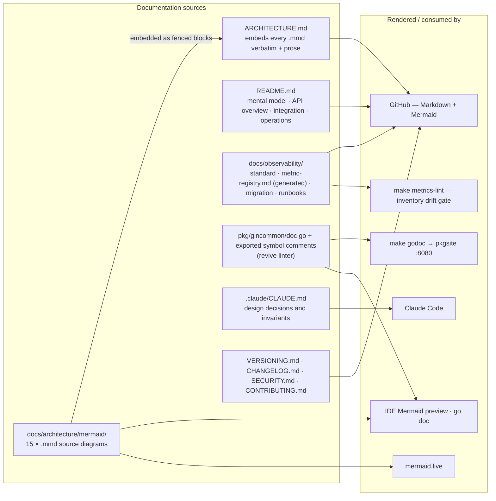

| Document | Description |
|---|---|
| [README.md](README.md) | Mental model, API overview, integration guide, local development, operations |
| [`docs/lld/platform-gincommon-lld.md`](docs/lld/platform-gincommon-lld.md) | Low-level design: public API contract, validation limits, init algorithms, error taxonomy, open-questions register |
| [`docs/architecture/README.md`](docs/architecture/README.md) | Index of the 15 `.mmd` diagrams embedded above |
| [`docs/observability/README.md`](docs/observability/README.md) | The observability standard as implemented, CI enforcement, strict mode |
| [`docs/observability/metric-registry.md`](docs/observability/metric-registry.md) | Generated registry inventory |
| [`docs/observability/migration.md`](docs/observability/migration.md) | Legacy → `platform_*` name mapping |
| [`docs/observability/runbooks.md`](docs/observability/runbooks.md) | Alert runbooks |
| [`.claude/CLAUDE.md`](.claude/CLAUDE.md) | Design decisions and invariants for Claude Code |
| [VERSIONING.md](VERSIONING.md) · [CHANGELOG.md](CHANGELOG.md) · [SECURITY.md](SECURITY.md) · [CONTRIBUTING.md](CONTRIBUTING.md) | Release policy, history, vulnerability reporting, contribution guide |

Render a diagram locally in a Mermaid-aware IDE (VS Code + Mermaid Preview, IntelliJ + Mermaid plugin), or paste it into [mermaid.live](https://mermaid.live).
