# Architecture

This document describes the internal structure, dependency rules, and runtime data flows of `platform-gincommon`.

`platform-gincommon` is a **private Go module** (`github.com/BCBP-SOLUTIONS-FZC-LLC/platform-gincommon`). It is never deployed as a standalone server — consuming services import it with `go get` (requires `GOPRIVATE=github.com/BCBP-SOLUTIONS-FZC-LLC/*`). The `cmd/server` binary and Docker image are a reference/demo only.

---

## Layer model

The library is organised in concentric Clean Architecture layers. Inner layers have **zero knowledge** of outer layers; dependencies always point inward.

> Source: [`docs/architecture/mermaid/layer-model.mmd`](docs/architecture/mermaid/layer-model.mmd)

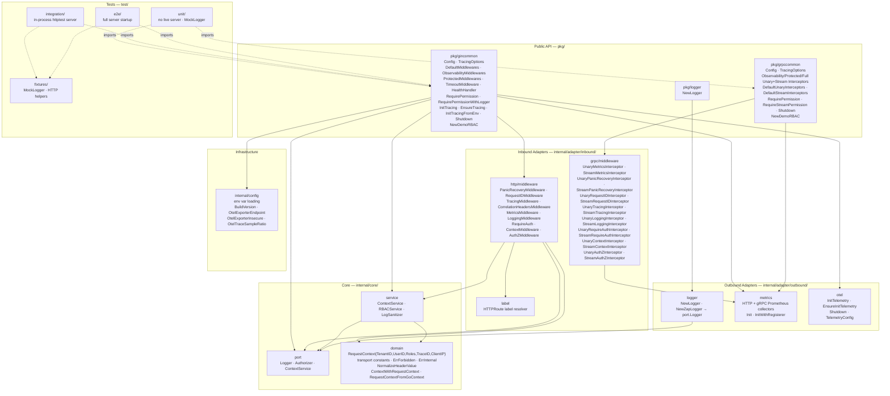

**Rule:** `domain` ← `port` ← `service` ← `adapter` ← `pkg`. The `domain` and `port` packages import nothing from this module's `adapter/` or framework packages. Packages in `pkg/` depend on `core/` but never directly on each other across packages. Tests (dashed arrows) consume the public API but are not part of the dependency chain.

---

## Package dependency graph

Arrows represent Go `import` relationships (module-internal only).

> Source: [`docs/architecture/mermaid/package-dependencies.mmd`](docs/architecture/mermaid/package-dependencies.mmd)

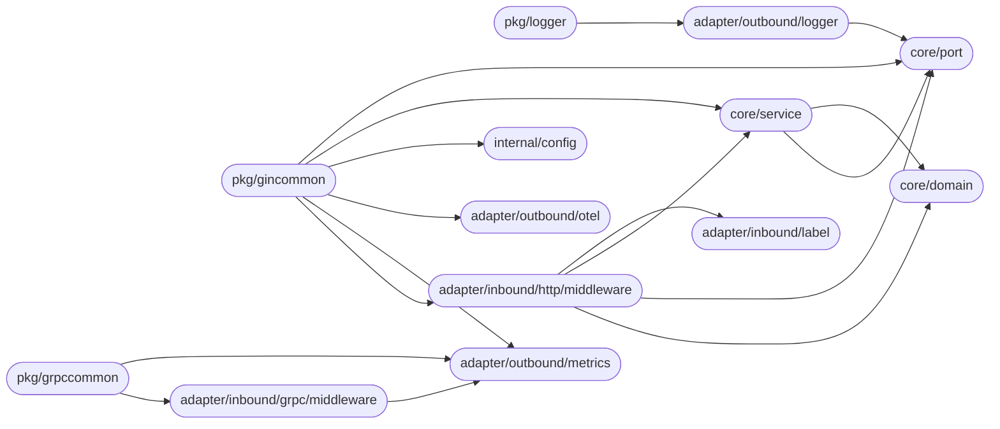

`core/domain` is the dependency sink — it imports nothing from this module. `core/port` imports only `core/domain`.

---

## Public API packages

### pkg/gincommon

| Symbol | Description |
|--------|-------------|
| `Config` | Middleware stack config: `Logger`, `ServiceName` (required — panics if empty), `BuildVersion`, `Tracing` |
| `TracingOptions` | Optional OTel overrides: `Endpoint`, `Insecure`, `SampleRatio`, `EnableBaggage` |
| `ObservabilityMiddlewares(cfg)` | Returns `[PanicRecovery, RequestID, Tracing, CorrelationHeaders, Metrics, Logging]` — no auth |
| `ProtectedMiddlewares(cfg)` | Returns `[RequireAuth, ContextMiddleware]` — validates identity headers |
| `DefaultMiddlewares(cfg)` | Full stack: `ObservabilityMiddlewares` + `ProtectedMiddlewares` |
| `TimeoutMiddleware(duration)` | Sets a per-request context deadline; insert before other middleware groups. Zero/negative duration is a no-op |
| `HealthHandler()` | Returns 200 `{"status":"ok"}` — register before `ProtectedMiddlewares` (no auth required) |
| `ErrorResponse` | Standard 4xx/5xx body struct: `Error`, `Status`, `TraceID`, `RequestID` — unmarshal from error responses |
| `PropagateHeaders(c, req)` | Injects trace context, request ID, and identity headers from inbound Gin context into an outbound `*http.Request` |
| `RequirePermission(action, resource, auth)` | Per-route RBAC middleware, no logging on denial |
| `RequirePermissionWithLogger(action, resource, auth, logger)` | Per-route RBAC with audit log on denial and internal errors |
| `NewDemoRBAC()` | Returns reference `*RBACService` (demos and tests only — not for production IAM). `NewRBAC()` is a deprecated alias |
| `RequestContext(c)` | Retrieves `*domain.RequestContext` from the Gin context; typed-nil safe |
| `TraceIDFromContext(c)` / `RequestIDFromContext(c)` | Type-safe correlation-ID readers for Gin handler context |
| `InitTracing(service, version, endpoint)` | Initialise OTLP/gRPC export; returns shutdown func |
| `EnsureTracing(service, version, endpoint)` | Install TracerProvider only if no SDK provider is registered yet |
| `EnsureInitTelemetry(service, version, cfg)` | Like `EnsureTracing` with full `TelemetryConfig` |
| `InitTracingFromEnv()` | Read `OTEL_SERVICE_NAME`, `BUILD_VERSION`, `OTEL_EXPORTER_OTLP_ENDPOINT` then call `InitTracing` |
| `Shutdown(logger)` | Graceful cleanup: flush OTel spans + `logger.Sync()`; call from `main()` after the HTTP server stops |

### pkg/grpccommon

| Symbol | Description |
|--------|-------------|
| `Config` | `ServiceName` (required — panics if empty), `BuildVersion`, `Logger`, `Tracing *TracingOptions` for Prometheus labels, tracing scopes, and interceptor logging |
| `TracingOptions` | Optional OTel overrides: `Endpoint`, `Insecure`, `SampleRatio`, `EnableBaggage` (mirrors `gincommon.TracingOptions`) |
| `ObservabilityUnaryInterceptors(cfg)` | Returns `[PanicRecovery, RequestID, Tracing, Metrics, Logging]` for unary RPCs |
| `ObservabilityStreamInterceptors(cfg)` | Returns `[PanicRecovery, RequestID, Tracing, Metrics, Logging]` for streaming RPCs |
| `ProtectedUnaryInterceptors(cfg)` | Returns `[RequireAuth, ContextInterceptor]` — validates identity metadata |
| `ProtectedStreamInterceptors(cfg)` | Returns `[RequireAuth, ContextInterceptor]` for streaming RPCs |
| `FullUnaryInterceptors(cfg)` | Full stack: `ObservabilityUnaryInterceptors` + `ProtectedUnaryInterceptors` |
| `FullStreamInterceptors(cfg)` | Full stack: `ObservabilityStreamInterceptors` + `ProtectedStreamInterceptors` |
| `DefaultUnaryInterceptors(cfg)` | Alias for `ObservabilityUnaryInterceptors` (backward compatible) |
| `DefaultStreamInterceptors(cfg)` | Alias for `ObservabilityStreamInterceptors` (backward compatible) |
| `RequirePermission(action, resource, auth)` | Per-RPC RBAC unary interceptor; requires `ProtectedUnaryInterceptors` to have run |
| `RequirePermissionWithLogger(action, resource, auth, logger)` | Like `RequirePermission` with audit logging on denial |
| `RequireStreamPermission(action, resource, auth)` | Per-stream RBAC interceptor; requires `ProtectedStreamInterceptors` to have run |
| `RequireStreamPermissionWithLogger(action, resource, auth, logger)` | Like `RequireStreamPermission` with audit logging on denial |
| `NewDemoRBAC()` | Returns reference `*RBACService` (demos and tests only — not for production IAM) |
| `RequestContextFromContext(ctx)` | Retrieves `*domain.RequestContext` from a gRPC handler context |
| `RequestIDFromContext(ctx)` | Retrieves the correlation request ID from a gRPC handler context |
| `Shutdown(logger)` | Graceful cleanup: flush OTel spans + `logger.Sync()`; call from `main()` after `GracefulStop` returns |

### pkg/logger

| Symbol | Description |
|--------|-------------|
| `NewLogger(env)` | Returns `port.Logger` backed by Zap; dev config when `env == "dev"`, production otherwise |

---

## Middleware stack composition

`ObservabilityMiddlewares`, `ProtectedMiddlewares`, and `DefaultMiddlewares` are pure factory functions — each call returns a new slice; no global state is mutated except for the idempotent `metrics.Init` and `EnsureInitTelemetry` calls.

`TimeoutMiddleware(duration)` can optionally be inserted before `ObservabilityMiddlewares` or `ProtectedMiddlewares` to set a per-request context deadline. Zero or negative duration is a no-op — insert it unconditionally and control the timeout via configuration.

> Source: [`docs/architecture/mermaid/middleware-stack-composition.mmd`](docs/architecture/mermaid/middleware-stack-composition.mmd)

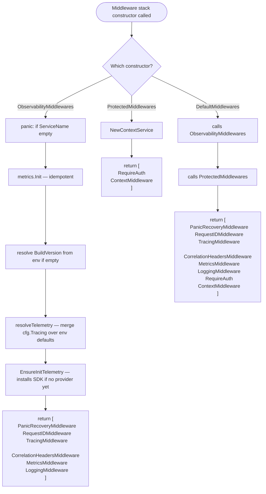

---

## Request flow through the full middleware stack

When using `DefaultMiddlewares`, every HTTP request passes through all eight handlers in order. Each deferred action runs in reverse as the call stack unwinds.

> Source: [`docs/architecture/mermaid/request-flow.mmd`](docs/architecture/mermaid/request-flow.mmd)

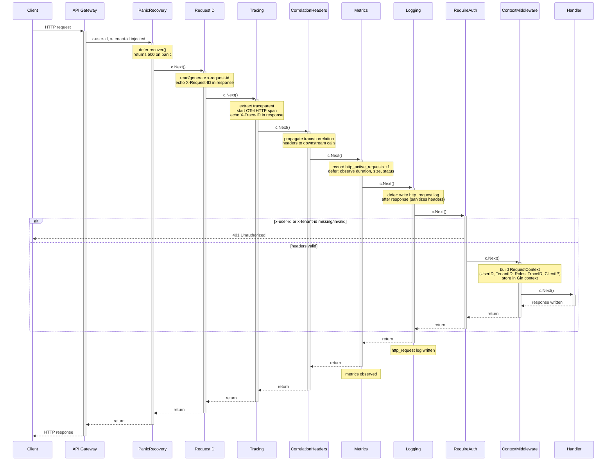

---

## Panic recovery flow

`PanicRecoveryMiddleware` sits first in the stack so it wraps all downstream middleware and handlers.

> Source: [`docs/architecture/mermaid/panic-recovery-flow.mmd`](docs/architecture/mermaid/panic-recovery-flow.mmd)

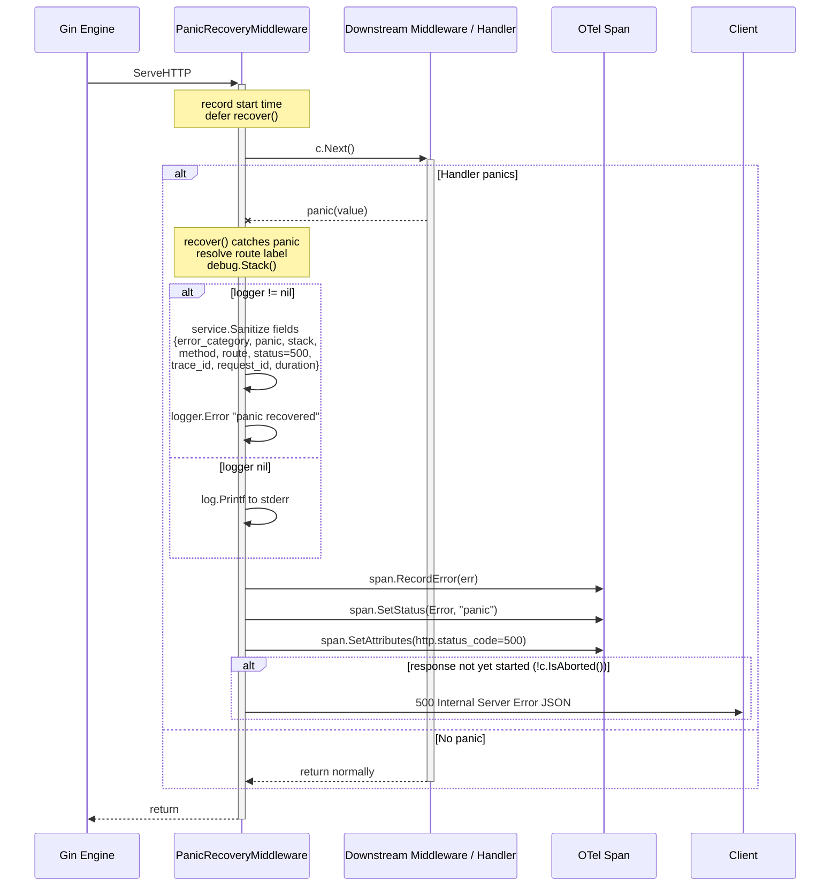

---

## RBAC middleware flow

`AuthZMiddleware` is a per-route handler installed after `ContextMiddleware`. It requires `ContextMiddleware` to have already stored a `*domain.RequestContext` in the Gin context.

> Source: [`docs/architecture/mermaid/rbac-middleware-flow.mmd`](docs/architecture/mermaid/rbac-middleware-flow.mmd)

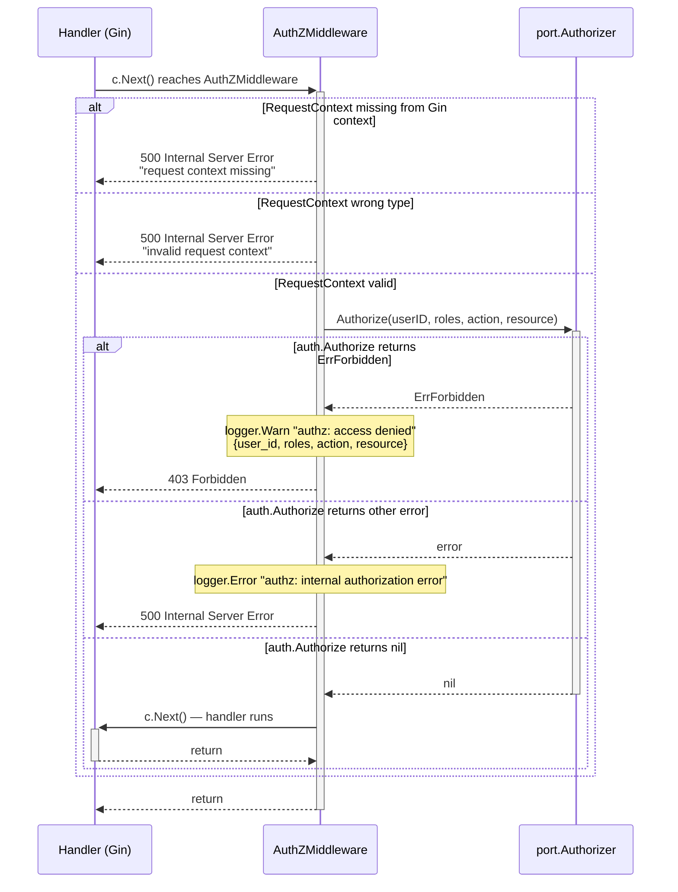

---

## Tracing initialisation

`ObservabilityMiddlewares` calls `EnsureInitTelemetry` automatically, so most consuming services do not need to call tracing helpers directly. They are provided for services that initialise tracing before their HTTP server starts (e.g. to instrument background jobs).

> Source: [`docs/architecture/mermaid/tracing-initialization.mmd`](docs/architecture/mermaid/tracing-initialization.mmd)

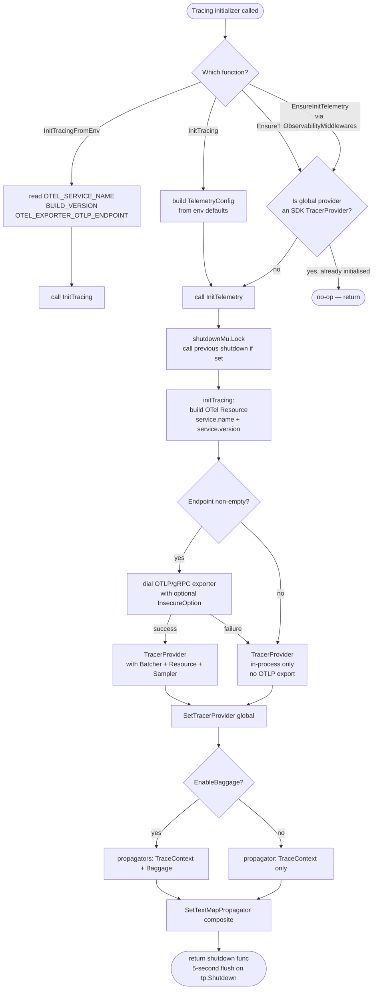

> `OtelExporterInsecure` defaults to **false** (TLS) unless `APP_ENV` is `"dev"`, `"development"`, or `"local"`. An unset `APP_ENV` is treated as secure. Override with `OTEL_EXPORTER_OTLP_INSECURE=true`.

---

## Metrics initialisation

> Source: [`docs/architecture/mermaid/metrics-initialization.mmd`](docs/architecture/mermaid/metrics-initialization.mmd)

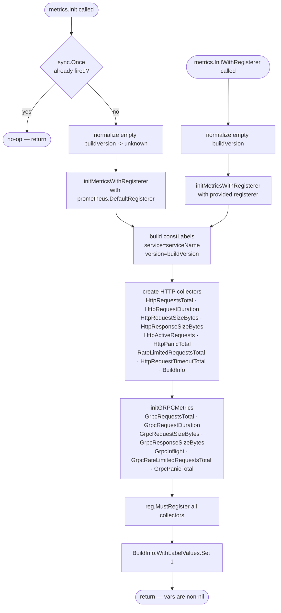

#### Registered Prometheus metrics

| Metric | Type | Labels |
|--------|------|--------|
| `http_requests_total` | Counter | method, route, status_class, error_class |
| `http_request_duration_seconds` | Histogram | method, route, status_class, error_class |
| `http_request_size_bytes` | Histogram | method, route, status_class, error_class |
| `http_response_size_bytes` | Histogram | method, route, status_class, error_class |
| `http_active_requests` | Gauge | route |
| `http_panic_total` | Counter | method, route |
| `rate_limited_requests_total` | Counter | method, route |
| `http_request_timeout_total` | Counter | method, route |
| `build_info` | Gauge (=1) | *(const: service, version)* |
| `grpc_server_handled_total` | Counter | method, grpc_code, status_class, error_class |
| `grpc_server_handling_seconds` | Histogram | method, status_class, error_class |
| `grpc_server_request_size_bytes` | Histogram | method, status_class, error_class |
| `grpc_server_response_size_bytes` | Histogram | method, status_class, error_class |
| `grpc_server_inflight_requests` | Gauge | method |
| `grpc_rate_limited_requests_total` | Counter | method |
| `grpc_panic_total` | Counter | method |

All metrics carry const labels `service` and `version` set at initialisation time.

> Note: `status_class` buckets 3xx into `2xx` (see `HTTPStatusClass`). `error_class` is one of `success`, `client_error`, `server_error`. The gRPC counter additionally exposes the raw `grpc_code` (e.g. `OK`, `InvalidArgument`, `Internal`).

---

## gRPC interceptor stack

`FullUnaryInterceptors` (and `FullStreamInterceptors`) compose the complete interceptor chain in the following order:

1. `PanicRecovery` — recover panics; return `codes.Internal`; log with stack trace
2. `RequestID` — read `x-request-id` from metadata or generate a UUID
3. `Tracing` — extract W3C `traceparent`; start OTel server span; scoped to `cfg.ServiceName`
4. `Metrics` — Prometheus `grpc_server_handled_total`, duration, sizes, inflight
5. `Logging` — structured `grpc_request` log: Info (OK), Warn (client errors), Error (server errors)
6. `RequireAuth` — reject calls missing `x-user-id` or `x-tenant-id` with `codes.Unauthenticated`
7. `ContextInterceptor` — build `domain.RequestContext`; store via `domain.ContextWithRequestContext`
8. *(Optional)* `AuthZInterceptor` — per-RPC RBAC; returns `codes.PermissionDenied` on denial

> Source: [`docs/architecture/mermaid/grpc-interceptors.mmd`](docs/architecture/mermaid/grpc-interceptors.mmd)

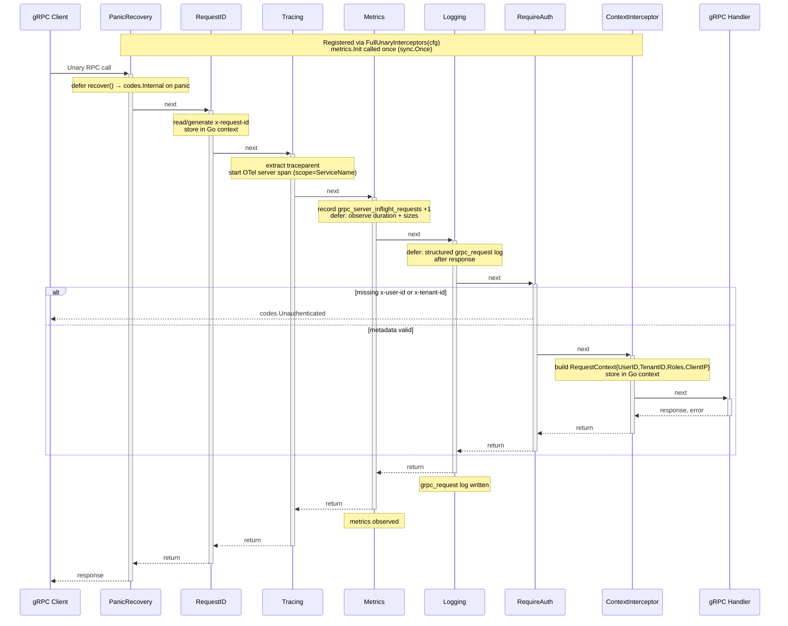

---

## Observability stack

Two observability concerns run per request: **Prometheus metrics** (synchronous, in-process) and **OpenTelemetry spans** (async, exported via OTLP/gRPC). They are independent — enabling one does not require the other.

> Source: [`docs/architecture/mermaid/observability-stack.mmd`](docs/architecture/mermaid/observability-stack.mmd)

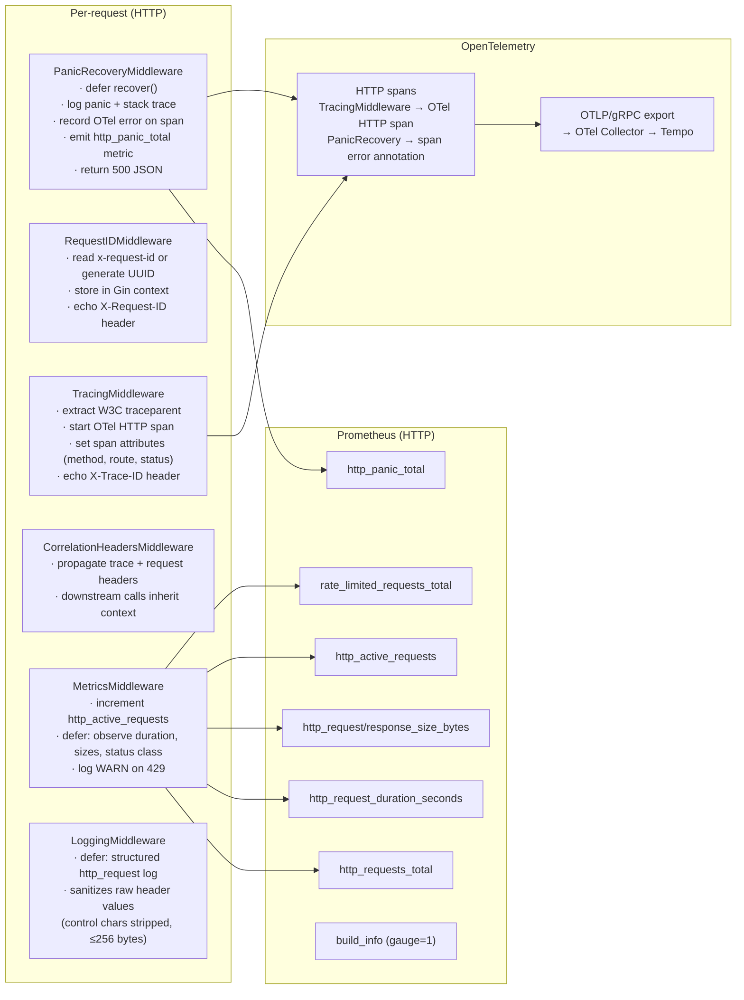

---

## Consuming service wiring

A typical service bootstrap combines the public API packages with the adapter implementations.

> Source: [`docs/architecture/mermaid/consuming-service-wiring.mmd`](docs/architecture/mermaid/consuming-service-wiring.mmd)

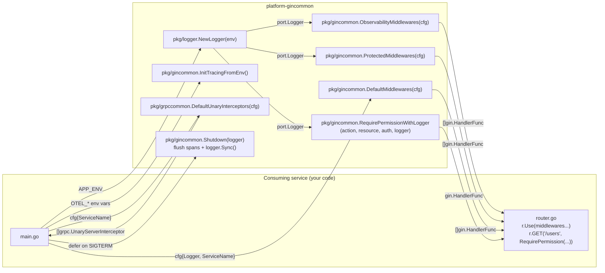

**Consumer setup** (in the consuming service's `go.mod`):

```
# requires GOPRIVATE=github.com/BCBP-SOLUTIONS-FZC-LLC/* in the consumer's environment
require github.com/BCBP-SOLUTIONS-FZC-LLC/platform-gincommon v1.x.x
```

**Minimal wiring example:**

```go
// main.go
import (
    "github.com/BCBP-SOLUTIONS-FZC-LLC/platform-gincommon/pkg/gincommon"
    "github.com/BCBP-SOLUTIONS-FZC-LLC/platform-gincommon/pkg/logger"
)

log, _ := logger.NewLogger(os.Getenv("APP_ENV"))
defer gincommon.InitTracingFromEnv()()

cfg := gincommon.Config{
    Logger:      log,
    ServiceName: "my-service",
}

r := gin.New()
r.Use(gincommon.DefaultMiddlewares(cfg)...)

// per-route RBAC
auth := gincommon.NewDemoRBAC()
r.DELETE("/users/:id", gincommon.RequirePermissionWithLogger("delete", "users", auth, log))

// graceful shutdown (after srv.Shutdown returns)
defer gincommon.Shutdown(log)
```

---

## Documentation assets

Every public package ships a `doc.go` package overview. Architecture diagrams live as standalone Mermaid source files under `docs/architecture/mermaid/` and are embedded into this document as fenced code blocks. Each section carries a `> Source:` link to the originating `.mmd` file.

> Source: [`docs/architecture/mermaid/documentation-assets.mmd`](docs/architecture/mermaid/documentation-assets.mmd)

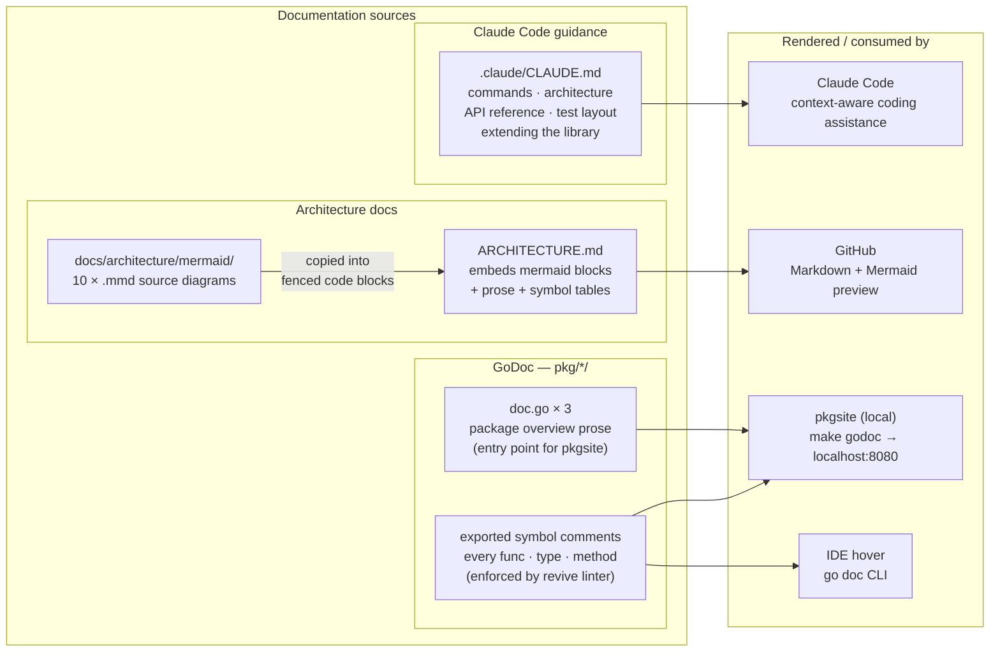

Run `make godoc` to render the full package documentation locally using `pkgsite`:

```
make godoc   # → http://localhost:8080
```

---

## Execution model

Understanding how middleware executes explains why observability signals are always accurate and why deferred operations are safe.

**HTTP (`c.Next()` nested call stack):**

```
PanicRecovery.defer ─────────────────────────────────────────────────── (8) recover on panic
  RequestID                                                               (1) set request ID
    Tracing.defer ───────────────────────────────────────────────────── (7) finalise span attributes
      CorrelationHeaders.defer ───────────────────────────────────────── (6) write response headers
        Metrics.defer ───────────────────────────────────────────────── (5) observe duration + sizes
          Logging.defer ───────────────────────────────────────────────  (4) write http_request log
            RequireAuth                                                   (2) validate identity headers
              ContextMiddleware                                           (3) build RequestContext
                Handler ← executes here
```

- Steps 1–3 execute **before** the handler, in order.
- Steps 4–8 (deferred) execute **after** the handler returns, in **reverse** order — innermost defer first, outermost last.
- Duration, status code, and response size observed by Metrics (5) and Logging (4) are captured after the handler writes its response, ensuring accurate values.
- Panic recovery (8) is the outermost defer, so it catches panics from all middleware and the handler.

**gRPC (`grpc.ChainUnaryInterceptor` nested interceptor chain):**

```
PanicRecovery ── RequestID ── Tracing ── Metrics ── Logging ── RequireAuth ── Context ── Handler
                                                                                              ↑
                              ← pre-handler (left to right) ─────────────────────────────────┘
                              ─ post-handler (right to left, after handler returns) ──────────
```

- Interceptors that record after the handler (`defer span.End()`, `logGRPCRequest`, metric observation) all execute in reverse order after the handler returns — same pattern as HTTP deferred middleware.
- All observability signals (logs, metrics, spans) are emitted **after** the handler completes, except panic handling which fires immediately on recovery.

This model ensures accurate duration measurement and full visibility into handler execution regardless of whether the handler succeeds, returns an error, or panics.

---

## Failure domains

This library isolates failures in each observability component to prevent cascading impact on request handling:

| Component | Failure mode | Impact | Fallback |
|-----------|-------------|--------|----------|
| **Prometheus metrics** | Nil collector (metrics not initialised) | None — all recording paths (including the inner panic-recovery defer) guard against nil | Silently skipped; request proceeds normally |
| **OTLP tracing export** | Collector unreachable at startup | None — dial failure is non-fatal | Falls back to in-process-only `TracerProvider`; spans get valid trace IDs but are not exported |
| **Structured logging** | Nil logger passed to middleware | None — all middleware checks for nil before calling logger | `LoggingMiddleware(nil)` is a complete no-op; `PanicRecoveryMiddleware(nil)` degrades to `log.Printf` on stderr |
| **RBAC / AuthZ** | Authorizer returns error | Handler receives `403 Forbidden` or `500 Internal Server Error` | Does not affect other middleware or routes |
| **Panic in handler** | Any unrecovered panic | `PanicRecoveryMiddleware` intercepts, logs, records metric, and returns `500 JSON` | Does not crash the server; does not affect other in-flight requests |
| **Context timeout** | Deadline exceeded | Downstream context-aware calls fail with `context.DeadlineExceeded` | Handler can detect and return an appropriate error; server continues serving other requests |

**No external dependency** — OTLP collector, Prometheus scrape endpoint, or logger sink — can cause request handling to fail. All external I/O paths are either in-process (metrics counters), async (OTLP batched export), or nil-safe-degrading (logger).

---

## Platform contract

Services that import this library must uphold the following contract. Violating these guarantees will result in broken tracing, inconsistent metrics, or incorrect identity propagation.

| Requirement | Why it matters |
|-------------|---------------|
| **Requests always enter through a trusted API gateway** | `RequireAuth` validates header format but does not verify authenticity. A direct client bypass silently grants arbitrary identity. |
| **All outbound HTTP calls use `PropagateHeaders`** | Without propagating `traceparent` and `x-request-id`, the distributed trace is broken at the call boundary and cross-service log correlation is impossible. |
| **`ServiceName` is globally unique per service** | Used as a Prometheus const label (`service=...`) and OTel `service.name`. Duplicate names merge metrics from two services into one time series — impossible to alert on or separate. |
| **`BUILD_VERSION` is set in production builds** | Recorded in `build_info{version=...}`. Without it, all releases appear as `unknown` — canary deployments and rollback tracking by version are invisible. |
| **`HealthHandler` is registered before `ProtectedMiddlewares`** | Load balancers and k8s liveness/readiness probes do not send identity headers. A protected health route causes 401 on every probe, triggering pod restarts. |
| **`RequirePermission` is registered after `ProtectedMiddlewares`** | `AuthZMiddleware` reads `RequestContext` from the Gin/Go context. Registering it before `ContextMiddleware` runs returns `500 Internal Server Error` instead of `403 Forbidden`. |

---

## Key invariants

| Invariant | Where enforced |
|-----------|---------------|
| Empty `ServiceName` → immediate panic | `ObservabilityMiddlewares` panics before any middleware is built — prevents invalid Prometheus label cardinality |
| Unregistered routes use `"unknown"` label | `HTTPRoute` returns the `Unknown` constant when `c.FullPath()` is empty — never the raw URL path, which would create unbounded Prometheus cardinality from scanner probes and path-parameter abuse |
| Idempotent Prometheus registration | `metrics.Init` is guarded by `sync.Once`; use `metrics.InitWithRegisterer` for isolated test registries; `InitWithRegisterer` is protected by an internal mutex against concurrent calls |
| Tracing idempotency | `EnsureInitTelemetry` checks for an existing SDK `TracerProvider` before installing a new one; prevents duplicate providers when called multiple times |
| OTLP export fallback | If the OTLP exporter dial fails, `initTracing` falls back to an in-process-only `TracerProvider` so spans still get valid trace IDs |
| Correct OTel RPC attributes on gRPC spans | `splitFullMethod` strips all leading slashes then uses `strings.LastIndex` to split into `rpc.service` and `rpc.method`; bare method names (no slash) return `("", method)` so `rpc.method` is always correct; empty or slash-only input returns `("", "unknown")` so `rpc.method` is never an empty Prometheus label |
| Panic-safe responses | `PanicRecoveryMiddleware` only writes a 500 response if `!c.IsAborted()` — avoids writing a second response body when a downstream handler already started writing |
| Panics counted in all HTTP metrics and logs | `MetricsMiddleware` and `LoggingMiddleware` both use `panicked`-sentinel defers — panicking requests increment `http_requests_total` (as 5xx) and emit an `http_request` log entry. `MetricsMiddleware` overrides code to 500 only when `panicked == true`; deliberate `c.Abort()` is recorded accurately |
| gRPC repeated-role metadata handled | `injectRequestContext` uses `strings.Join(md.Get(MetaTenantRoles), ",")` before calling `domain.ParseRoles` — gRPC gateways that send roles as repeated metadata entries (e.g. two separate `x-tenant-roles` headers) have all entries merged and validated, matching HTTP gateway behaviour |
| Tracing `code == 0` guard is load-bearing | In `TracingMiddleware`, `finalCode` is 0 during panic unwind (PanicRecovery hasn't fired yet). The `if code == 0` guard is marked with an explanatory comment — removing it would cause all panicking requests to produce spans with `http.response_status_code=0`, breaking 5xx trace-based alerting |
| `pkg/gincommon.RequestContext` typed-nil safe | Returns `(nil, false)` for both absent and typed-nil `*RequestContext` values — matches the same guard in `domain.RequestContextFromGoContext` |
| gRPC auth error precision | `checkRequiredMeta` distinguishes absent metadata (`"missing x-user-id"`) from blank/whitespace-only values (`"blank x-user-id"`) so engineers can distinguish gateway omission from gateway misconfiguration |
| gRPC role validation parity | `parseGRPCRoles` replaced by `domain.ParseRoles` — gRPC path now applies the same `[a-zA-Z0-9_-]+` regex, `MaxRoleLen` cap, and deduplication as the HTTP path |
| gRPC missing-metadata status code | `injectRequestContext` returns `codes.Unauthenticated` (not `codes.Internal`) when metadata is absent — client-side misconfiguration is not a server fault; `BuildContext` sentinel errors map to fixed messages with no internal detail leakage |
| `ZapLogger.Fatal` removed | `Fatal` is absent from both `port.Logger` and the `ZapLogger` concrete type — no code path in the library can call `os.Exit(1)` through a logger, preserving deferred OTel flush and graceful shutdown |
| Log injection prevention | `LoggingMiddleware` runs raw header values through `LogSanitizer` (control chars stripped, truncated to ≤256 bytes at a UTF-8 rune boundary) before emitting structured log fields |
| Auth before context | `RequireAuth` runs before `ContextMiddleware`; `AuthZMiddleware` requires `ContextMiddleware` to have run — the order within `DefaultMiddlewares` enforces this |
| Gateway trust boundary | `RequireAuth` validates format of `x-user-id` and `x-tenant-id` but does not cryptographically verify identity — the consuming service is responsible for ensuring requests cannot bypass the API gateway |
| Nil-safe logger | Every middleware that accepts a `port.Logger` checks for `nil` before calling it — missing logger never panics; `LoggingMiddleware(nil)` is a complete no-op; `PanicRecoveryMiddleware(nil)` degrades to `log.Printf`; `Fatal` is excluded from the interface (belongs in `main()`, not middleware) |
| Nil-safe metrics | `RecordHTTPRateLimited` and all `MetricsMiddleware` recording paths guard against nil collectors — services that skip `metrics.Init` do not panic |
| `RequestContextFromGoContext` typed-nil safe | Returns `(nil, false)` for both absent and typed-nil pointer values — callers that check only `ok` before dereferencing cannot panic |
| `clientIPFromContext` nil-Addr safe | gRPC context interceptor guards `p.Addr != nil` before calling `p.Addr.String()` — custom transports and `bufconn` that leave `Addr` unset do not panic |
| gRPC logging fires on panic | `UnaryLoggingInterceptor` and `StreamLoggingInterceptor` use named returns + `defer` + panic sentinel so panicking handlers always emit a `grpc_request` log entry (as `codes.Internal`) |
| gRPC metrics counted on panic | `UnaryMetricsInterceptor` and `StreamMetricsInterceptor` use `panicked`-sentinel defers — panicking handlers are recorded in `grpc_server_handled_total` (as `codes.Internal`) and `grpc_server_handling_seconds`, and increment `grpc_panic_total` |
| gRPC spans record real panic value | `UnaryTracingInterceptor` and `StreamTracingInterceptor` use an inner `defer recover()+re-panic` to capture the actual panic value into `span.RecordError(fmt.Errorf("%v", panicValue))` before re-panicking so `UnaryPanicRecoveryInterceptor` still converts it to `codes.Internal` |
| gRPC spans marked Error for all server errors | `UnaryTracingInterceptor` and `StreamTracingInterceptor` call `span.SetStatus(otelcodes.Error, err.Error())` for any non-nil handler error (not only panics) — per OTel spec `RecordError` alone does not change span status, so the explicit call is required for trace-based 5xx alerting |
| gRPC `TraceID` populated in `RequestContext` | `injectRequestContext` reads the active OTel span via `trace.SpanFromContext(ctx).SpanContext()` after `UnaryTracingInterceptor` runs; `rc.TraceID` is the 32-hex trace ID when the span context is valid, empty string otherwise |
| gRPC `isClientError` matches Prometheus classification | `isClientError` in logging includes `codes.DeadlineExceeded`, matching `GRPCStatusClass`/`GRPCRequestOutcome` — timed-out RPCs log at `Warn` level and are counted as client errors in metrics |
| `duration_ms` is true float64 milliseconds | Both `LoggingMiddleware` and `logGRPCRequest` compute `duration_ms` as `float64(elapsed.Nanoseconds()) / 1e6` (not `float64(elapsed.Milliseconds())`), preserving sub-millisecond precision. `PanicRecoveryMiddleware` uses the same key and formula for a consistent log schema across panic and normal request entries |
| Log injection prevention (panic path) | `PanicRecoveryMiddleware` applies `sanitizeLogValue` to `c.Request.URL.Path` before logging — raw URL paths containing embedded newlines cannot inject forged log lines. `UnaryPanicRecoveryInterceptor` and `StreamPanicRecoveryInterceptor` pass all log fields through `service.Sanitize` before logging, matching HTTP recovery's redaction guarantees |
| Log sanitizer covers `key` suffix patterns without false positives | `isSensitiveLogKey` matches `k == "key"` or `strings.HasSuffix(k, "_key")` — covers `signing_key`, `enc_key`, `hmac_key` without false-positive redaction of `monkey`, `hockey`, or `key_metrics` |
| gRPC `RequirePermission` misconfiguration returns `FailedPrecondition` | `authorizeGRPC` returns `codes.FailedPrecondition "request context missing — ensure ProtectedUnaryInterceptors ran before RequirePermission"` when no `RequestContext` is in the Go context — a diagnosable chain misconfiguration error, not a misleading `codes.Internal` |
| `ProtoMessageSize` typed-nil safe | Uses `reflect.ValueOf(m).Kind() == reflect.Pointer && rv.IsNil()` guard — a `(*pb.Response)(nil)` passed as `any` has a non-nil interface but nil concrete pointer; without this guard `proto.Size` would panic |
| OTel spans flushed on all demo-server exit paths | `cmd/server/main.go` calls `shutdownTracing()` explicitly before every `os.Exit(1)` (listen error, shutdown timeout, normal exit) — `os.Exit` bypasses `defer`, so the flush must be explicit rather than deferred |
| Production-safe OTel sampling default | `AppEnv()` returns `""` (not `"dev"`) when `APP_ENV` is unset, so `OtelTraceSampleRatio` defaults to `0.1` in production deployments that omit the env var |
| gRPC `ServiceName` panic guard | `ObservabilityUnaryInterceptors`, `ObservabilityStreamInterceptors`, and all `Full*` constructors panic on empty `ServiceName` — same guarantee as the HTTP stack |
| gRPC auth ordering | `ProtectedUnaryInterceptors` / `ProtectedStreamInterceptors` always place `RequireAuth` before `ContextInterceptor`; `AuthZInterceptor` requires `ContextInterceptor` to have run |
| `ClientIP` in `RequestContext` | HTTP: set from `c.ClientIP()` (Gin respects `TrustedProxies`). gRPC: set from `peer.FromContext` if `Addr` is non-nil; empty string otherwise |
| `TimeoutMiddleware` is a no-op for zero/negative durations | Insert unconditionally and set `timeout=0` to disable without restructuring the router |
