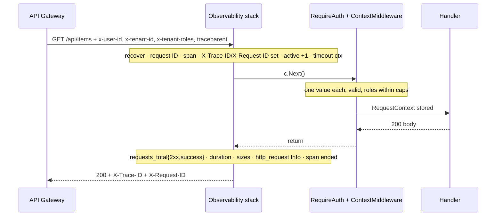
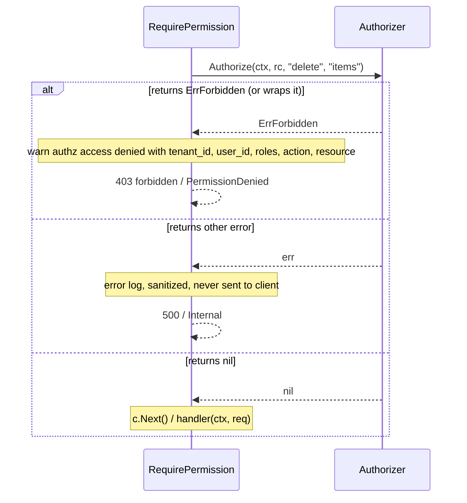
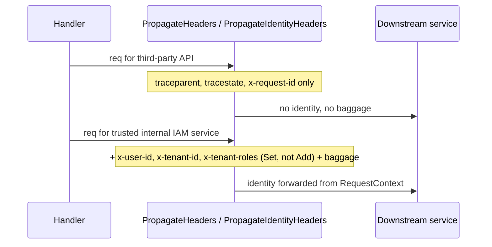
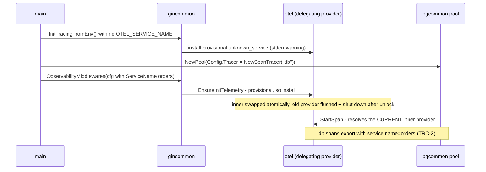
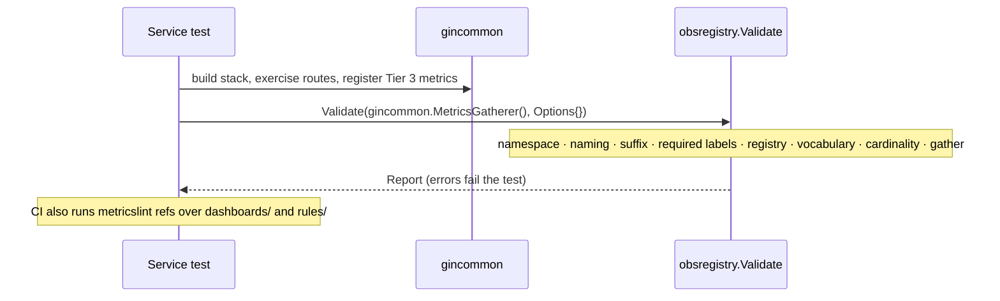

# platform-gincommon — Low-Level Design

## Tender Management SaaS Platform — Shared Platform Libraries

| Field | Value |
|---|---|
| Document type | Low-Level Design (LLD) |
| Component | `platform-gincommon` (shared Gin HTTP + gRPC transport and observability library) |
| Go module | `github.com/BCBP-SOLUTIONS-FZC-LLC/platform-gincommon/v2` (`go 1.26.0`, `toolchain go1.26.9`) |
| Status | `v2.0.0` released 2026-10-16: RFC 9457 Problem Details error contract, `/v2` module path |
| Previous release | `v1.6.0` (2026-10-03). The 11 IAM services pin `v1.6.0` (10) and `v1.5.0` (`iam-org-membership`); none is on `/v2` yet (§18.1) |
| Governing standard | Enterprise Platform Observability Standard ([`docs/observability/README.md`](../observability/README.md)) |
| Base HLD | IAM HLD — shared library dependencies (§15.4), Clean Architecture layout (§15.3) |
| Sibling designs | `platform-events` (outbox, SNS/SQS, messaging metrics), `platform-pgcommon` (pgx pool, RLS GUC, DB metrics), `platform-schemagov` (event schema governance), `platform-fastapicommon` (Python port, vendors the registry) |
| Companion documents | [`ARCHITECTURE.md`](../../ARCHITECTURE.md) (diagrams, invariants), [`README.md`](../../README.md) (integration guide), [`VERSIONING.md`](../../VERSIONING.md), [`CHANGELOG.md`](../../CHANGELOG.md) |
| Deployment stage | Library — **never deployed**. Consumed via `go get`; the demo image is a CI smoke target only (see §13) |

### Revision history

| Rev | Date | Change |
|---|---|---|
| 1.8 | 2026-10-16 | **OQ-24 resolved.** Unclassified 500s (`problem.Error.Unclassified()`) emit an error-level `unclassified error` entry with route, operation and error-chain types, never the error text (§7.3, P-6). |
| 1.7 | 2026-10-16 | **Alignment with v2.0.0 and current status.** Package layout, dependency rules, symbol catalogue (`pkg/problem`, P-*), status map, log catalogue (`problem response`), §8.3 and §17.1 rewritten for RFC 9457 problems. New tests (§14): error contract, uninitialised-metrics pass-through, stream-timeout client cancel, custom validator, authz error logging; coverage 99.6%. Security: `go1.26.9`, `golang.org/x/net` v0.60.0 (§3.1). §18.1 consumer pins and v2 migration status; §19.2 v1.x → v2.0.0. OQ-8 resolved; OQ-24 (cause logging for unclassified 500s) added. |
| 1.6 | 2026-10-16 | **RFC 9457 Problem Details (v2.0.0).** Every HTTP error is `application/problem+json` (§4.3). New `pkg/problem` (stdlib-only model, type registry, builder, error types, trace-id resolution, client decoder, OpenAPI components). The global error handler `ProblemMiddleware` is the innermost `ObservabilityMiddlewares` handler. `gincommon.ErrorResponse` was removed. The module path is now `/v2`. Full contract: `docs/problem-details/`. |
| 1.5 | 2026-10-02 | **LLD-vs-code verification.** Three independent claim-by-claim checks against the code. ~45 document corrections (log field names, sanitisation scope, context-error statuses, gRPC check order, catalogue gaps, release/CI details, consumer usage). Six code gaps found; five fixed: gRPC authz logs carry `tenant_id`; `PropagateIdentityHeaders` removes a stale `x-tenant-roles`; gRPC span panic values are sanitized; every HTTP 500 body is `internal server error`; an empty `RegisterKnownMethods` no longer maps every method to `unknown`. The sixth (OTel error-logger downgrade) is recorded as OQ-22. New open items OQ-18–23, including OQ-18: all 11 services register `TimeoutMiddleware` outermost. |
| 1.4 | 2026-10-02 | **Production-readiness review 3 fixes.** Panic after a partial write now aborts the connection (bare `http.ErrAbortHandler`), so the client never sees a complete 200 (§8.6). A wrapped `ErrAbortHandler` is re-panicked as the bare sentinel, because net/http compares by identity. An established `unknown` build version is upgraded by a later real version, so startup no longer depends on whether HTTP or gRPC is built first (§6.2). Tracing `Shutdown` keeps the delegating provider installed (§6.3). The gRPC alias is renamed `RequestContextData` to match gincommon (§5.3). gRPC timeout interceptors are documented and tested as **innermost** (§8.8). |
| 1.3 | 2026-10-01 | **Production-readiness review 2 fixes.** `pkg/` aliases so consumers can implement `Authorizer` without `internal/` (§5.3). Exact-match gRPC health exemption, which closed a prefix-match auth bypass (§10.1, SEC-6). `ErrAbortHandler` became a 499 client abort in every layer. HTTP rejects repeated identity headers, matching gRPC. The delegating global `TracerProvider` replaced global swaps (§6.3). The stream timeout runs the handler in a goroutine. `BUILD_VERSION` is sanitised instead of rejected. Canonical `CANCELLED` status name. `metricslint refs` returns exit 2 on I/O errors, with a 64 MiB per-file cap. Rate-limited `/metrics` error log + `promhttp_metric_handler_errors_total`. |
| 1.2 | 2026-10-01 | **Production-readiness review 1 fixes.** `X-Trace-ID` is set before `c.Next()`. The timeout fires only on `DeadlineExceeded` and sits innermost via `Config.RequestTimeout`. `PropagateHeaders` is split from opt-in `PropagateIdentityHeaders`. `x-tenant-roles` is capped at 4096 bytes / 64 roles. Recovery never appends to a written body. 429 warn logs are sampled. The access log separates verified and claimed identity. 401 audit logging. gRPC: logging wraps auth, context errors are classified, `grpc_method` is bounded with `RegisterKnownMethods`, client interceptors, repeated identity rejected, request ID echoed, status-code span attributes, timeout + health helpers. Metrics: identity mismatch error, transactional retryable init, atomic collector set, `ContinueOnError`. Tracing: no library default service name, resource environment/domain, `ParentBased` always, remote-parent re-sampling, OTLP failure warnings. Zap sampling off by default, `LOG_LEVEL`. `Authorizer` takes `(ctx, *RequestContext, action, resource)`. CI: SHA-pinned actions, golangci v2, release tag must be on `main`. |
| 1.1 | 2026-10-01 | **Enterprise Platform Observability Standard.** Central registry (`registry.json`) importing platform-events and platform-pgcommon verbatim; `platform_*` collectors built from it; `Config.Domain` required; pre-standard `http_*`/`grpc_*`/`build_info` names removed with no compatibility period; `pkg/obsregistry` + `cmd/metricslint`; reference recording rules and SLO alerts; CI/CD rebuilt on the IAM pipeline model. |
| 1.0 | 2026-08-18 | `v1.3.0` baseline — HTTP + gRPC middleware stacks, demo RBAC, OTel setup, Prometheus metrics (pre-standard names). |

> **Scope note.** This LLD specifies what `v2.0.0` *is*, as verified against the code. Where this document and the code disagree, the code (and its tests) win, and this document is wrong. File an update. Where this document and the observability standard disagree on a metric contract, the registry wins (§7.4).

### Table of Contents

1. [Document Overview](#1-document-overview)
2. [Library Responsibilities and Boundaries](#2-library-responsibilities-and-boundaries)
3. [Architecture and Package Layout](#3-architecture-and-package-layout)
4. [Domain Model and Contracts](#4-domain-model-and-contracts)
5. [Public API Contract](#5-public-api-contract)
6. [Process State and Initialisation](#6-process-state-and-initialisation)
7. [Telemetry Architecture](#7-telemetry-architecture)
8. [Key Request Flows](#8-key-request-flows)
9. [Concurrency, Consistency, and Failure Handling](#9-concurrency-consistency-and-failure-handling)
10. [Security](#10-security)
11. [Observability](#11-observability)
12. [Configuration](#12-configuration)
13. [Release and Distribution](#13-release-and-distribution)
14. [Testing Strategy](#14-testing-strategy)
15. [Privacy and Data Handling](#15-privacy-and-data-handling)
16. [Open Questions and Sign-off Register](#16-open-questions-and-sign-off-register)
17. [Appendix — Error Taxonomy](#17-appendix--error-taxonomy)
18. [Integration Details](#18-integration-details)
19. [Migration Strategy](#19-migration-strategy)
20. [Operational Considerations](#20-operational-considerations)
21. [Performance Considerations](#21-performance-considerations)

---

## 1. Document Overview

This document is the low-level design for **`platform-gincommon`**, the shared Go library that every IAM Go service uses as its transport and observability layer. It owns four things:

1. **The request pipeline.** The ordered HTTP middleware stack and gRPC interceptor chain: panic recovery, request correlation, tracing, metrics, access logging, timeouts, gateway-identity validation, request-context construction, and per-route/per-RPC authorization.
2. **The trust-boundary contract.** How gateway-injected identity (`x-user-id`, `x-tenant-id`, `x-tenant-roles`) is validated, bounded, exposed to handlers as `RequestContext`, propagated to downstream services, and kept separate from unverified client input in logs.
3. **The telemetry contract for Go services.** `platform_*` metrics with centrally injected identity labels, OpenTelemetry tracing with one delegating global provider, and a structured log schema.
4. **The Enterprise Platform Observability Standard's enforcement for Go.** The central metric registry, collectors built from it, Tier 3 validation, and `metricslint`, which every service runs in CI.

It refines the IAM HLD's shared-library requirements into an implementable spec: exact public signatures, validation rules and limits, initialisation algorithms, error codes and messages, flows, invariants, and test obligations. Consuming-service integration is in [README.md](../../README.md); diagrams and the invariant catalogue are in [ARCHITECTURE.md](../../ARCHITECTURE.md). This document is the contract both are derived from.

**The code is at this state.** Every behaviour below is implemented on branch `feat/observability-api` and covered by tests under `test/`. Section §14.5 lists the canonical tests that pin the load-bearing invariants.

### 1.1 Relationship to the HLD and the observability standard

| Source section | What it specifies | Where this LLD refines it |
|---|---|---|
| IAM HLD §15.4 | Shared libraries every service depends on (gincommon, events, pgcommon) | §2, §3.1, §18 |
| IAM HLD §15.3 | Clean Architecture repository layout | §3, §3.2 |
| IAM HLD — gateway trust model | Gateway authenticates and injects identity headers; services trust the mesh | §4.1, §10.1, §10.4 |
| Observability Standard — three-tier naming | `platform_*` / `<domain>_*` / `<domain>_<service>_*` | §7.1, §7.4 |
| Observability Standard — identity labels | `{domain, service, environment}` injected centrally; `version` only on build info | §6.2, §7.1 |
| Observability Standard — label governance | Vocabularies, prohibited labels, cardinality bounds | §4.4, §7.4, §10.3 |
| platform-events / platform-pgcommon released registries | Messaging and DB metric contracts | §7.4 (imported verbatim; their contract wins on conflict) |

**Relationship to sibling designs.**

| Source | Role relative to this document |
|---|---|
| `platform-events` | Emits `platform_messages_*` / `platform_dlq_*` itself, with its own identity injection. Its registry is imported verbatim. Do **not** wrap it in `LabeledRegisterer` |
| `platform-pgcommon` | Emits DB pool/query metrics. Its registry is imported verbatim. Consumes `gincommon.NewSpanTracer` as `Config.Tracer` |
| `platform-schemagov` | Governs *event* schemas (AsyncAPI/Glue). Separate from the *metric* registry governed here |
| `platform-fastapicommon` | Python port of this library; vendors a copy of `registry.json` |

---

## 2. Library Responsibilities and Boundaries

### 2.1 In scope

| Concern | Mechanism |
|---|---|
| Panic recovery | Outermost HTTP middleware / gRPC interceptor; JSON 500 / `codes.Internal`; `http.ErrAbortHandler` as a client abort |
| Request correlation | `x-request-id` validation/generation, `X-Request-ID` / gRPC response header |
| Distributed tracing | Server spans, W3C propagation, a delegating global `TracerProvider`, OTLP/gRPC export, `ParentBased` sampling |
| Metrics | `platform_http_*`, `platform_grpc_*`, `platform_build_info` built from the registry; identity labels injected centrally |
| Access logging | `http_request` / `grpc_request` structured entries; sanitisation; verified vs claimed identity |
| Timeouts | HTTP `Config.RequestTimeout` / `TimeoutMiddleware`; gRPC unary + stream timeout interceptors |
| Gateway identity | Validation, ambiguity rejection, role parsing and caps, `RequestContext` construction, 401 audit logging |
| Authorization hook | `RequirePermission*` delegating to a consumer `Authorizer`; reference `NewDemoRBAC` |
| Outbound propagation | `PropagateHeaders`, opt-in `PropagateIdentityHeaders`, gRPC client interceptors, `InjectTraceContext` |
| Metric governance | `registry.json`, `pkg/obsregistry`, `cmd/metricslint`, Tier 3 construction-time validation |
| Health | `HealthHandler` (HTTP); `RegisterHealth` (gRPC) with exact-match auth exemption |

### 2.2 Out of scope (owned elsewhere)

| Concern | Owner |
|---|---|
| Authentication (JWT, OAuth, API keys, MFA) | API gateway / Keycloak |
| Cryptographic identity verification | Not performed. Network-layer trust (mesh mTLS, NetworkPolicy) |
| Business authorization policy | Each service's `Authorizer` (IAM / OPA) |
| Database access, pooling, RLS GUC injection, migrations | `platform-pgcommon` |
| Outbox, SNS/SQS, event schemas | `platform-events`, `platform-schemagov` |
| Messaging / DB metric emission | `platform-events`, `platform-pgcommon` (governed by this registry) |
| Rate limiting, retries, circuit breaking | Gateway / service mesh (this library only *observes* 429) |
| Request body binding, business validation, domain error mapping | Each service |
| Production telemetry backends (collector, Tempo, Prometheus, Loki, Grafana) | Platform observability infrastructure |
| Ratifying `proposed` registry entries | Observability governance (this repo records decisions) |

### 2.3 Ownership split with sibling libraries

| Shared concern | gincommon | platform-events | platform-pgcommon |
|---|---|---|---|
| Identity resolution (`domain`, `service`, `environment`) | Same precedence and value rule (explicit → `APP_ENV` → `ENVIRONMENT`; `[a-z][a-z0-9_-]{0,62}`) | Same | Same |
| Identity label injection | Its own collectors via const labels | Its own | Its own |
| Registry | **Central copy** (imports both verbatim) | Library-local Tier 1 only | Library-local Tier 1 only |
| Tracing | Installs the process's global provider | Uses the global provider | Uses `Config.Tracer` (`gincommon.NewSpanTracer`) |

---

## 3. Architecture and Package Layout

```
platform-gincommon/
├── pkg/                                   # PUBLIC API — the only import surface (SemVer-covered)
│   ├── gincommon/
│   │   ├── gincommon.go                   # Config, Observability/Protected/DefaultMiddlewares, TimeoutMiddleware
│   │   ├── observability.go               # TracingConfig, ErrServiceNameRequired, InitTracingWithConfig, InitTracing*, EnsureTracing, Shutdown, ensureInitTelemetry
│   │   ├── tracing.go                     # Tracer/Span aliases, NewTracer, NoopTracer, SpanTracer, NewSpanTracer, SpanTraceID, RecordSpanError, InjectTraceContext
│   │   ├── metrics.go / metrics_api.go    # MetricsRegisterer/ConstLabels/Handler/Gatherer, NewShared*Vec, New*Vec, LabeledRegisterer, Registerer/Gatherer/Counter*/Gauge*/HistogramVec aliases
│   │   ├── propagate.go                   # PropagateHeaders, PropagateIdentityHeaders
│   │   ├── authz.go / context.go          # RequirePermission*, RequestContext, TraceIDFromContext, RequestIDFromContext
│   │   ├── health.go / errors.go          # HealthHandler, AbortWithProblem / ClassifyError / BindingError
│   │   ├── transport.go                   # Header* constants
│   │   └── types.go                       # aliases: Authorizer, RequestContextData, Logger, DemoRBAC, ErrForbidden
│   ├── grpccommon/
│   │   ├── grpccommon.go                  # Config, Observability/Protected/Full/Default interceptors, RequirePermission*
│   │   ├── server.go                      # RegisterKnownMethods, RegisterHealth, Timeout*, *Client*Interceptor
│   │   ├── metrics.go                     # MetricsRegisterer, MetricsConstLabels
│   │   └── types.go                       # aliases: Authorizer, RequestContextData, Logger, DemoRBAC, ErrForbidden (no Tracer/metrics aliases)
│   ├── problem/problem.go                 # RFC 9457 facade over internal/problem (stdlib only), §5.3 P-*
│   ├── obsregistry/obsregistry.go         # Default, Parse, Validate, ValidateText, ServicePrefix, Severity, Rule*
│   └── logger/logger.go                   # NewLogger, Default
├── internal/
│   ├── core/
│   │   ├── domain/                        # RequestContext, transport constants, ParseRoles(Strict), NormalizeRequestID, sentinel errors
│   │   ├── port/                          # Logger, Authorizer, ContextBuilder
│   │   └── service/                       # ContextService, RBACService (demo), LogSanitizer
│   ├── adapter/
│   │   ├── inbound/
│   │   │   ├── http/middleware/           # recovery, request_id, tracing, correlation(_headers), metrics, log_limiter,
│   │   │   │                              #   logging, timeout, auth, identity, context, authz, keys,
│   │   │                              #   problem (ProblemMiddleware, WriteProblem, ClassifyError), binding (BindingError)
│   │   │   ├── grpc/middleware/           # recovery, request_id, tracing, metrics, logging, auth, context, authz,
│   │   │   │                              #   timeout, client, status, stream, keys
│   │   │   └── label/                     # HTTPRoute, GRPCMethod, RegisterGRPCMethods
│   │   └── outbound/
│   │       ├── metrics/                   # metrics.go (init), record.go, outcome.go, buckets.go, message_size.go, errorlog.go
│   │       ├── otel/                      # provider.go (delegating), setup.go, env.go, telemetry_config.go
│   │       └── logger/                    # zap.go (adapter), fields_pool.go
│   ├── problem/                           # problem.go, types.go (registry), errors.go (FromError), builder.go, trace.go, client.go, openapi.go + openapi.yaml
│   ├── obsregistry/                       # registry.json, registry.go, validate.go, refs.go, openmetrics.go, inventory.go, cli.go
│   ├── config/env.go                      # env loading + normalisation
│   └── server/                            # demo router
├── cmd/
│   ├── server/                            # demo binary (reference only)
│   └── metricslint/                       # CLI over internal/obsregistry
├── docs/{observability,architecture,lld}/
├── docker/                                # local collector/Tempo/Prometheus(+rules)/Loki/Promtail/Grafana config
└── test/{unit,integration,e2e,smoke,fixtures,testenv}/
```

### 3.1 Library dependencies (direct)

```
require (
    github.com/gin-gonic/gin                                            v1.12.0
    github.com/go-playground/validator/v10                              v10.30.2 // validationErrors mapping (Gin's validator)
    github.com/google/uuid                                              v1.6.0
    github.com/joho/godotenv                                            v1.5.1   // demo + tests only
    github.com/prometheus/client_golang                                 v1.24.1
    github.com/prometheus/client_model                                  v0.6.3
    github.com/prometheus/common                                        v0.72.0
    go.opentelemetry.io/otel                                            v1.46.0
    go.opentelemetry.io/otel/exporters/otlp/otlptrace/otlptracegrpc     v1.46.0
    go.opentelemetry.io/otel/sdk                                        v1.46.0
    go.opentelemetry.io/otel/trace                                      v1.46.0
    go.uber.org/zap                                                     v1.28.0
    google.golang.org/grpc                                              v1.84.0
    google.golang.org/protobuf                                          v1.36.12
    gopkg.in/yaml.v3                                                    v3.0.1   // tests only (OpenAPI schema check)
)
```

The `go 1.26.0` directive (with `toolchain go1.26.9`) keeps consumers on any Go 1.26.x; CI builds with 1.26.9 via `setup-go`'s `go-version-file`. golangci-lint is a `go tool` dependency. `golang.org/x/net` (indirect, via gRPC/OTLP) is held at v0.60.0 and the toolchain at 1.26.9 for the 2026-10 `net/http` / HTTP/2 / `crypto/tls` advisories (GO-2026-6603 … -6617); `make vuln-check` and CI's govulncheck gate on them.

### 3.2 Dependency rules

| Package | May import (module-internal) |
|---|---|
| `core/domain` | nothing |
| `core/port` | `domain` |
| `core/service` | `domain` (`RBACService` satisfies `port.Authorizer` structurally) |
| `adapter/inbound/{http,grpc}/middleware` | `label`, `adapter/outbound/metrics`, `service`, `port`, `domain`; HTTP also `internal/problem` |
| `adapter/inbound/label`, `adapter/outbound/logger`, `obsregistry`, `problem`, `config` | nothing (`problem` is standard library only) |
| `adapter/outbound/metrics` | `obsregistry`, `config` |
| `adapter/outbound/otel` | `config`, `port` |
| `pkg/gincommon` | the above + `pkg/logger`, `pkg/problem`; **never** `pkg/grpccommon` |
| `pkg/grpccommon` | the above; **never** `pkg/gincommon` |
| `pkg/obsregistry`, `cmd/metricslint` | `internal/obsregistry` only |
| `pkg/problem` | `internal/problem` only |
| `pkg/logger` | `adapter/outbound/logger`, `port` |
| `internal/server` (demo) | `pkg/gincommon`, `adapter/outbound/logger`, `config`, `port` |

Verified with `go list -f '{{.Imports}}'`. The graph is drawn in [`package-dependencies.mmd`](../architecture/mermaid/package-dependencies.mmd).

### 3.3 Integration points with sibling libraries

- **platform-pgcommon tracing.** `gincommon.NewSpanTracer(scope)` returns a `StartSpan(ctx, name) (ctx, end)` hook. It resolves the active provider on each call (delegating provider, §6.3), so a pool built before tracing is initialised still exports.
- **Third-party collectors.** `LabeledRegisterer(reg)` wraps a registerer so collectors registered through it receive `{domain, service, environment}`, resolved at registration time. platform-events and platform-pgcommon inject identity themselves and must not be wrapped.
- **Consumer CI.** `pkg/obsregistry.Validate(gincommon.MetricsGatherer(), obsregistry.Options{})` in a service test, plus `metricslint refs` over dashboards and rules.

---

## 4. Domain Model and Contracts

### 4.1 `RequestContext`

```go
// internal/core/domain — exposed as gincommon.RequestContextData / grpccommon.RequestContextData
type RequestContext struct {
    TenantID string   // x-tenant-id, trimmed, validated
    UserID   string   // x-user-id, trimmed, validated
    Roles    []string // x-tenant-roles, joined across repeats, validated, deduplicated
    TraceID  string   // 32-hex OTel trace ID of the active span, "" when invalid
    ClientIP string   // HTTP: c.ClientIP() (respects SetTrustedProxies); gRPC: peer address, "" if unset
}
```

| ID | Invariant |
|---|---|
| RC-1 | A `RequestContext` exists in a handler's context **only** after `RequireAuth` and `ContextMiddleware` (or their gRPC equivalents) both succeeded |
| RC-2 | `TenantID` and `UserID` are each non-empty, at most 256 bytes, free of control characters, and came from **exactly one** header/metadata value |
| RC-3 | Every `Roles` entry matches `[a-zA-Z0-9_-]+` and is at most 64 characters; the list is deduplicated, at most 64 entries, from a header of at most 4096 bytes |
| RC-4 | Accessors (`gincommon.RequestContext`, `grpccommon.RequestContextFromContext`, `domain.RequestContextFromGoContext`) return `(nil, false)` for an absent **or typed-nil** value. HTTP stores the context in the **Gin** context only (`c.Set`), not in `c.Request.Context()`; gRPC stores it in the Go context (§16 OQ-19) |

### 4.2 Transport constants

Only the `Header*` constants are public (`pkg/gincommon/transport.go`); the gRPC `Meta*` keys live in `internal/adapter/inbound/grpc/middleware/keys.go`.

| Constant | Header / metadata key | Direction |
|---|---|---|
| `HeaderUserID` / `MetaUserID` | `x-user-id` | inbound from gateway; outbound only via identity helpers |
| `HeaderTenantID` / `MetaTenantID` | `x-tenant-id` | same |
| `HeaderTenantRoles` / `MetaTenantRoles` | `x-tenant-roles` | same |
| `HeaderRequestID` / `MetaRequestID` | `x-request-id` | inbound (optional), echoed, propagated |
| `HeaderTraceIDResponse` | `X-Trace-ID` | response only |
| `HeaderRequestIDResponse` | `X-Request-ID` | response only |
| — | `traceparent`, `tracestate` (+ `baggage` when enabled) | inbound + propagated |

Limits (`internal/core/domain/transport.go`): `MaxHeaderValueLen = 256`, `MaxRoleLen = 64`, `MaxRequestIDLen = 128`, `MaxRolesHeaderLen = 4096`, `MaxRoles = 64`.

### 4.3 Error envelope

```json
{ "error": "forbidden", "status": 403, "trace_id": "4bf92f3577b34da6a3ce929d0e0e4736", "request_id": "b1a2c3d4-e5f6-7890-abcd-1234567890ef" }
```

Since v2.0.0: an RFC 9457 problem, `pkg/problem.Problem` (`type`, `title`, `status`, `detail`, `instance`, `traceId`, `errorCode`, `tenantId`, `timestamp`, `validationErrors`), served as `application/problem+json`. Every library-produced HTTP rejection goes through `middleware.WriteProblem`, which sets `X-Trace-ID` / `X-Request-ID` before writing. `detail` is a fixed sentence (§17), never internal error detail, and is absent on `internal-error`. Contract: `docs/problem-details/README.md`.

### 4.4 Registry document (`internal/obsregistry/registry.json`)

| Top-level key | Content |
|---|---|
| `schema_version` | `1` |
| `const_labels` | `domain`, `service`, `environment` — injected centrally, never declared by instrumentation |
| `required_labels` | per tier: `platform` → `domain, service, environment`; `domain` and `service` → `service, environment` |
| `prohibited_labels` | `user_id`, `email`, `tenant_id`, `request_id`, `event_id`, `session_id`, `trace_id`, `span_id`, `correlation_id`, `user`, `username`, `ip`, `client_ip`, `url`, `path`, `query`, `message_id`, `subject`, `actor` |
| `prohibited_label_suffixes` | `_id`, `_email`, `_ip`, `_uuid`, `_token` |
| `exempt_prefixes` | `go_`, `process_`, `promhttp_`, `python_` (runtime collectors, not validated) |
| `bucket_presets` | `request_duration`, `payload_size`, `dependency_request`, `message_processing`, `event_propagation`, `db_query`, `db_pool_acquire` (all seven) |
| `labels` | 24 label definitions: `description`, `values` or `pattern`, `max_values`, `cardinality` |
| `metrics` | 114 entries: `name`, `tier`, `domain`, `type`, `help`, `labels`, `label_values`, `buckets`, `unit`, `aggregation`, `cardinality`, `status` (`approved`/`proposed`/`deprecated`/`removed`), `owner`, `replacements`, `sunset`, `governance_notes`. Today: 5 `approved`, 52 `proposed` (44 platform + 8 domain), 57 `removed` (legacy); no entry is `deprecated` |

Key label vocabularies:

| Label | Rule |
|---|---|
| `domain` | `iam`, `workflow`, `billing`, `tender_management`, `notifications`, `documents` |
| `environment` | `local`, `dev`, `test`, `staging`, `prod` (no aliases — `production` is rejected) |
| `service` | `^[a-z][a-z0-9_-]{0,62}$` |
| `version` | `^[0-9A-Za-z][0-9A-Za-z._+-]{0,63}$`, only on build-info metrics |
| `method` | standard HTTP methods + `OTHER` |
| `route` | `^(unknown\|/[A-Za-z0-9_./:*~-]*)$`, `max_values` 1000 |
| `grpc_method` | `^(unknown\|/?[A-Za-z0-9_.]+/[A-Za-z0-9_]+)$`, `max_values` 1000 |
| `grpc_code` | the 17 gRPC code names (`OK`, `Canceled`, ..., `Unauthenticated`) |
| `status_class` | `2xx`, `4xx`, `5xx` |
| `error_class` | `success`, `client_error`, `server_error` |

`Parse` is strict: unknown fields, duplicate metric names, metrics referencing undefined labels or bucket presets, const-label misuse, and legacy-tier entries that are not `deprecated`/`removed` or lack `replacements` are all errors. The embedded document is parsed at init, and a parse failure panics (`obsregistry: embedded registry.json is invalid`), so a broken registry can never ship.

---

## 5. Public API Contract

### 5.1 Conventions

- **Import surface.** Consumers import only `pkg/gincommon`, `pkg/grpccommon`, `pkg/obsregistry`, `pkg/logger`. `internal/*`, `cmd/*` and `test/*` are outside SemVer.
- **Constructors validate eagerly.** Misconfiguration panics at construction (service startup), never per request.
- **Nil-safe dependencies.** Every `Logger` parameter may be nil (no-op, or stderr for panic recovery). Recording helpers are no-ops before metrics initialisation. A nil `Authorizer` yields `500` / `Internal`, never a nil dereference.
- **No `os.Exit`.** `Logger` has no `Fatal`; fatal decisions belong in `main()`.
- **Factories, not singletons.** Stack constructors return new slices. Process-wide effects (metrics identity, tracer provider) are idempotent for identical configuration.
- **Errors to clients are fixed strings** (§17). Detail goes to sanitized logs.

### 5.2 Ordering rules

| # | Rule | Consequence of violation |
|---|---|---|
| ORD-1 | `PanicRecovery` is outermost in every stack | (enforced by constructors) |
| ORD-2 | `HealthHandler` and `/metrics` are registered before `ProtectedMiddlewares` | probes/scrapes get `401` |
| ORD-3 | `RequirePermission*` comes after the protected chain | `500` (HTTP) / `FailedPrecondition` (gRPC). Diagnosable, never an allow |
| ORD-4 | HTTP timeout is innermost observability (`Config.RequestTimeout`, or `TimeoutMiddleware` registered after `ObservabilityMiddlewares`) | metrics/logs record 200 while the client gets 503 |
| ORD-5 | gRPC timeout interceptors are appended after `Full*` / `Observability*` | metrics/logs record the abandoned handler's result instead of `DeadlineExceeded` |
| ORD-6 | `RegisterKnownMethods(srv)` is called after every service (including `RegisterHealth`) is registered, for every server | registered methods appear as `unknown` |
| ORD-7 | Custom metric constructors run after the stack constructor | constructors return an error (metrics not initialised) |

### 5.3 Symbol catalogue

#### `pkg/gincommon`

| # | Signature | Behaviour |
|---|---|---|
| G-1 | `type Config struct{ Logger Logger; ServiceName, BuildVersion, Domain, Environment string; Tracing *TracingOptions; RequestTimeout time.Duration; ProblemTypeBase string }` | Stack configuration (§12.2) |
| G-2 | `type TracingOptions struct{ Endpoint string; Insecure *bool; SampleRatio *float64; EnableBaggage *bool; IgnoreRemoteParentSampled *bool }` | Per-field override of `OTEL_*` env (empty `Endpoint` / nil pointer = env) |
| G-3 | `func ObservabilityMiddlewares(cfg Config) []gin.HandlerFunc` | §8.1. Panics on empty `ServiceName`, invalid/conflicting identity |
| G-4 | `func ProtectedMiddlewares(cfg Config) []gin.HandlerFunc` | `[RequireAuth(cfg.Logger), ContextMiddleware(ctxSvc, cfg.Logger)]` |
| G-5 | `func DefaultMiddlewares(cfg Config) []gin.HandlerFunc` | G-3 + G-4 |
| G-6 | `func TimeoutMiddleware(timeout time.Duration) gin.HandlerFunc` | §8.7; `≤ 0` is a no-op |
| G-7 | `func HealthHandler() gin.HandlerFunc` | `200 {"status":"ok"}` |
| G-8 | `func AbortWithProblem(c *gin.Context, err error)` · `func ClassifyError(err error) *problem.Error` · `func BindingError(err error) *problem.Error` · `func ShouldBindJSON(c *gin.Context, obj any) error` · `func ShouldBind(c *gin.Context, obj any) error` | §4.3. `AbortWithProblem` writes now (only aborts if already written; nil err → 500); `ClassifyError`: `*problem.Error` as is → `validator.ValidationErrors` 400 → `ErrForbidden` 403 → `problem.FromError`; `ShouldBind*` return nil or a `BindingError` |
| G-9 | `func PropagateHeaders(c *gin.Context, req *http.Request)` | Sets `traceparent`/`tracestate` + `x-request-id`. No identity, no baggage. Nil `c`/`req` → no-op; nil `req.Header` allocated |
| G-10 | `func PropagateIdentityHeaders(c *gin.Context, req *http.Request)` | G-9 + `x-user-id`/`x-tenant-id`/`x-tenant-roles` from the `RequestContext` (set, not appended; a pre-existing `x-tenant-roles` is removed when the caller has no roles) + full propagator output (baggage) |
| G-11 | `func RequirePermission(action, resource string, auth Authorizer) gin.HandlerFunc` | §8.4, no logging |
| G-12 | `func RequirePermissionWithLogger(action, resource string, auth Authorizer, logger Logger) gin.HandlerFunc` | §8.4 with audit entries |
| G-13 | `func NewDemoRBAC() *DemoRBAC` (`NewRBAC` deprecated alias) | §10.4 |
| G-14 | `func RequestContext(c *gin.Context) (*RequestContextData, bool)` | RC-4 |
| G-15 | `func TraceIDFromContext(c *gin.Context) string` / `func RequestIDFromContext(c *gin.Context) string` | Correlation IDs |
| G-16 | `type TracingConfig struct{ ServiceName, BuildVersion, Domain, Environment string; Logger Logger; Tracing *TracingOptions }` + `func InitTracingWithConfig(cfg TracingConfig) (func(), error)` | §8.10; `ErrServiceNameRequired` on empty name |
| G-17 | `func InitTracing(service, version, endpoint string) func()` / `func EnsureTracing(service, version, endpoint string)` / `func InitTracingFromEnv() func()` | §8.10; an empty name gives a provisional `unknown_service` provider |
| G-18 | `func Shutdown(logger Logger) error` | Flush spans (5 s) + `logger.Sync()` |
| G-19 | `func NewTracer(scope string) Tracer` / `NoopTracer() Tracer` / `NewSpanTracer(scope string) *SpanTracer` | Tracers via the delegating provider |
| G-20 | `func SpanTraceID(ctx context.Context) string` / `RecordSpanError(ctx, err, description)` / `InjectTraceContext(ctx, header http.Header)` | Tracing outside handlers |
| G-21 | `func MetricsHandler() http.Handler` / `MetricsGatherer() Gatherer` / `MetricsRegisterer() Registerer` / `MetricsConstLabels() prometheus.Labels` | §7.1 |
| G-22 | `func NewSharedCounterVec(reg Registerer, name string) (*CounterVec, error)` (+ `Gauge`, `Histogram`) | Tier 1/2 from the registry entry; `nil` reg = `MetricsRegisterer()` |
| G-23 | `func NewCounterVec(reg, name, help string, labelNames ...string)`, `NewCounter`, `NewGaugeVec`, `NewGauge`, `NewHistogramVec(reg, name, help, buckets, labels...)` | Tier 3, validated by `CheckCustom` (§7.4) |
| G-24 | `func LabeledRegisterer(reg Registerer) Registerer` | §3.3 |
| G-25 | aliases `Authorizer`, `RequestContextData`, `Logger`, `DemoRBAC`, `ErrForbidden` (`types.go`), `Tracer`, `Span` (`tracing.go`), `Registerer`, `Gatherer`, `Counter(Vec)`, `Gauge(Vec)`, `HistogramVec` (`metrics_api.go`) | No `internal/` import ever needed |
| G-26 | `const RequestContextKey`; `HeaderUserID`, `HeaderTenantID`, `HeaderTenantRoles`, `HeaderRequestID`, `HeaderTraceIDResponse`, `HeaderRequestIDResponse` | Gin context key and header names |
| G-27 | `func (*SpanTracer) StartSpan(ctx context.Context, name string) (context.Context, func())` | The hook pgcommon calls |
| G-28 | `var ErrServiceNameRequired` | Returned by G-16 |
| G-29 | `NewHistogramVec(..., buckets=nil, ...)` | nil buckets default to the `request_duration` preset |

#### `pkg/problem`

Standard library only; a facade over `internal/problem`. Contract: [`docs/problem-details/`](../problem-details/README.md).

| # | Signature | Behaviour |
|---|---|---|
| P-1 | `type Problem struct{ Type, Title string; Status int; Detail, Instance, TraceID, ErrorCode, TenantID, Timestamp string; ValidationErrors []FieldError }` · `type FieldError struct{ Field, Message string }` | JSON members `type,title,status,detail,instance,traceId,errorCode,tenantId,timestamp,validationErrors`; optional ones `omitempty` |
| P-2 | `type Type struct{ Domain, Name, Title string; Status int; Code string }` · `Type.ID()` · `Type.URI(base)` · `TypeURI` · `DefaultTypeBase` | `{base}/{domain}/{name}`; zero Type → `about:blank` |
| P-3 | `TypeBadRequest` … `TypeGatewayTimeout` (15) · `PlatformTypes()` · `TypeForStatus(status)` | registry of record `docs/problem-details/registry.md` (drift-tested); a bare 400 → `bad-request`; unknown status → `about:blank` + status text |
| P-4 | `func NewType(domain, name, title string, status int, code string) (Type, error)` · `MustType` · `ErrInvalidType` | kebab slugs, 4xx/5xx, upper-snake code; `platform` domain reserved |
| P-5 | `type Error struct{ Type Type; Detail, Code string; ValidationErrors []FieldError; Err error }` · `NewError`, `NewValidationError`, `NewBadRequestError`, `NewUnauthorizedError`, `NewForbiddenError`, `NewNotFoundError`, `NewConflictError`, `NewBusinessRuleError`, `NewRateLimitError`, `NewNotImplementedError`, `NewServiceUnavailableError`, `NewInternalError` · `WithCode`/`WithCause`/`WithFields` | `Err` is the cause: `Unwrap`, logs only, never rendered |
| P-6 | `func FromError(err error) *Error` · `(*Error).Unclassified() bool` | `*Error` in chain as is; `ErrUnsupported` 501; `DeadlineExceeded` 503 `REQUEST_TIMEOUT`; `*http.MaxBytesError` 413; else 500 without detail, marked `Unclassified()` (logged as `unclassified error`, §7.3) |
| P-7 | `NewBuilder(t)` · `BuilderFor(err)` · `.TypeBase/.Detail/.ErrorCode/.Instance/.TraceID/.TenantID/.ValidationErrors/.Timestamp` · `.Build() Problem` | `internal-error` never carries a detail or validationErrors |
| P-8 | `ResolveTraceID(traceparent, requestID, spanTraceID)` · `TraceIDFromTraceparent` · `SanitizeRequestID` · `NewTraceID` | platform-pgcommon-py's order and vectors |
| P-9 | `FromResponse(*http.Response) (*Problem, error)` · `Decode(io.Reader)` · `IsProblemContentType` · `ErrNotProblem` | clients; unknown members ignored; body read capped at 1 MiB |
| P-10 | `OpenAPIComponents() []byte` · `StandardResponses() map[int]string` | shared `ProblemDetails`/`ValidationError` schemas and the 400/401/403/404/409/422/429/500 responses |

#### `pkg/grpccommon`

| # | Signature | Behaviour |
|---|---|---|
| R-1 | `type Config struct{ ServiceName, BuildVersion string; Logger Logger; Tracing *TracingOptions; Domain, Environment string }` | Same identity rules as G-1 |
| R-2 | `Observability{Unary,Stream}Interceptors(cfg)` | `[PanicRecovery, RequestID, Tracing, Metrics, Logging]` |
| R-3 | `Protected{Unary,Stream}Interceptors(cfg)` | `[RequireAuth, Context]` |
| R-4 | `Full{Unary,Stream}Interceptors(cfg)` | R-2 + R-3 (logging wraps auth) |
| R-5 | `Default{Unary,Stream}Interceptors(cfg)` | Alias of R-2 |
| R-6 | `TimeoutUnaryInterceptor(d)` / `TimeoutStreamInterceptor(d)` | §8.8; `≤ 0` is a no-op |
| R-7 | `RequirePermission(action, resource, auth)` / `RequirePermissionWithLogger(...)` / `RequireStreamPermission(...)` / `RequireStreamPermissionWithLogger(...)` | §8.4 |
| R-8 | `UnaryClientInterceptor()` / `StreamClientInterceptor()` | Outbound trace context + `x-request-id`; a caller-set request ID is kept |
| R-9 | `UnaryClientIdentityInterceptor()` / `StreamClientIdentityInterceptor()` | Opt-in identity from `RequestContext` (set, not appended); no `RequestContext` → pass-through |
| R-10 | `RegisterKnownMethods(srv ServiceInfoProvider)` | Adds `srv.GetServiceInfo()` methods to the process-wide allow-list |
| R-11 | `RegisterHealth(srv grpc.ServiceRegistrar) *health.Server` | Registers `grpc.health.v1.Health` |
| R-12 | `RequestContextFromContext(ctx) (*RequestContextData, bool)` / `RequestIDFromContext(ctx) string` | Handler accessors |
| R-13 | `Shutdown(logger)`, `MetricsRegisterer()`, `MetricsConstLabels()`, `NewDemoRBAC()` + aliases `Authorizer`, `RequestContextData`, `Logger`, `DemoRBAC`, `ErrForbidden` (no tracing or metric-type aliases) | |
| R-14 | `type TracingOptions struct{...}` (own struct, same fields as gincommon's) · `type ServiceInfoProvider interface{ GetServiceInfo() map[string]grpc.ServiceInfo }` | R-1 / R-10 parameter types |

#### `pkg/obsregistry`

| # | Signature | Behaviour |
|---|---|---|
| O-1 | `func Default() *Registry` / `func Parse(data []byte) (*Registry, error)` | Embedded registry / strict parse |
| O-2 | `func Validate(g prometheus.Gatherer, opts Options) (*Report, error)` | Validates the gathered families **even when `Gather` errors**; the error is also a `gather` finding |
| O-3 | `func ValidateText(r io.Reader, opts Options) (*Report, error)` | Text or OpenMetrics (`# EOF`) exposition |
| O-4 | `func ServicePrefix(domain, service string) string` | `<domain>_<service>_` |
| O-5 | `Options{Strict bool; AllowProposedOwners []string}` (only these two fields), `Severity`, `SeverityError`/`SeverityWarning`, `Rule*` | §17.4 |
| O-6 | types `Registry`, `Metric`, `Label`, `Report` (`Errors()`, `Warnings()`), `Finding`, `Reference`, `Status`, `Tier`; consts `Tier{Platform,Domain,Service,Legacy,Exempt}`, `Status{Approved,Proposed,Deprecated,Removed}` | Report and registry model |

#### `pkg/logger`

| # | Signature | Behaviour |
|---|---|---|
| L-1 | `func NewLogger(env string) (Logger, error)` | Console format for `dev`/`local`, JSON otherwise; `LOG_LEVEL`, `LOG_SAMPLING`, `LOG_FILE` (§12.1) |
| L-2 | `func Default() (Logger, error)` | Built once for `APP_ENV` → `ENVIRONMENT`, default production; callers handle the error |

### 5.4 Key behaviour specifications

#### 5.4.1 `ObservabilityMiddlewares(cfg)`

1. `cfg.ServiceName == ""` → `panic("gincommon.Config.ServiceName is required")`.
2. `metrics.MustInitFromConfig(Options{ServiceName, BuildVersion, Domain, Environment})` (§6.2). Any error panics.
3. Resolve telemetry: `cfg.Tracing` fields over `OTEL_*` env, plus `Domain`/`Environment` for the resource.
4. `ensureInitTelemetry` (§6.3): install a provider if none (or only a provisional one) is installed, else keep it and upgrade its error logger.
5. Return `[PanicRecovery(logger), RequestID(), Tracing(ServiceName), CorrelationHeaders(), Metrics(logger), Logging(logger)]`, plus `Timeout(RequestTimeout)` when `> 0`.

#### 5.4.2 `RequireAuth(logger)` (HTTP) / `UnaryRequireAuthInterceptor` (gRPC)

| Step | HTTP | gRPC |
|---|---|---|
| 0 | — | `FullMethod` is exactly `/grpc.health.v1.Health/{Check,Watch,List}` → pass |
| 1 | `len(Header.Values(h)) > 1` for `x-user-id` or `x-tenant-id` → `401 "ambiguous <h> header"` | no incoming metadata → `"missing metadata"` |
| 2 | value missing / blank / > 256 bytes / control chars → `401 "missing or invalid authentication headers"` | per key, `x-user-id` then `x-tenant-id`, in this order: absent → `"missing <k>"`; repeated → `"ambiguous <k> metadata"`; whitespace → `"blank <k>"`; invalid → `"invalid <k>"` (so a missing `x-user-id` is reported before an ambiguous `x-tenant-id`) |
| 3 | logger non-nil → warn `auth: request rejected` (§7.3) | rejection logged by the outer logging interceptor at Warn |

#### 5.4.3 `ContextMiddleware(ctxSvc, logger)` / `UnaryContextInterceptor`

0. gRPC only: the health methods are skipped here too.
1. Repeated identity rechecked (defence in depth).
2. All `x-tenant-roles` values are joined with `,` and passed to `domain.ParseRolesStrict`. `ErrInvalidRoles` → `401 "invalid tenant roles"` / `Unauthenticated "invalid tenant roles"`.
3. `ContextBuilder.BuildContext` → `RequestContext`. Sentinels `ErrMissingTenant`/`ErrMissingUser` → HTTP `401 "missing tenant id"` / `"missing user id"`, gRPC `Unauthenticated` with the same text. Any other error → HTTP `400 "invalid request context"` with a warn `context: request rejected` carrying the sanitized builder error; gRPC `InvalidArgument "invalid request context"`.
4. Store the context: HTTP in the Gin context only (`c.Set`), gRPC in the Go context plus the logging identity holder.

#### 5.4.4 `PanicRecoveryMiddleware(logger)`

| Recovered value | Action |
|---|---|
| `http.ErrAbortHandler` (or wraps it, `errors.Is`) | Debug `request aborted`, then `panic(http.ErrAbortHandler)` (bare sentinel) |
| anything else, response not written | Error `panic recovered` (sanitized value, stack, route, sanitized path, status 500, IDs, `duration_ms`), or `log.Printf` to stderr when logger is nil; then `500` envelope, even after a handler `c.Abort()` |
| anything else, response already written | same log; `c.Abort()`; `panic(http.ErrAbortHandler)` so the client sees truncation |

#### 5.4.5 `TimeoutMiddleware(d)`

`d ≤ 0` → pass-through. Otherwise wrap `c.Request` in `context.WithTimeout(d)` and run `c.Next()`. After it returns, if `errors.Is(ctx.Err(), context.DeadlineExceeded)` **and** nothing was written **and** the status is still the default 200: `platform_http_request_timeouts_total{method, route}` +1 and `503 "request timeout"`. The handler goroutine is never interrupted. An explicit `c.Status(200)` with no body after the deadline is indistinguishable from no response and still gets 503 (documented).

#### 5.4.6 `TimeoutStreamInterceptor(d)`

`d ≤ 0` → pass-through. A client deadline at or before `now+d` → run the handler inline with the client deadline. Otherwise wrap the stream in `timeoutStream` (capped context) and run the handler in a goroutine, then `select`:

| Event | Result |
|---|---|
| handler returns | its error; a handler panic is re-raised in the interceptor goroutine with its original value |
| parent (client) context cancelled | wait for the handler's own result |
| cap reached | set `expired` atomically; every `SendMsg`/`RecvMsg`/`SetHeader`/`SendHeader` on the wrapper returns `DeadlineExceeded` (`SetTrailer` has no return value and silently drops the trailer); return `status.Error(codes.DeadlineExceeded, "stream deadline exceeded")`. The abandoned handler's later result is discarded; a later panic is logged to stderr (`%q`, truncated) and dropped |

### 5.5 Status mapping summary

| Condition | HTTP (status · problem `type` · `errorCode`) | gRPC |
|---|---|---|
| Panic (not abort) | 500 · `platform/internal-error` · `INTERNAL_ERROR` | `Internal` |
| Client abort (`ErrAbortHandler`) | connection aborted; recorded as 499 when nothing was written, else the written status | — |
| Client cancel recorded via `c.Error(context.Canceled)` | 499, no body | — |
| Missing / invalid / ambiguous identity | 401 · `platform/unauthorized` · `UNAUTHORIZED` | `Unauthenticated` |
| Invalid roles | 401 · `platform/unauthorized` · `UNAUTHORIZED` | `Unauthenticated` |
| `BuildContext` sentinel (missing user / tenant id) | 401 · `platform/unauthorized` · `UNAUTHORIZED` | `Unauthenticated` |
| other `BuildContext` failure | 400 · `platform/bad-request` · `INVALID_REQUEST_CONTEXT` | `InvalidArgument "invalid request context"` |
| Authorizer denies (`ErrForbidden`) | 403 · `platform/forbidden` · `FORBIDDEN` | `PermissionDenied` |
| Authorizer error / nil authorizer | 500 · `platform/internal-error` (no detail) | `Internal` |
| No `RequestContext` at authz (misordered) | 500 · `platform/internal-error` (no detail) | `FailedPrecondition` |
| Timeout | 503 · `platform/service-unavailable` · `REQUEST_TIMEOUT` | `DeadlineExceeded` |
| Unregistered route / method | 404 `ROUTE_NOT_FOUND` / 405 `METHOD_NOT_ALLOWED` | — |
| Handler `c.Error(err)` | `ClassifyError(err)` (G-8, P-6) | — |

---

## 6. Process State and Initialisation

### 6.1 Process-wide state inventory

| State | Owner | Lifetime | Protection |
|---|---|---|---|
| Metrics collector set (identity + collectors) | `adapter/outbound/metrics` | first successful init → process exit | `initMu` + `atomic.Pointer[collectorSet]` |
| Global `TracerProvider` (delegating) | `adapter/outbound/otel` | installed once; never replaced | `shutdownMu`; inner provider in `atomic.Pointer` |
| OTel error-handler logger | `adapter/outbound/otel` | **set on every install** (a nil logger means stderr, so a later `InitTracing` without a logger downgrades it); a kept provider upgrades it only from nil (§16 OQ-22) | `atomic.Pointer`, written under `shutdownMu` |
| Global text-map propagator | `adapter/outbound/otel` | set on each install | OTel global |
| gRPC known-method allow-list | `adapter/inbound/label` | additive | `sync.RWMutex` |
| 429 log limiter | `http/middleware/log_limiter.go` | one per `MetricsMiddleware` instance | mutex; keyed by route template |
| `/metrics` error-log limiter | `metrics/errorlog.go`, used by `pkg/gincommon/metrics_api.go` | one package-level limiter shared by every `MetricsHandler()` | mutex; ≤ 64 keys, 5-minute interval |
| `pkg/logger.Default()` | `pkg/logger` | built once | `sync.Once` |

### 6.2 Metrics initialisation algorithm

`MustInitFromConfig(opts)` = `InitWithOptions(ApplyEnvDefaults(opts))`, panicking on error.

```
ApplyEnvDefaults:  BuildVersion ← BUILD_VERSION ← "unknown"
                   Domain       ← OBSERVABILITY_DOMAIN
                   Environment  ← APP_ENV ← ENVIRONMENT        (first non-empty raw value; a whitespace-only APP_ENV does NOT fall through)
resolve():         Domain required (ErrDomainRequired) and in the registry vocabulary
                   ServiceName matches ^[a-z][a-z0-9_-]{0,62}$
                   Environment normalised (trim + lowercase), then in {local, dev, test, staging, prod}
                   BuildVersion ← SanitizeVersion(BuildVersion)     — "" after sanitising → error
lock initMu
if published set exists:
    if AllowIdentityChangeForTesting → return nil
    mismatch(new, established):
        domain/service/environment must be equal       → else ErrIdentityMismatch("<field> ...")
        either version == "unknown"                    → compatible
        both real and different                        → ErrIdentityMismatch("version ...")
    if established.version == "unknown" and new is real → upgradeVersion (relabel platform_build_info, publish copy)
    return nil
build all collectors from registry entries (registryBuilder) with const labels {domain, service, environment}
registerAll via Register: on any failure unregister those already registered, return error (nothing published)
publish via atomic.Pointer; platform_build_info{version} = 1; refresh exported read-only vars
```

`SanitizeVersion`: strip a leading `refs/tags/` or `refs/heads/`, map characters outside `[0-9A-Za-z._+-]` to `_`, drop leading non-alphanumerics, truncate to 64. The result is idempotent and always matches the registry pattern (fuzzed with 6.2 M inputs). It warns once per original value on stderr (at most 64 warnings).

| ID | Invariant |
|---|---|
| MET-1 | One `{domain, service, environment}` identity per process across `pkg/gincommon` and `pkg/grpccommon` |
| MET-2 | `unknown` is compatible with any version, in either initialisation order |
| MET-3 | Initialisation is all-or-nothing and retryable |
| MET-4 | Recording reads one atomic pointer; before init every helper is a no-op |
| MET-5 | Constructors (`NewShared*`, `New*`) return an error before init, rather than registering label-less collectors |

### 6.3 Tracer provider lifecycle

```
install(service, version, cfg)            [under shutdownMu]
    tp ← initTracing: error handler, Resource, Sampler, exporter (or none), propagator, log effective config
    active ← generation{tp, shutdown, provisional}
    global.inner.Store(tp)                                        — atomic swap
    if otel.GetTracerProvider() is not global → otel.SetTracerProvider(global)   — exactly once
    return old generation's shutdown, run AFTER unlocking (ForceFlush + Shutdown, shared 5 s budget)

EnsureInitTelemetry(service, version, cfg)
    cur ← otel.GetTracerProvider()
    cur is global and active != nil and (not active.provisional or cfg.provisional) → keep; upgrade error logger
    cur is a consumer's own *sdktrace.TracerProvider                                → keep; upgrade error logger
    otherwise                                                                       → install

Shutdown()
    active ← nil; global.inner.Store(nil)        — global provider STAYS installed (records nothing)
    old.shutdown()

delegatingTracer.Start(ctx, name)
    tp ← global.inner.Load(); nil → noop tracer Start (keeps the parent span context)
    reuse cached SDK tracer if cached.tp == tp, else tp.Tracer(name, opts) and cache
```

| ID | Invariant |
|---|---|
| TRC-1 | The OTel global provider is set at most once and never replaced by this library |
| TRC-2 | A tracer obtained at any time (before init, under a provisional provider, after `Shutdown`) exports through whichever SDK provider is current |
| TRC-3 | A consumer-installed `*sdktrace.TracerProvider` is never replaced or shut down by `EnsureInitTelemetry` |
| TRC-4 | A provisional (`unknown_service`) provider is replaced by the first non-provisional install |
| TRC-5 | Spans in flight at a swap end on the old provider; those that end after its shutdown are dropped (documented, startup-only window) |

### 6.4 gRPC known-method allow-list

`label.GRPCMethod(full)` returns `full` only if it matches `^/[A-Za-z0-9_.]+/[A-Za-z0-9_]+$`, is at most 256 bytes, and either no method has been registered yet (pattern-only mode) or the allow-list contains `full`. An empty registration is a no-op and does not switch modes. Otherwise it returns `unknown`. `RegisterKnownMethods` adds every `/<service>/<method>` from `GetServiceInfo()`. The list is process-wide and additive. After the first registration, methods of a server that was never passed in become `unknown`.

---

## 7. Telemetry Architecture

### 7.1 Metrics

Collectors are built from registry entries (name, help, labels, buckets) by `registryBuilder` in `initCollectors`; no metric name is hard-coded outside the registry. All series carry const labels `domain`, `service`, `environment`. `MetricsHandler()` serves `MetricsRegisterer()`'s gatherer with `promhttp.ContinueOnError`, a rate-limited `ErrorLog` (via `pkg/logger.Default()`), and `HandlerOpts.Registry` so `promhttp_metric_handler_errors_total{cause}` is exposed (exempt prefix).

**Recording rules (`record.go`, `outcome.go`):**

| Input | Label value |
|---|---|
| HTTP status 100–399 | `status_class=2xx`, `error_class=success` (1xx WebSocket upgrades are not errors) |
| HTTP 400–499 | `4xx`, `client_error` |
| HTTP 500+, or 0 | `5xx`, `server_error` |
| gRPC `OK` | `2xx`, `success` |
| gRPC `Canceled`, `InvalidArgument`, `NotFound`, `AlreadyExists`, `PermissionDenied`, `Unauthenticated`, `FailedPrecondition`, `OutOfRange`, `Aborted`, `DeadlineExceeded`, `ResourceExhausted` | `4xx`, `client_error` |
| other gRPC codes | `5xx`, `server_error` |
| HTTP method not in the standard set | `OTHER` |
| unmatched Gin route | `unknown` |
| request `Content-Length: -1` | size not observed (`metrics.UnknownSize`) |
| panic | counted once in `*_panics_total` and as 5xx / `Internal` |
| `http.ErrAbortHandler` | 499 (`client_error`) or the already-written status; panic counter untouched |

Buckets: `request_duration` = `0.001 … 10` s (18 bounds); `payload_size` = `128 B … 16 MiB` (14 bounds, including the 4 MiB gRPC default maximum message size).

### 7.2 Traces

| Aspect | HTTP | gRPC |
|---|---|---|
| Span name | started as the method, renamed in `annotate()` to `<METHOD> <route>` (e.g. `GET /api/items/:id`, `HTTP unknown` for a non-standard method on an unmatched route) | bounded `grpc_method` (unknown → `rpc.method=_OTHER`) |
| Bounded attributes | `http.request.method` (`_OTHER` + `http.request.method_original` ≤ 32 bytes), `server.address` ≤ 256 bytes | `rpc.service`, `rpc.method`, `rpc.method_original` (sanitized) |
| Status | `http.response.status_code`; Error for 5xx / panic | `rpc.response.status_code` (canonical: `CANCELLED`, `DEADLINE_EXCEEDED`, ...) + legacy int `rpc.grpc.status_code`; Error for any non-nil error |
| Panic | `RecordError(sanitized value)`, status Error | real panic value (sanitized) via inner recover + re-panic |
| Raw path | `url.path` attribute (raw, truncated to 512 bytes) | — |
| Abort | `http.aborted` attribute + event; not Error; span ended before re-panic | — |
| Resource | `service.name`, `service.version`, `service.namespace` (domain), `deployment.environment.name` | same |

### 7.3 Log event catalogue

| Message | Level | Emitted by | Fields |
|---|---|---|---|
| `http_request` | Info 2xx/3xx · Warn 4xx · Error 5xx · Debug on abort | `LoggingMiddleware` | `method`, `path` (the **route template**, not the raw path), `status`, `duration_ms` (float64), `request_id`, `trace_id`, `tenant_id`/`user_id` (verified) **or** `claimed_tenant_id`/`claimed_user_id`, `aborted` |
| `grpc_request` | Info OK · Warn client codes · Error server codes | gRPC logging interceptor | `method` (bounded), `grpc_code`, `duration_ms`, `request_id`, `user_id`/`tenant_id` (verified, via holder). No `trace_id` |
| `auth: request rejected` | Warn | `RequireAuth`, `ContextMiddleware` (401) | `reason`, `method`, `route`, `status`, `client_ip`, `trace_id`, `request_id`, `claimed_user_id`, `claimed_tenant_id` |
| `context: request rejected` | Warn | `ContextMiddleware` (400) | as above + sanitized `error` |
| `authz: access denied` / `grpc authz: access denied` | Warn | AuthZ | `tenant_id`, `user_id`, `roles`, `action`, `resource` |
| `authz: internal authorization error` / `grpc authz: internal error` | Error | AuthZ | identity, `action`, `resource`, sanitized `error` |
| `authz: request context missing` / `authz: invalid request context type` | Error | HTTP AuthZ | misordered chain (ORD-3) / wrong context value type |
| `problem response` | Warn | `WriteProblem` (every HTTP problem) | `traceId`, `type`, `status`, `errorCode`, `service` (when set), `tenantId` (verified only). Never detail, instance or identity; a panicking logger is ignored |
| `unclassified error` | Error | `WriteProblem`, for an `Error.Unclassified()` 500 (a `FromError` fallback) | `classified=false`, `traceId`, `trace_id`, `request_id`, `service`, `method`, `route` (template), `operation` (Gin handler, `pkg.Func`), `status`, `errorCode`, `error_type`, `error_chain` (≤ 8 Go types along `Unwrap`). **Never the error text.** Not for deliberate `NewInternalError` or panics. Alert on it: each is a defect |
| `authz: no authorizer configured` | Error | HTTP AuthZ | `action`, `resource` |
| `panic recovered` | Error | HTTP recovery | `panic` (sanitized), `stack`, `method`, `route`, `path` (sanitized raw path), `status`, IDs, `duration_ms` |
| `grpc panic recovered` | Error | gRPC recovery | `method` (raw `FullMethod`), `panic`, `stack` only |
| `request aborted` | Debug | HTTP recovery | `method`, `route`, `path`, IDs |
| `rate limited` | Warn, ≤ 1 per route per second | `MetricsMiddleware` | `route`, `method`, `status`, `suppressed` |
| `metrics handler error` | Error, ≤ 1 per distinct error per 5 min | `MetricsHandler` | `error` |
| `otel_tracing_initialized` | Info (once per install) | otel | service, version, domain, environment, endpoint, insecure, exporter, sample_ratio, ignore_remote_parent_sampled, baggage, provisional |
| `otel_exporter_init_failed` / `otel_shutdown_flush_failed` / `otel_resource_merge_failed` / `otel_error` | Warn | otel | `error` (+ endpoint, fallback) |

Sanitisation is two separate mechanisms. `service.Sanitize(fields)` **redacts sensitive keys** (`key`, `*_key`, and names containing `password`, `secret`, `token`, `credential`, `session`, ...); it is applied to the access, auth, context, panic and gRPC request logs, but **not** to the authz audit entries or the otel `warn`/`info` logs. `sanitizeLogValue` / `SanitizeString` **strip control characters and truncate to 256 bytes** at a UTF-8 boundary; they are applied explicitly to header-derived values, paths, panic values and error strings.

### 7.4 Metric governance (registry and `metricslint`)

**Tiers.**

| Tier | Prefix | Definition | Construction |
|---|---|---|---|
| 1 | `platform_*` | registry, cross-domain | `registryBuilder` / `NewShared*Vec` |
| 2 | `<domain>_*` | registry, one domain | `NewShared*Vec` |
| 3 | `<domain>_<service>_*` | the service | `New*Vec` → `CheckCustom` |

**`CheckCustom` (Tier 3, at construction).** The name must start with `<domain>_<service>_` (once a domain is set), must not be a registry or `platform_*` name, and must not be a legacy name (the error names the replacement). The name must not use an exempt runtime prefix (`go_`, `process_`, `promhttp_`, `python_`). Counters end `_total`; Tier 3 histograms end `_seconds` (the `unit: bytes` exception exists only for registry entries, so a Tier 3 `_bytes` histogram is rejected, §16 OQ-20); gauges must not end `_total`. Labels must be snake_case and not prohibited (by name or suffix) or centrally injected.

**Precedence.** When gincommon's registry and a sibling library's released registry conflict, the sibling's released contract wins. Library-specific enums on cross-emitter metrics go to `governance_notes`.

**Statuses.** `approved` (ratified), `proposed` (pending governance; a warning, and an error under `-strict` unless `-allow-proposed-owner` lists the owner), `deprecated` (a warning — evaluated for legacy-tier entries only), `removed` (error naming `replacements`).

### 7.5 Telemetry invariants

| ID | Invariant |
|---|---|
| OBS-1 | No raw URL path, user, tenant, request or trace identifier is ever a metric label |
| OBS-2 | `route`, `method` and `grpc_method` are bounded regardless of client input |
| OBS-3 | Every signal records the status the client received (panic, abort, timeout included) |
| OBS-4 | HTTP and gRPC use the same classification rules (§7.1) |
| OBS-5 | A failing collector never blanks the scrape |
| OBS-6 | The registry is the only source of shared metric names, help, labels and buckets |
| OBS-7 | `version` appears only on `platform_build_info` |

---

## 8. Key Request Flows

Diagrams for every flow below are maintained as standalone Mermaid files under [`docs/architecture/mermaid/`](../architecture/mermaid/) and embedded in [ARCHITECTURE.md](../../ARCHITECTURE.md). This section specifies each flow's steps and outcomes.

### 8.1 Protected HTTP request (happy path)

Diagram: [`request-flow.mmd`](../architecture/mermaid/request-flow.mmd)



### 8.2 Full-chain gRPC unary call

Diagram: [`grpc-interceptors.mmd`](../architecture/mermaid/grpc-interceptors.mmd)

1. Recovery → request ID (`grpc.SetHeader` echo) → tracing (extract `traceparent`, bounded span name) → metrics (inflight +1) → logging (install identity holder) → auth → context (fill holder) → [RBAC] → [timeout] → handler.
2. On return, observability records `grpcStatus(err)`: `status.FromError`, else `status.FromContextError`.
3. The `grpc_request` log carries the verified identity from the holder. A call rejected at auth is logged at Warn with `grpc_code=Unauthenticated` and no verified identity.

### 8.3 Authentication rejection

Diagram: [`auth-context-flow.mmd`](../architecture/mermaid/auth-context-flow.mmd)

| Input | HTTP outcome | gRPC outcome | Log |
|---|---|---|---|
| no `x-user-id` | `401` problem, detail `Missing or invalid authentication headers.` | `Unauthenticated "missing x-user-id"` | HTTP: `auth: request rejected` + `claimed_*`. gRPC: only `grpc_request` at Warn (no `claimed_*`) |
| `x-user-id: "  "` | `401` (same message) | `Unauthenticated "blank x-user-id"` | Warn |
| two `x-tenant-id` values | `401` problem, detail `Ambiguous x-tenant-id header.` | `Unauthenticated "ambiguous x-tenant-id metadata"` | Warn |
| roles header of 5000 bytes | `401` problem, detail `Invalid tenant roles.` | `Unauthenticated "invalid tenant roles"` | Warn, `claimed_*` |
| `/grpc.health.v1.Health/Check`, no identity | n/a | handler runs | `grpc_request` Info |
| `/grpc.health.v1.Health/CheckX`, no identity | n/a | `Unauthenticated` | Warn |

### 8.4 Authorization decision

Diagram: [`rbac-middleware-flow.mmd`](../architecture/mermaid/rbac-middleware-flow.mmd)



### 8.5 Handler panic

Diagram: [`panic-recovery-flow.mmd`](../architecture/mermaid/panic-recovery-flow.mmd). Logging (Error, status 500), metrics (panics +1, 5xx), tracing (Error + sanitized exception) each record once and re-panic; recovery logs `panic recovered` and writes the 500 envelope (§5.4.4).

### 8.6 Client abort (`http.ErrAbortHandler`) and panic after a partial write

| Case | Logging | Metrics | Tracing | Recovery | Client |
|---|---|---|---|---|---|
| `panic(http.ErrAbortHandler)` | Debug, `aborted=true`, status 499 or written status | 4xx `client_error`, no panic count | `http.aborted`, not Error | Debug, re-panic bare sentinel | connection closed; server logs no stack trace |
| `panic(fmt.Errorf("proxy: %w", http.ErrAbortHandler))` | same | same | same | re-panics the **bare** sentinel (net/http compares by identity) | same |
| `c.String(200, "partial"); panic("boom")` | Error, 500 | panic +1, 5xx | Error | Error log; `c.Abort()`; `panic(http.ErrAbortHandler)` | truncated response (unexpected EOF), never a complete 200 |

### 8.7 HTTP request timeout

Diagram: [`timeout-flow.mmd`](../architecture/mermaid/timeout-flow.mmd)

| Handler behaviour | Client gets | Recorded |
|---|---|---|
| finishes within `d` | handler response | same |
| overruns `d`, writes nothing | `503 request timeout` | 503 in metrics, log, span; `platform_http_request_timeouts_total` +1 |
| overruns `d`, then `c.Status(204)` | 204 | 204 |
| client disconnects (`Canceled`) | — | handler's status; **not** a timeout |

### 8.8 gRPC stream timeout

The interceptor is appended **after** `Full*`, so the observability chain runs outside the handler goroutine. An idle client with a handler looping on `RecvMsg` ends at `d` with `DeadlineExceeded`, and the handler exits once grpc-go tears the stream down (`TestGRPC_StreamTimeoutEndsIdleRecvLoop`). A handler that swallows the error and returns `nil` later is still recorded as `DeadlineExceeded`, never `OK` (`TestGRPC_StreamTimeoutInnermost_MetricsMatchClient`).

### 8.9 Outbound propagation



gRPC: `UnaryClientInterceptor` sets trace context and `x-request-id` (keeping one the caller set explicitly). `UnaryClientIdentityInterceptor` additionally *sets* identity metadata from the `RequestContext`, and passes through when there is none.

### 8.10 Tracing initialisation and provider replacement

Diagram: [`tracing-initialization.mmd`](../architecture/mermaid/tracing-initialization.mmd)



### 8.11 Metrics initialisation across two stacks

Diagram: [`metrics-initialization.mmd`](../architecture/mermaid/metrics-initialization.mmd)

| Sequence (one process) | Result |
|---|---|
| HTTP `{svc, iam, prod, 1.4.0}` then gRPC `{svc, iam, prod, ""}` | OK; gRPC inherits `1.4.0` |
| gRPC `{svc, iam, prod, ""}` then HTTP `{svc, iam, prod, 1.4.0}` | OK; `platform_build_info` upgraded to `1.4.0` |
| HTTP `{svc-a, ...}` then gRPC `{svc-b, ...}` | panic `ErrIdentityMismatch: service "svc-b", already initialized with "svc-a"` |
| `{..., 1.4.0}` then `{..., 2.0.0}` | panic `ErrIdentityMismatch` (version) |
| first init fails registering (collector conflict) | error; nothing published; a corrected retry succeeds |

### 8.12 Metric compliance in a consuming service's CI



---

## 9. Concurrency, Consistency, and Failure Handling

### 9.1 Concurrency model

| ID | Invariant |
|---|---|
| CONC-1 | Hot-path reads of shared state are lock-free atomic loads (each recording helper loads the collector set itself — several loads per request; a re-init between them is only possible in tests) |
| CONC-2 | Initialisation paths take a single mutex each (`initMu`, `shutdownMu`); a slow old-provider shutdown runs **after** `shutdownMu` is released |
| CONC-3 | `monitoredServerStream` guards its message-size counters with a mutex (concurrent Send/Recv on bidi streams) |
| CONC-4 | The stream-timeout `expired` flag is atomic and checked by every wrapper method; the race window between the check and a transport call is safe because grpc-go serialises transport writes with `WriteStatus` |
| CONC-5 | The gRPC logging identity holder is an `atomic.Pointer` written by the context interceptor and read after the handler returns |

All race-sensitive suites (`test/unit/grpc`, `TestGRPC_*`, `test/unit/otel`, `test/unit/gincommon`) pass `-race -count=20`.

### 9.2 Idempotency of constructors

| Call repeated with the same configuration | Effect |
|---|---|
| `ObservabilityMiddlewares` / `Full*` | metrics no-op; tracing kept; new middleware slice |
| `InitTracing` with the same name | new provider generation (old flushed); captured tracers follow |
| `EnsureTracing` | no-op when a non-provisional provider exists |
| `RegisterKnownMethods` | additive, duplicates ignored |
| `MetricsHandler()` | the `promhttp` error counter is reused, not double-registered |

### 9.3 Failure scenarios

| Scenario | Behaviour | Signal |
|---|---|---|
| OTLP exporter cannot be created | in-process provider; valid trace IDs; nothing exported | `otel_exporter_init_failed` |
| Collector down at runtime | batch exporter retries/drops; requests unaffected | `otel_error` per export attempt |
| Custom collector fails `Gather` | rest of the scrape served (200) | `promhttp_metric_handler_errors_total`, rate-limited log |
| Metric registration conflict at init | init returns error; `MustInitFromConfig` panics at startup; retry possible | startup panic |
| Logger nil | logging no-op; recovery to stderr | — |
| Authorizer erroring | `500` / `Internal` for that route/RPC only | `authz` error log |
| Authorizer nil | `500` / `Internal` | none (no log) |
| Handler ignores `ctx` past the deadline | HTTP: 503 once it returns, goroutine not interrupted. gRPC stream: abandoned | timeout counter / `DeadlineExceeded` |
| Invalid `BUILD_VERSION` | sanitised; startup continues | one stderr warning |

### 9.4 Consistency guarantees

| ID | Guarantee |
|---|---|
| CONS-1 | Recorded status = delivered status for every request/RPC (OBS-3) |
| CONS-2 | HTTP and gRPC classify and log outcomes identically (OBS-4) |
| CONS-3 | Collectors cannot drift from the registry (built from it; inventory drift fails `make metrics-lint`) |
| CONS-4 | One telemetry identity per process: metric const labels and the trace resource agree |

### 9.5 Operational invariants

| ID | Invariant |
|---|---|
| FAIL-1 | No observability dependency can fail a request |
| FAIL-2 | Misconfiguration fails at startup, not at request time |
| FAIL-3 | Ambiguous, malformed or oversized identity fails closed |
| FAIL-4 | Internal error detail never reaches a client |
| FAIL-5 | Metrics initialisation is all-or-nothing |

---

## 10. Security

### 10.1 Trust boundary

| ID | Rule |
|---|---|
| SEC-1 | Identity headers are trusted, not verified. The gateway must authenticate, strip client-supplied identity headers, and **replace** them |
| SEC-2 | The consuming service must be unreachable around the gateway (mesh mTLS / NetworkPolicy) |
| SEC-3 | Repeated identity is rejected, never resolved by first-value-wins |
| SEC-4 | Identity is forwarded downstream only through explicit identity helpers, and only to trusted internal services |
| SEC-5 | Unverified identity never appears in verified log fields |
| SEC-6 | Only `/grpc.health.v1.Health/{Check,Watch,List}` bypass auth (exact match). A prefix match would be a bypass behind `UnknownServiceHandler` |
| SEC-7 | Error responses never leak internals. A 5xx `internal-error` has no `detail` (enforced in `Builder.Build`); validation messages never echo the rejected value; `instance` omits the query string; `tenantId` comes only from the verified `RequestContext` (never on a 401); a client `x-request-id` is reflected as `traceId` only when it matches `[A-Za-z0-9._:-]{1,128}` |

### 10.2 Network expectations (consumer responsibility)

- `/metrics` is commonly scraped unauthenticated. Restrict it by NetworkPolicy, an auth proxy, or a dedicated admin port.
- Services behind a proxy call `r.SetTrustedProxies([]string{"<cidr>"})`; the demo uses `nil`, so `c.ClientIP()` is the socket peer.
- OTLP uses TLS unless `APP_ENV` is `dev`/`local`.

### 10.3 Input validation

| Input | Validation | On failure |
|---|---|---|
| `x-user-id`, `x-tenant-id` | exactly one value; trimmed non-empty; ≤ 256 bytes; no characters below 0x20, DEL, U+2028 or U+2029 (C1 controls U+0080–U+009F are accepted, §16 OQ-23) | 401 / `Unauthenticated` |
| `x-tenant-roles` | joined; ≤ 4096 bytes; tokens `[a-zA-Z0-9_-]+` ≤ 64 chars (invalid dropped); deduped; ≤ 64 roles | 401 / `Unauthenticated` |
| `x-request-id` | `[A-Za-z0-9._-]`, ≤ 128 | replaced by a UUID |
| `traceparent` | W3C parse by the propagator | ignored (new root span) |
| HTTP method | standard set | metric `OTHER`, span `_OTHER` |
| Host header | — | span attribute truncated to 256 bytes |
| gRPC `FullMethod` | pattern, ≤ 256 bytes, allow-list | `unknown` |
| Metric names / labels (Tier 3) | `CheckCustom` | constructor error |
| `BUILD_VERSION` | registry pattern | sanitised |
| `APP_ENV` / `ENVIRONMENT` | trimmed, lowercased, registry vocabulary | startup panic |

### 10.4 Authorization rules (reference `NewDemoRBAC`)

| Action | Rule |
|---|---|
| `read` | allowed for any role |
| `delete` | requires role `admin` |
| any other (`write`, `create`, `update`, ...) | denied |
| nil `RequestContext` | denied |

Reference only. Production services implement `Authorizer` with tenant-scoped policy and honour `ctx`.

---

## 11. Observability

### 11.1 SLOs

The library defines no SLO of its own. `docker/prometheus/rules/` ships reference recording rules (`platform-recording.yml`) and multi-window SLO burn-rate alerts (`platform-alerts.yml`) over `platform_http_*` / `platform_grpc_*`, with `promtool test rules` cases (`promtool-tests.yml`) run by `make metrics-lint`. Services adopt them with their own targets.

### 11.2 Prometheus metrics

| Metric | Type | Labels | Notes |
|---|---|---|---|
| `platform_http_requests_total` | counter | `method`, `route`, `status_class`, `error_class` | |
| `platform_http_request_duration_seconds` | histogram (`request_duration`) | same | |
| `platform_http_request_size_bytes` | histogram (`payload_size`) | same | unknown length not observed |
| `platform_http_response_size_bytes` | histogram (`payload_size`) | same | |
| `platform_http_active_requests` | gauge | `route` | |
| `platform_http_panics_total` | counter | `method`, `route` | aborts excluded |
| `platform_http_rate_limited_requests_total` | counter | `method`, `route` | every 429 |
| `platform_http_request_timeouts_total` | counter | `method`, `route` | `DeadlineExceeded` only |
| `platform_grpc_server_handled_total` | counter | `grpc_method`, `grpc_code`, `status_class`, `error_class` | |
| `platform_grpc_server_handling_seconds` | histogram (`request_duration`) | `grpc_method`, `status_class`, `error_class` | |
| `platform_grpc_server_request_size_bytes` / `_response_size_bytes` | histogram (`payload_size`) | same | typed-nil safe sizing |
| `platform_grpc_server_inflight_requests` | gauge | `grpc_method` | |
| `platform_grpc_panics_total` | counter | `grpc_method` | |
| `platform_grpc_rate_limited_requests_total` | counter | `grpc_method` | |
| `platform_build_info` | gauge (= 1) | `version` | only series with `version` |

All 16 are `proposed` (owner `platform-gincommon`) pending governance ratification (§16 OQ-1).

### 11.3 OpenTelemetry tracing

See §6.3 and §7.2. Sampling: `ParentBased(root)` with root `AlwaysSample` (ratio ≥ 1), `NeverSample` (≤ 0), or `TraceIDRatioBased`. Default ratio `1.0` in dev/local, `0.1` otherwise. `OTEL_TRACES_IGNORE_REMOTE_PARENT_SAMPLED=true` applies `WithRemoteParentSampled(root)`; an unsampled remote parent is still never sampled.

### 11.4 Structured logs

See §7.3. Zap: console encoder in dev/local, JSON otherwise. Level from `LOG_LEVEL` (default debug in dev/local, info otherwise). Sampling off unless `LOG_SAMPLING=true` (100/s per message+level, then 1 in 100). `LOG_FILE` tees with the same level and sampling.

---

## 12. Configuration

### 12.1 Environment variables (read by the library in a consuming service)

| Variable | Default | Used for |
|---|---|---|
| `OBSERVABILITY_DOMAIN` | — (required unless `Config.Domain`) | `domain` label, `service.namespace` |
| `APP_ENV` → `ENVIRONMENT` | — | `environment` label (trimmed, lowercased). Only `APP_ENV` = `dev`/`local` selects the dev OTLP-insecure, sampling and log-format defaults; `ENVIRONMENT=dev` sets the label only |
| `BUILD_VERSION` | `unknown` | `platform_build_info{version}`, `service.version` |
| `OTEL_SERVICE_NAME` → `APP_NAME` | — (no library default) | service name for `InitTracingFromEnv`; unset → provisional `unknown_service` |
| `OTEL_EXPORTER_OTLP_ENDPOINT` | `localhost:4317` | OTLP/gRPC endpoint; empty = unset; `none`/`off`/`disabled` disables export |
| `OTEL_TRACES_EXPORTER` | — | `none` disables export; other values ignored |
| `OTEL_EXPORTER_OTLP_INSECURE` | `true` in dev/local, else `false` | plaintext OTLP |
| `OTEL_TRACES_SAMPLER_RATIO` → `OTEL_TRACES_SAMPLER_ARG` | `1.0` dev/local, `0.1` otherwise | sampling ratio (invalid → default + warning) |
| `OTEL_TRACES_IGNORE_REMOTE_PARENT_SAMPLED` | `false` | remote-parent re-sampling |
| `OTEL_PROPAGATOR_BAGGAGE` | `false` | W3C baggage |
| `LOG_LEVEL` | debug (dev/local) / info | `debug\|info\|warn\|warning\|error` |
| `LOG_SAMPLING` | `false` | Zap sampling |
| `LOG_FILE` | — | JSON log tee |

Boolean `OTEL_*` values are case-insensitive (`true`/`1`/`yes`, `false`/`0`/`no`); others warn once and use the default. Demo/test only: `APP_PORT` (8080), `SMOKE_BASE_URL`, `TEST_SERVICE_NAME`, `E2E_SERVICE_NAME`.

### 12.2 `Config` fields

| Field | Required | Default | Validation |
|---|---|---|---|
| `ServiceName` | yes | — | non-empty (panic); `^[a-z][a-z0-9_-]{0,62}$` (registry) |
| `Domain` | yes | `OBSERVABILITY_DOMAIN` | registry domain vocabulary |
| `Environment` | effectively yes (empty after `APP_ENV` → `ENVIRONMENT` panics) | `APP_ENV` → `ENVIRONMENT` | registry environment vocabulary |
| `BuildVersion` | no | `BUILD_VERSION` → `unknown` | sanitised to the version pattern |
| `Logger` | no | nil (no logging) | — |
| `Tracing` | no | env | per-field overrides |
| `RequestTimeout` (HTTP) | no | 0 (off) | `> 0` appends the timeout innermost |
| `ProblemTypeBase` (HTTP) | no | `https://errors.company.com` (`problem.DefaultTypeBase`) | trailing `/` ignored; must be the same for every service of an organisation |

---

## 13. Release and Distribution

### 13.1 Artefacts

| Artefact | Produced by | Consumers |
|---|---|---|
| Go module tag `vX.Y.Z` | pushed by a maintainer (triggers `release.yml`) | all consuming services (`go get ...@vX.Y.Z`, `GOPRIVATE`) |
| `metricslint` binaries (linux/darwin amd64+arm64, windows amd64) + `.sha256` | `prepare-release-binary.sh` (`binaries` job) | non-Go CI |
| `checksums.txt` + `checksums.txt.sigstore.json` (Cosign `sign-blob`) | `release-checksums.sh` + `publish` job | release consumers |
| SBOM, SLSA provenance | `release.yml` | supply-chain audit |
| Demo image, Cosign-signed — semver tags from `release.yml` (no `latest`); branch + `sha-` tags from `ci.yml` `push` | `release.yml`, `ci.yml` | CI smoke gate only |

### 13.2 Demo image

Two-stage `Dockerfile`: digest-pinned `golang:1.26.9-alpine` builder; digest-pinned `alpine:3.21` runtime; `USER nobody`; `EXPOSE 8080`; `HEALTHCHECK` on `/health`. Pins are verified against `.docker-digests` in CI. The smoke gate requires an image of at most 60 MB, a non-zero exit with the registry error on an invalid `OBSERVABILITY_DOMAIN`, and `/health` + `/metrics` with identity labels.

### 13.3 Compatibility and release gates

- SemVer over `pkg/*` ([VERSIONING.md](../../VERSIONING.md)); `v2.0.0` (RFC 9457) is a proper MAJOR with the `/v2` module path; `v1.4.0` was a recorded exception (breaking in a MINOR).
- `verify-changelog-entry.sh`: a `## [X.Y.Z]` section must exist (fixed-string match).
- `verify-release-tag.sh`: the tag points at HEAD (`git tag --points-at`) and is reachable from `origin/main`.
- `release.yml` mirrors platform-pgcommon's:
  1. `verify`: dispatch ref, tag on `main`, CHANGELOG section.
  2. The `ci.yml` gates at the tag (Trivy CRITICAL/HIGH/UNKNOWN, smoke, interop), plus `binaries`.
  3. `push`: the image is pushed only when its content fingerprint matches the image Trivy and smoke judged, checked both before and after the push.
  4. `publish`: Cosign-signed `checksums.txt`.

  The gates run after the git tag is pushed; they gate the image and the GitHub Release, not the tag itself. Floating image tags `X.Y`/`X` only move forward, and the demo image never gets `latest`.

---

## 14. Testing Strategy

### 14.1 Unit tests (`test/unit/`, no Docker)

| Package | Covers |
|---|---|
| `middleware` | every HTTP middleware; correlation headers on `w.Result().Header`; abort and identity cases (`abort_identity_test.go`); roles limits; `ProblemMiddleware`/`WriteProblem`/`BindingError` (`problem_test.go`, `binding_pointer_test.go`); authz error logging (`authz_logging_test.go`) |
| `grpc` | interceptors, health/timeout/roles (`health_timeout_roles_test.go`), stream-timeout client cancel (`stream_timeout_cancel_test.go`), hardening, shutdown |
| `gincommon` | stack constructors, propagation, tracing init and delegation, consumer API, full-chain abort; RFC 9457 through the full stack (`errors_test.go`) |
| `metrics`, `platformmetrics`, `metricshandler`, `uninit`, `identity` | init, recording, registry compliance of gincommon's own metrics, version rules, `/metrics` error handling, identity contract; `uninit/passthrough_test.go`: HTTP metrics middleware and gRPC metrics interceptors pass through before init (runs first by file order; package valid only with `-count=1`) |
| `problem` | type registry invariants and `registry.md` drift, builder, `FromError`, trace-id vectors (shared with pgcommon-py), client decoding, OpenAPI schema vs struct |
| `customvalidator` | own process: a service-replaced `binding.Validator` is left alone and its errors become `validation-failed` without the message |
| `obsregistry` | parse strictness, every rule, `refs` (limits, exit codes, skipped dirs), CLI, OpenMetrics input |
| `otel`, `config`, `logger`, `domain`, `service`, `label`, `server` | provider lifecycle, env normalisation, log options, validation, sanitisation, label bounding, demo router |

### 14.2 Integration tests (`test/integration/`, in-process)

HTTP: the full chain over `httptest` (`TestMiddlewareFlow*`). gRPC: a real bufconn server (`grpc_server_test.go`). Full-chain HTTP cases `TestObservabilityMiddlewares_ErrAbortHandler_FullChain`, `TestProtectedMiddlewares_RepeatedIdentityHeader401` and `TestTimeoutMiddleware_KeepsStatusOnlyResponse` live in `test/unit/gincommon/abort_chain_test.go`. `problem_details_test.go`: problems pass through a reverse-proxy gateway unchanged (status, media type, body, `X-Trace-ID`), a gateway-generated problem, and `problem.FromResponse`.

### 14.3 Contract tests

| Contract | Test |
|---|---|
| Consumers need no `internal/` import | `TestConsumerAuthorizer_Gin`, `TestConsumerAuthorizer_GRPC` |
| gincommon's emitted metrics comply with the registry | `test/unit/platformmetrics` |
| One identity per process through the public constructors | `TestOneIdentityPerProcess` (no `testenv`) |
| README quick starts compile from an external module | verified per release in a scratch consumer module (§16 OQ-12) |

### 14.4 E2E and smoke

`test/e2e/` starts the demo server. `test/smoke/` runs in-process or against `SMOKE_BASE_URL`. CI's `smoke-tests.sh` gates the built image.

### 14.5 Canonical test cases (do not break)

| # | Test | Pins |
|---|---|---|
| T-1 | `TestGRPC_HealthPrefixNearMissRequiresAuth` | SEC-6 — no prefix bypass, over the wire |
| T-2 | `TestGRPC_StreamTimeoutInnermost_MetricsMatchClient` | OBS-3 / ORD-5 |
| T-3 | `TestGRPC_StreamTimeoutEndsIdleRecvLoop` | stream timeout bounds a blocked handler |
| T-4 | `TestObservabilityMiddlewares_ErrAbortHandler_FullChain` | abort is never a panic or 5xx |
| T-5 | `TestReplacement_EarlierTracerExportsToNewProvider` / `TestShutdown_CapturedProviderLiveAfterReinit` | TRC-2 |
| T-6 | `TestReplacement_ConcurrentStartsRace` | CONC-1 under `-race` |
| T-7 | `TestOneIdentityPerProcess`, `TestUnknownFirstThenRealVersionUpgrades` | MET-1, MET-2 |
| T-8 | `TestConsumerAuthorizer_Gin` / `_GRPC` | public API completeness |
| T-9 | `TestProtectedMiddlewares_RepeatedIdentityHeader401`, `TestGRPC_AmbiguousIdentityRejected` | SEC-3 |
| T-10 | `TestGRPC_UnknownMethodBoundedLabel` | OBS-2 |

**Coverage.** Measured with `-coverpkg=./internal/...,./pkg/...,./cmd/...` (tests live in a separate tree). The CI gate is ≥ 98% (`coverage-gate.sh`); the current total is 99.5%.

---

## 15. Privacy and Data Handling

### 15.1 Data the library touches

| Data | Where it appears | Notes |
|---|---|---|
| `user_id`, `tenant_id` (opaque gateway identifiers) | `RequestContext`, logs (verified or `claimed_*`), authz audit entries, outbound identity headers (opt-in) | Never metric labels (prohibited) |
| Roles | `RequestContext`, authz denial logs | Never metric labels |
| Client IP | `RequestContext`, access log `client_ip` | Prohibited as a label |
| Request ID, trace ID | logs, spans, response headers, problem `traceId` | Prohibited as labels |
| Request/response bodies | never logged or exported | Sizes only (histograms); gRPC sizes come from `proto.Size` on the decoded message |
| URL path | sanitized `path` in panic logs; raw `url.path` span attribute (truncated to 512 bytes) | Never a metric label; `route` template instead |
| Header values | sanitized, truncated in logs | Sensitive keys redacted |

### 15.2 Rules

| ID | Rule |
|---|---|
| PRIV-1 | No request or response payload is logged or exported |
| PRIV-2 | Identifiers never become metric labels (`prohibited_labels`, `prohibited_label_suffixes`) |
| PRIV-3 | Sensitive field names are redacted before any log write |
| PRIV-4 | Retention of logs, traces and metrics is the backends' responsibility; the library persists nothing |

---

## 16. Open Questions and Sign-off Register

| # | Open question / decision | Owner | Status |
|---|---|---|---|
| OQ-1 | **Ratify gincommon's 16 `platform_*` entries** (`proposed`). Until then `metricslint check -strict` fails on every gincommon service unless `-allow-proposed-owner platform-gincommon,platform-events,platform-pgcommon` is passed | Observability governance | Open |
| OQ-2 | **`_bytes` histogram exception** to the `_seconds` suffix rule (registry `unit: bytes`) | Observability governance | Open |
| OQ-3 | **Domain vocabulary spelling** (`tender_management`) | Observability governance | Open |
| OQ-4 | **Ownerless Tier 2 entries** (`iam_auth_events_total`, `iam_tenant_resolution_total`, `iam_identity_sync_total`, `iam_realm_operations_total`, `iam_rls_violations_total`, `iam_auth_session_revoke_failed_total`, `iam_lifecycle_event_skipped_total`, `iam_lifecycle_event_lag_seconds`) need an owner before ratification | IAM + governance | Open |
| OQ-5 | **Versioning of the breaking release.** `v2.0.0` with a `/v2` path vs `v1.4.0` with a written exception | Platform team | **Resolved** — `v1.4.0` + recorded exception (VERSIONING.md) For v1.4.0. The next breaking change (RFC 9457) shipped as `v2.0.0` with the `/v2` path |
| OQ-6 | **`PropagateHeaders` identity removal in consumers.** Only `iam-delegation` calls it (4 outbound clients: tender, catalogadmin, userprofile, orgmembership); any of those that needs identity must switch to `PropagateIdentityHeaders` on upgrade | iam-delegation owners | Open |
| OQ-7 | **`alpine:3.21` end of support (~Nov 2026).** Bump the demo runtime image and re-pin (`make pin-base-images`, requires docker) | Library maintainers | Open |
| OQ-8 | **`platform-fastapicommon` registry copy** must be re-synced (the `payload_size` buckets gained 4 MiB / 16 MiB) | Python port owners | **Resolved** 2026-10-16 — re-vendored in platform-fastapicommon#20 (its drift test passes) |
| OQ-9 | **`OTEL_TRACES_SAMPLER` not honoured** (only ratio + remote-parent toggle) | Library maintainers | Deferred |
| OQ-10 | **gRPC client spans.** Client interceptors propagate context but create no client spans | Library maintainers | Deferred |
| OQ-11 | **Per-server method allow-list.** The list is process-wide; a per-server variant would remove ORD-6's multi-server footgun | Library maintainers | Deferred |
| OQ-12 | **Automate the README quick-start compile check** (today a manual scratch-module build) | Library maintainers | Open |
| OQ-13 | **Per-request tracer lookup.** HTTP/gRPC tracing middleware calls `otel.Tracer(scope)` per request; hoisting the tracer gives ~4x on that step (§21.2) | Library maintainers | Deferred |
| OQ-14 | **Consumer `otel.SetErrorHandler` is replaced** by tracing setup without notice | Library maintainers | Deferred |
| OQ-15 | **Provisional-provider flush blocks startup** for up to 5 s when the collector is unreachable and spans are buffered | Library maintainers | Deferred |
| OQ-16 | **gRPC binary logging** has an unsynchronised write in grpc-go after a stream timeout (only when binlog is enabled) | Upstream (grpc-go) | Noted |
| OQ-18 | **All 11 services register `TimeoutMiddleware` outermost.** Under v1.4.0 their metrics, access log and span would record 200 while the client gets 503. Each must switch to `Config.RequestTimeout` (or register the middleware after `ObservabilityMiddlewares`) when upgrading | Service owners | Open — top upgrade item |
| OQ-19 | **HTTP `RequestContext` is not in `c.Request.Context()`.** Service-layer code that only receives a `context.Context` cannot read identity on HTTP (gRPC can, via `RequestContextFromContext`). Option: also store it in the request context and expose a `gincommon` Go-context accessor | Library maintainers | Open |
| OQ-20 | **Tier 3 `_bytes` histograms are rejected** by `CheckCustom` (the `unit: bytes` exception covers registry entries only). Decide with OQ-2 whether services may define their own size histograms | Observability governance | Open |
| OQ-21 | **Whitespace-only `APP_ENV` does not fall through to `ENVIRONMENT`** (raw non-empty check before normalisation) and fails startup | Library maintainers | Deferred |
| OQ-22 | **A later `InitTracing` without a logger resets the OTel error handler to stderr** after `ObservabilityMiddlewares` set `Config.Logger` | Library maintainers | Deferred |
| OQ-23 | **C1 control characters (U+0080–U+009F) are accepted** in identity headers | Library maintainers | Deferred |
| OQ-24 | **Cause logging for unclassified 500s.** A handler's `c.Error(err)` that maps to `internal-error` lost its root cause | Platform team | **Resolved** 2026-10-16 — confidentiality first: the error text is never logged; an `unclassified error` entry (error level) records route, operation, request/trace ids and the error-chain types, and an unclassified 500 is treated as a defect to alert on (§7.3) |
| OQ-17 | **gRPC roles parity.** Repeated `x-tenant-roles` are joined (not rejected); gateways must strip client-supplied roles | Gateway owners | Accepted (documented, SEC-1) |

---

## 17. Appendix — Error Taxonomy

### 17.1 HTTP responses (library-produced)

All are RFC 9457 problems (§4.3).

| HTTP | `type` · `errorCode` | `detail` | Produced by | Cause |
|---|---|---|---|---|
| 401 | `platform/unauthorized` · `UNAUTHORIZED` | `Missing or invalid authentication headers.` | `RequireAuth`, `ContextMiddleware` | identity header missing, blank, > 256 bytes, or control characters |
| 401 | same | `Ambiguous x-user-id header.` / `Ambiguous x-tenant-id header.` | `RequireAuth`, `ContextMiddleware` | more than one value |
| 401 | same | `Invalid tenant roles.` | `ContextMiddleware` | roles header > 4096 bytes or > 64 roles |
| 401 | same | `Missing tenant id.` / `Missing user id.` | `ContextMiddleware` | `BuildContext` sentinels |
| 400 | `platform/bad-request` · `INVALID_REQUEST_CONTEXT` | `Invalid request context.` | `ContextMiddleware` | other `ContextBuilder` failure (detail in the warn log only) |
| 403 | `platform/forbidden` · `FORBIDDEN` | `The identity is not allowed to perform this operation.` | `AuthZMiddleware` | `Authorizer` returned `ErrForbidden` |
| 500 | `platform/internal-error` · `INTERNAL_ERROR` | — | `AuthZMiddleware` | `RequirePermission` before the protected chain (ORD-3), wrong context type, nil or failing `Authorizer` |
| 500 | same | — | `PanicRecoveryMiddleware`, error handler | panic; unclassified handler error |
| 503 | `platform/service-unavailable` · `REQUEST_TIMEOUT` | `The request timed out.` | `TimeoutMiddleware` | `DeadlineExceeded` with nothing written |
| 404 / 405 | `platform/not-found` · `ROUTE_NOT_FOUND` / `platform/method-not-allowed` | `No route matches the request path.` / `The route does not support the request method.` | error handler | unregistered route / method (405 needs `HandleMethodNotAllowed`) |
| 400 | `platform/validation-failed` · `VALIDATION_FAILED` | — or `The request body is empty.` / `…is not valid JSON.` / `…could not be bound.` | `BindingError` | binding / validation failure, with `validationErrors` |
| — (connection aborted) | — | — | recovery | `http.ErrAbortHandler`, or a panic after a partial write |

All are `application/problem+json` with `instance`, `traceId`, `timestamp`, and `tenantId` for a verified identity (never on a 401).

### 17.2 gRPC statuses (library-produced)

| Code | Message | Cause |
|---|---|---|
| `Unauthenticated` | `missing metadata` | no incoming metadata |
| `Unauthenticated` | `missing x-user-id` / `missing x-tenant-id` | key absent |
| `Unauthenticated` | `blank x-user-id` / `blank x-tenant-id` | whitespace-only value |
| `Unauthenticated` | `invalid x-user-id` / `invalid x-tenant-id` | > 256 bytes or control characters |
| `Unauthenticated` | `ambiguous x-user-id metadata` / `ambiguous x-tenant-id metadata` | repeated values |
| `Unauthenticated` | `missing user id` / `missing tenant id` | `BuildContext` sentinels |
| `Unauthenticated` | `invalid tenant roles` | roles caps |
| `InvalidArgument` | `invalid request context` | context build failure (fixed message) |
| `PermissionDenied` | `forbidden` | authorizer denied |
| `FailedPrecondition` | `request context missing — ensure ProtectedUnaryInterceptors ran before RequirePermission` | ORD-3 |
| `Internal` | `internal server error` | panic, authorizer error, nil authorizer |
| `DeadlineExceeded` | `stream deadline exceeded` | stream timeout cap |

### 17.3 Startup errors and panics

| Error / panic | Raised by | Cause |
|---|---|---|
| `panic("gincommon.Config.ServiceName is required")` / `grpccommon...` | stack constructors | empty `ServiceName` |
| `metrics.ErrDomainRequired` ("metrics: a domain is required (set Config.Domain or OBSERVABILITY_DOMAIN to a registry domain)") | `MustInitFromConfig` → panic | no domain |
| registry vocabulary error (e.g. `metrics: environment "" is not in the registry vocabulary`) | `MustInitFromConfig` → panic | unknown domain, invalid service, environment outside the vocabulary |
| `metrics.ErrIdentityMismatch` ("metrics: already initialized with a different identity"), wrapped with the field | `MustInitFromConfig` → panic | second stack with a different identity |
| `gincommon.ErrServiceNameRequired` | `InitTracingWithConfig` | empty `TracingConfig.ServiceName` |
| `metrics: build version %q has no characters usable in the version label ...` | `MustInitFromConfig` → panic | `BUILD_VERSION` sanitises to empty (e.g. `////`) |
| `panic("obsregistry: embedded registry.json is invalid: ...")` | package init | broken embedded registry (cannot ship: CI fails) |
| constructor error (metrics not initialised / `CheckCustom` violation) | `NewShared*`, `New*` | ORD-7, Tier 3 naming |

### 17.4 `metricslint` / `obsregistry` rules

| Rule ID | Checks |
|---|---|
| `namespace` | classification into Tier 1/2/3 or exempt; Tier 3 under `<domain>_<service>_` |
| `name-format` | snake_case metric name |
| `type` | type matches the registry entry |
| `suffix` | `_total` counters, `_seconds` (or `unit: bytes`) histograms, gauges not `_total` |
| `required-label` | per-tier required labels present |
| `label-vocabulary` | label names allowed for the entry |
| `prohibited-label` | prohibited names and suffixes |
| `label-value` | values match `values` / `pattern` |
| `cardinality` | distinct values within `max_values` |
| `label-name` | Tier 3 label names snake_case on the scrape |
| `status` | `proposed` / `deprecated` entries (warning; error under `-strict`) |
| `deprecated` / `removed` | legacy names emitted or referenced; the message names the replacement |
| `gather` | a collector failed during `Gather` |

Exit codes: `0` clean, `1` error findings (including `metricslint registry` on a readable but invalid registry), `2` usage or I/O error (missing `-registry` file, `-url` together with files, unreadable or oversized file in `refs`, unparsable input).

---

## 18. Integration Details

### 18.1 Consuming services

All 11 IAM Go services import `pkg/gincommon`, and `iam-authz-enrichment` also uses `pkg/grpccommon` (`Config`, `ObservabilityUnaryInterceptors`, `Shutdown`). As of 2026-10-16 ten pin `v1.6.0` and `iam-org-membership` pins `v1.5.0`; none is on `/v2`. The README's *v2.0.0 migration status* table lists, per service, the `ErrorResponse` uses and hand-written error bodies to replace. Every service uses `Config`, `ObservabilityMiddlewares`, `TimeoutMiddleware`, `InitTracingFromEnv`, `Shutdown` and `MetricsRegisterer`; beyond that (non-test code, comments excluded):

| Service | Also uses |
|---|---|
| `iam-org-membership` | `ProtectedMiddlewares`, `NewSharedCounterVec`, `NewSharedHistogramVec` |
| `iam-audit-log` | `ProtectedMiddlewares`, `NewSharedCounterVec`, `NewSharedGaugeVec`, `NewSharedHistogramVec` |
| `iam-realm-provisioner` | `ProtectedMiddlewares`, `NewSharedHistogramVec` |
| `iam-delegation` | `ProtectedMiddlewares`, `NewSharedCounterVec`, `NewSharedHistogramVec`, **`PropagateHeaders` (4 outbound clients)** |
| `iam-group-mapping` | `ProtectedMiddlewares`, `NewCounterVec`, `NewGaugeVec`, `MetricsHandler`, `InitTracing`, `NewTracer`, `NoopTracer`, `NewSpanTracer`, `InjectTraceContext`, `RecordSpanError`, `SpanTraceID` |
| `iam-tender-acl` | `ProtectedMiddlewares`, `NewCounterVec`, `MetricsHandler` |
| `iam-catalog-admin`, `iam-token-service`, `iam-user-profile` | `ProtectedMiddlewares` |
| `iam-authz-enrichment` | `grpccommon.ObservabilityUnaryInterceptors` (no `ProtectedMiddlewares`) |
| `iam-event-consumer` | observability only (no `ProtectedMiddlewares`) |

No service calls `LabeledRegisterer` outside tests. Six services moved to `Config.RequestTimeout`; five (`iam-audit-log`, `iam-authz-enrichment`, `iam-catalog-admin`, `iam-delegation`, `iam-user-profile`) still call `TimeoutMiddleware` directly and must place it after `ObservabilityMiddlewares` (§16 OQ-18).

### 18.2 platform-events

Imported registry: 48 entries it owns (23 live — 18 proposed + 5 approved — and 25 removed legacy names). It emits messaging metrics with its own identity injection. Services pass it the same identity (domain/environment precedence is identical).

### 18.3 platform-pgcommon

Imported registry: 23 entries it owns (10 proposed, 13 removed). `Config.Tracer = gincommon.NewSpanTracer("db")`. DB spans follow the active provider (TRC-2).

### 18.4 platform-fastapicommon

Vendors `registry.json`; must be re-copied on every registry change (its `test_vendored_registry_is_identical_to_gincommon` fails on drift). Implements the same RFC 9457 contract (`fastapicommon.problem`); its `tests/unit/problem` checks its platform types against this repo's `docs/problem-details/registry.md`.

### 18.5 platform-interop-tests

Cross-library suite run by CI's `interop` job (reusable workflow pinned to a commit SHA, `GO_PRIVATE_TOKEN`; the harness itself is always checked out at its `main`). Pair 2's `error_shape` check requires the Go and Python 401 to be the same RFC 9457 problem.

### 18.6 Dependency table

| Dependency | Direction | Contract |
|---|---|---|
| API gateway | inbound | authenticates; replaces identity headers |
| OTel collector | outbound | OTLP/gRPC; failure-tolerant (§9.3) |
| Prometheus | inbound scrape | `/metrics` text exposition |
| Log pipeline | outbound | stdout / `LOG_FILE` |
| platform-events, platform-pgcommon | registry import | released contract wins |
| platform-fastapicommon | registry export; error contract | manual copy; same RFC 9457 types, codes and messages (interop `error_shape`) |

---

## 19. Migration Strategy

### 19.1 `v1.3.0` → `v1.4.0` (per consuming service)

| Step | Change | Verification |
|---|---|---|
| 1 | Set `Config.Domain` (or `OBSERVABILITY_DOMAIN`) and a registry `APP_ENV` | service starts; `platform_build_info` has identity labels |
| 2 | Migrate the `Authorizer` to `Authorize(ctx, *RequestContextData, action, resource)` using `pkg/` aliases | compiles without `internal/` |
| 3 | Switch identity-forwarding calls to `PropagateIdentityHeaders` (OQ-6) | downstream receives identity |
| 4 | Replace the outermost `TimeoutMiddleware` with `Config.RequestTimeout` — **all 11 services need this** (OQ-18) | 503 recorded as 503 |
| 5 | Update dashboards/alerts to `platform_*`; run `metricslint refs` | 0 legacy references |
| 6 | Update log queries to `claimed_*` for unverified identity | — |
| 7 | gRPC (when adopted): `RegisterHealth`, `RegisterKnownMethods`, timeout innermost, client interceptors | `TestGRPC_*`-style checks |
| 8 | Add `obsregistry.Validate` to the service's tests | CI green |

The legacy → `platform_*` name mapping is [`docs/observability/migration.md`](../observability/migration.md). No compatibility period: nothing was deployed.

### 19.2 `v1.x` → `v2.0.0` (per consuming service)

| Step | Change | Verification |
|---|---|---|
| 1 | `go get github.com/BCBP-SOLUTIONS-FZC-LLC/platform-gincommon/v2@v2.0.0`; rewrite imports to `.../v2/pkg/...` | builds; no v1 path in `go.mod` |
| 2 | Replace `gincommon.ErrorResponse`, `c.JSON(4xx/5xx, …)`, `c.AbortWithStatusJSON`, `c.AbortWithError`, `c.BindJSON` with `c.Error` + `return`, `AbortWithProblem`, `ShouldBindJSON` | every error response is `application/problem+json` |
| 3 | Define domain types with `problem.MustType`; register them in `docs/problem-details/registry.md` | `type` URIs stable |
| 4 | Update clients decoding `error`/`trace_id` to `problem.FromResponse` | branch on `Type`/`ErrorCode` |
| 5 | OpenAPI: reference the shared `ProblemDetails` schema for 400/401/403/404/409/422/429/500 | spec lint |
| 6 | Optional: `r.HandleMethodNotAllowed = true` for 405 problems | — |

Full detail: [`docs/problem-details/README.md`](../problem-details/README.md#migrating-from-v1x).

### 19.3 Rollback

From v2: pin back to `github.com/BCBP-SOLUTIONS-FZC-LLC/platform-gincommon@v1.6.0`, restore the v1 import path and revert the service's adaptation commit; clients that already parse problems must still accept the v1 body. From v1.4: pin back to `@v1.3.0` and revert the service's adaptation commit. There is no persisted state to migrate. Dashboards referencing `platform_*` names stop receiving data until re-upgrade.

### 19.4 Registry evolution

A new shared metric is a registry change first (`status: proposed`, owner, labels, buckets), then `make metrics-inventory`, then collector construction. Retiring keeps the entry as `removed` with `replacements`.

---

## 20. Operational Considerations

### 20.1 Startup diagnostics

| Log / panic at startup | Meaning | Action |
|---|---|---|
| `otel_tracing_initialized` | effective tracing config | verify endpoint, insecure, ratio, service |
| `otel_exporter_init_failed` | spans are not exported | check endpoint/TLS; the service keeps running |
| stderr warning: no service name, `unknown_service` | `InitTracingFromEnv` without a name | set `OTEL_SERVICE_NAME` or use `InitTracingWithConfig` |
| stderr warning: `BUILD_VERSION` sanitised | non-pattern version | set a clean version |
| panic `ErrIdentityMismatch` | two stacks with different identities | align HTTP and gRPC `Config` |
| panic: environment not in the vocabulary | `APP_ENV` unset or `production`/`development` | use `prod`/`dev`/... |

### 20.2 Runtime signals worth alerting on

| Signal | Meaning |
|---|---|
| `promhttp_metric_handler_errors_total` > 0 | a custom collector is failing |
| sustained `otel_error` logs | collector unreachable |
| `platform_http_panics_total` / `platform_grpc_panics_total` rate > 0 | handler bugs (aborts excluded) |
| `platform_http_request_timeouts_total` rising | handlers exceeding `RequestTimeout` |
| `grpc_method="unknown"` share rising | unregistered methods (scanner traffic, or ORD-6 misuse) |
| `auth: request rejected` rate | gateway misconfiguration or bypass attempts |

Runbooks: [`docs/observability/runbooks.md`](../observability/runbooks.md).

### 20.3 Degradation matrix

| Dependency down | Requests | Metrics | Traces | Logs |
|---|---|---|---|---|
| OTel collector | unaffected | unaffected | not exported | `otel_error` |
| Prometheus | unaffected | not scraped | unaffected | unaffected |
| Log pipeline | unaffected | unaffected | unaffected | lost downstream |
| Gateway misconfigured (headers missing) | 401 on protected routes | 4xx | recorded | audit entries |

---

## 21. Performance Considerations

### 21.1 Hot path

Per request, the library adds: one atomic load (collector set), one read-lock (gRPC allow-list), label resolution (route template lookup), sanitisation of a bounded set of header values, and one `http_request` log write. No allocation-heavy work depends on client input size: identity values are capped at 256 bytes, roles at 4096 bytes / 64 tokens, request IDs at 128.

### 21.2 Tracing overhead

Measured (review benchmark, delegating provider vs direct SDK):

| Case | ns/op | allocs/op |
|---|---|---|
| per-request `otel.Tracer(...).Start`, delegating | 365.7 | 4 |
| same, direct SDK provider | 363.0 | 2 |
| captured tracer, delegating | 93.5 | 2 |

The per-request `otel.Tracer(scope)` call in the tracing middleware dominates. Hoisting it into the constructor is the identified ~4x optimisation (OQ-13).

### 21.3 Metrics

Histograms use bounded presets (18 duration bounds, 14 size bounds). Series count per service is bounded by `routes × methods × 3 status classes` (HTTP) and `registered methods × codes` (gRPC). Both are capped by the registry's `max_values` (1000) at validation time.

### 21.4 Logging

Zap with sampling off by default, so every request is logged. High-RPS services that need sampling enable `LOG_SAMPLING=true` (100/s per message+level, then 1 in 100) and accept the loss of identical entries. The 429 warn log is independently limited to one per route per second.

---

## Appendix — Production-readiness Fix Log (2026-10-01 → 2026-10-02)

Three review rounds against the code, each followed by fixes, tests and a green `make ci`.

| Round | Blocking / high findings fixed | Representative tests |
|---|---|---|
| 1 | `X-Trace-ID` never reached clients on success; timeout counted client disconnects and recorded the wrong status; `PropagateHeaders` leaked identity to any host; Zap sampling dropped ~99% of access logs above 100 rps; version/semver policy conflict (resolved by OQ-5) | correlation tests on `w.Result().Header`; `TestTimeoutMiddleware_*`; propagate tests |
| 2 | Consumers could not implement `Authorizer` (internal type in signature); gRPC health prefix-match auth bypass; provisional-provider replacement dropped spans; `ErrAbortHandler` counted as panic/5xx; HTTP accepted repeated identity | `TestConsumerAuthorizer_*`; `TestGRPC_HealthPrefixNearMissRequiresAuth`; `TestReplacement_*`; `TestObservabilityMiddlewares_ErrAbortHandler_FullChain`; `TestProtectedMiddlewares_RepeatedIdentityHeader401` |
| 3 | Panic after a partial write looked like a complete 200; wrapped abort still logged by net/http; startup depended on stack build order (unknown version); gRPC stream observability disagreed with the client on timeout; `Shutdown` stranded captured providers; README examples did not compile/start | partial-write and wrapped-abort tests; `TestUnknownFirstThenRealVersionUpgrades`; `TestGRPC_StreamTimeoutInnermost_MetricsMatchClient`; `TestShutdown_CapturedProviderLiveAfterReinit` |

Full per-change detail: [CHANGELOG.md](../../CHANGELOG.md) `[1.4.0]`.
